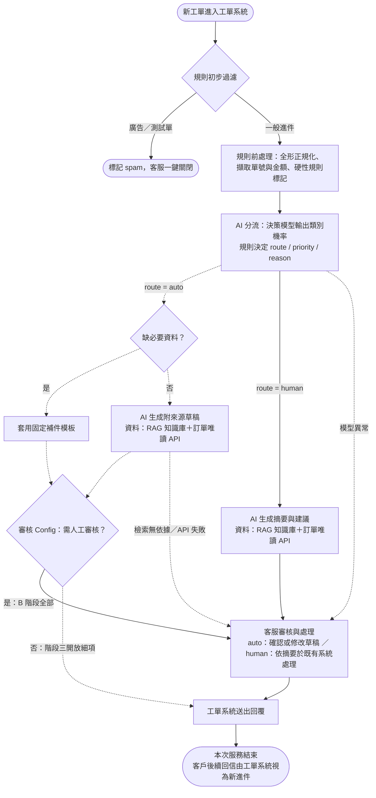

# T 旅遊 AI 客服導入方案

## 情境摘要

- 業務：email 與網站表單的文字客服工單，平日約 350 件／天，旺季約 700 件／天；8 位客服，平均首次回覆 6 小時，旺季超過 24 小時。
- 進件比例（客服主管口述）：訂單約 40%、產品約 30%、退改約 20%，其餘為投訴與雜項。
- 限制條件：
  - 客戶個資不得傳到未經評估與簽約的外部服務；目前沒有簽約的 LLM 供應商。
  - 訂單 API 需申請權限，QPS 很低。
  - 知識文件分散在 Word、Excel 與舊 FAQ，版本混亂。
  - 退款金額超過 30,000 元須主管簽核。

## Q1. 場景判斷

```
Q: 請評估三個構想各自的適用性、風險與前置條件，並明確指出：這個情境裡有哪些子問題其實不該用 AI 解（或不該現在解），你建議的推進順序與理由。
```

### 判斷依據：樣本觀察

48 筆樣本中，除了一般詢問，還有三類進件：
- 非客服雜訊：博弈廣告、B2B 報價、履歷、業配、媒體採訪。
- 高時效急件：明日出發遇颱風、票券未收到、旅途中飯店異常。
- 久候衍生的重複催單與客訴升級。

因此系統的價值不只在生成文字，更在於「分流＋急件置頂＋預先查好資料」。

### 三個構想的評估

| 構想 | 適用性 | 主要風險 | 前置條件 |
| --- | --- | --- | --- |
| A：AI 自動回覆所有工單 | 目前不適合；之後只對少數答案固定的低風險細項開放 | 錯答或不當承諾直接送到客戶手上，無人攔截 | 明確的開放範圍、經驗證的品質數據、一鍵停用機制 |
| B：AI 分流＋草擬，客服確認後送出 | **主要推進方向**；同時解決佇列排序與查找、撰寫工時 | 分流錯誤；客服未細看就送出錯誤草稿 | 類別與分流規則、有效知識源、訂單唯讀 API、審核介面 |
| C：內部知識庫問答工具 | 適合先驗證知識檢索品質；單獨做無法解決分流與急件積壓 | 引用舊版文件、漏掉適用條件 | 確認有效版本、維護負責人 |

**共同的合規前提與 concern**：
- 三者都需要先有法務核准的 LLM 供應商或部署環境，才能接觸真實工單。內部使用或有人工確認，都不構成例外。
- 樣本中有客戶在信件內文自行貼上身分證字號與銀行帳號。即使完成簽約，從資料最小化角度仍建議日後以**獨立的個資遮罩系統**處理。此系統不在本次範圍，B 階段不實作。
- 開工前須請法務確認「簽約後可否不遮罩直接傳輸」。若法務要求遮罩，需另立專案，上線時程會延後。

### 不該用 AI 解（或不該現在解）的子問題

- **交給確定性規則與固定模板**：
  - 垃圾信與測試單過濾。
  - 缺少訂單號等必要資料時，套用固定補件模板。
  - 訂單 API 的排隊與限流。
  - 金額 > 30,000 元的退改或求償，一律轉人工（金額門檻是確定性規則，不讓 AI 判斷）。
- **交給真人與既有流程**：
  - 知識版本衝突的裁決。
  - 退款、改單、通融與賠償決策，包含 > 30,000 元主管簽核，都維持在既有系統處理，不納入本系統。
  - LLM 供應商的資安評估。
- **現在不做**：
  - 全面自動回信，以及 AI 直接寫入訂單或呼叫退款 API。
  - 個資遮罩系統（另立專案，見上方 concern）。
  - 一次清洗所有歷史文件（只先整理高頻問題）。

### 推進順序與理由

**B 是目標方向，C 是 B 的知識檢索元件**：C 以小範圍內部工具先行驗證，不作為獨立產品。Q2 以 B 為對象撰寫。

`準備期 → 階段一：C 驗證檢索 → 階段二：B 上線 → 階段三：限縮開放 A`

1. **準備期**：
   - 資深客服裁決高頻問題的有效知識版本。
   - 向資訊部盤點訂單、會員、發票等系統的 API 範圍與時程。
   - 建立離線評估集。
   - 法務核准前，只用虛構樣本與 mock 開發。
2. **階段一（C）**：給少數客服試用知識問答，答案必須附來源與版本，沒有依據時拒答。檢索品質達標後進入 B。此工具保留下來，供 B 階段真人處理工單時主動查詢。
3. **階段二（B）**：
   - 全部進件先分流，依緊急度與影響度排序。
   - 標準詢問由 AI 草擬回覆；缺資料的工單套用固定補件模板。
   - 高風險或高影響的工單轉人工。
   - 所有對外回覆都經客服確認後送出。
4. **階段三（A）**：B 穩定且證實省時後，先針對固定補件信，以及答案固定、無承諾風險的細項，以小流量開放自動回信。

---

## Q2. 需求收斂

```
Q: 選定你在 Q1 建議優先的方向，寫一份可以拿去跟利害關係人對齊的問題定義書，至少包含：
- 目標與非目標（明確的 out of scope）
- 使用者與使用情境
- 輸入／輸出定義
- 資料與系統的前置條件（哪些事沒到位就不該開工）
- 可量化的驗收標準
- 開工前必問利害關係人的 5 個關鍵問題，每題附上「這題想排除的風險是什麼」
```

> **文件定位**：方案 B（AI 分流＋草擬，客服確認後送出）的開工前對齊草案。

### 1. 目標與非目標

| 項目 | 內容 |
| --- | --- |
| 目標 | 1. **分流與急件置頂**：過濾非客服雜訊，依優先級排序佇列，高風險工單轉人工。<br>2. **縮短處理工時**：標準詢問產出附來源的回覆草稿；轉人工的工單附上摘要與建議處理方式。 |
| 非目標（Out of Scope） | 1. B 階段不自動對客發信，所有回覆都經客服確認。<br>2. 不寫入任何系統：不改單、不呼叫退款 API、不處理簽核；真人沿用既有系統處理。<br>3. 不建置個資遮罩系統（另立專案）。<br>4. 不接管工單系統既有職責：狀態管理、去重、多封信歸戶。<br>5. 不承諾人力減半；不一次清洗所有歷史文件。 |

### 2. 使用者與使用情境

| 使用者 | 情境 | 系統提供 |
| --- | --- | --- |
| 一線客服 | 處理 `route = auto` 工單 | AI 草稿（附引用來源）或固定補件模板。客服確認或修改後送出；草稿不可用時按「棄用」改為人工撰寫 |
| 一線客服 | 處理 `route = human` 工單 | 工單上附 AI 摘要與建議處理方式。客服在既有系統查單、退改、走簽核並撰寫回覆，需要時使用知識庫查詢助手 |
| 資深客服 | 知識維護與品質抽查 | 維護有效知識版本、標註評估集、抽查草稿 |
| 客服主管 | 監控與控管 | 看監控指標，透過審核 Config 開關個別細項的草擬或自動回信 |

### 3. 輸入／輸出定義

- **輸入**：
  - 工單欄位：`ticket_id`, `created_at`, `channel`, `customer_name`, `subject`, `body`。
  - 有效知識庫與模板。
  - 訂單唯讀資料。
- **輸出**：
  - 分流欄位：`category`、`sub_category`、`priority`（P1 低／P2 一般／P3 高／P4 超重要急件）、`route`、`reason`。
  - `route = auto`：系統可產出完整回覆（AI 草稿或固定模板），或直接標記為垃圾信；客服只需確認。
  - `route = human`：系統只提供內部摘要與建議，由真人處理並自行撰寫回覆。
- **分類原則**：
  - 一張工單有多個訴求時，以風險最高的訴求決定 `route` 與 `priority`。
  - `sub_category` 與 `priority` 的初始定義見附件 [taxonomy-and-priority-spec.md](taxonomy-and-priority-spec.md)。

| 主類別 (`category`) | 涵蓋範圍 | 預設 `route` |
| --- | --- | --- |
| `product_inquiry`（售前產品詢問） | 行程內容與費用、票券兌換、護照簽證與天氣出團通則、客製化需求 | `auto`；客製化評估、外部無依據的最新法規轉 `human` |
| `order_info`（訂單與規定查詢） | 客戶提供行程或訂單，詢問訂單狀態、行前通知、點數、取消手續費規定、已辦退款入帳天數、確認信或憑證補發、發票收據、帳號與計價異常 | 狀態與退改規定查詢、標準補發與發票走 `auto`（AI 查知識庫與唯讀 API 草擬）；帳號鎖定、計價異常、72 小時內急用走 `human` |
| `order_change`（訂單修改與加購） | 針對已成立訂單申請改期、換接送飯店、更正護照英文名、團員人數變動、加購嬰兒票或行李 | `human`；AI 產出摘要與相關條文，由真人在既有系統改單與核算差價 |
| `order_refund`（訂單取消與退費） | 針對已成立訂單因傷病、天災或個人因素申請取消與退費，或提供銀行帳戶要求匯入退款 | `human`；AI 產出摘要與退費規定，由真人在既有系統核算與辦理退費 |
| `complaint`（客訴） | 純抱怨（如電話打不通）、服務瑕疵、帳務爭議、求償、揚言申訴 | 純抱怨且未提出具體要求走 `auto`（致歉草稿）；要求補償、退款或具體處理走 `human` |
| `other_non_cs`（非客服） | 企業包團、供應商報價、媒體、業配、履歷、廣告、測試單 | 廣告與測試單由規則標記 `auto`（不生成回覆）；其餘 `human` 轉交對應部門 |
| `unknown`（待釐清） | 內文過短、缺訂單號或行程等必要資料 | `auto`；套用固定補件模板，不呼叫 AI 生成 |

### 4. 資料與系統的前置條件（未到位則停在離線 PoC，不接正式工單）

- **知識與業務**：完成試點範圍的有效知識版本裁決；標註 50–100 筆歷史工單作為評估集；安排試營運審核人力。
- **系統**：工單系統 API 測試權限（讀取工單、寫入標籤與草稿）；訂單／會員唯讀 API 的範圍、查詢鍵值與 QPS 配額。
- **合規**：法務核准 LLM 供應商或部署環境，Embedding 與評估工具一併納入審核；確認可傳給模型的欄位範圍。

### 5. 可量化的驗收標準（初始值，開工前與客服主管確認；推導與公式見 Q4）

- 先抽樣量測現有單筆處理工時（AHT）作為基準。首次回覆 6 小時是等待時間，不能直接當成處理工時。
- **離線 PoC**：
  - 分流錯誤率 ≤ 10%。
  - 高風險誤放行（False Auto）= 0 件。
  - 草稿錯誤率 ≤ 5%。
- **試營運**（至少 2 週，累積至少 100 筆適用工單）：
  - 任務成功率 ≥ 80%、草稿錯誤率 ≤ 5%、技術錯誤率 ≤ 1%。
  - AHT 較同類人工基準下降 ≥ 15%；草稿棄用率 ≤ 20%。
  - 錯誤草稿流出 = 0 件。

### 6. 開工前必問利害關係人的 5 個關鍵問題

| 問題（對象） | 想排除的風險 |
| --- | --- |
| 1. （管理層／客服主管）B 階段的成功標準是縮短等待與處理工時，還是硬性要求人力減半？由誰驗收？ | 期望落差：主管期待全自動與立即減人，專案即使有成效仍被判失敗 |
| 2. （資訊部）「跨兩三個系統查」具體是哪些系統？各自能否開唯讀 API、用什麼鍵值查詢、QPS 上限與審核時程？ | 範圍誤判：設計依賴拿不到的資料，草擬只能停在半成品 |
| 3. （客服主管）現在有沒有單筆處理工時與首次回覆時間的基準數據、歷史工單分類紀錄？ | 無法驗收：沒有基準，「工時下降 15%」無從比較 |
| 4. （資深客服）Word、Excel 與舊 FAQ 衝突時由誰裁決？能否先鎖定高頻問題，並約定改版時的更新流程？ | 引用過期規定導致錯答；或為了清洗全部文件而無限延宕 |
| 5. （法務／資安）最快的合規路徑是什麼（企業零留存合約或地端模型）？需時多久？簽約後是否仍要求先遮罩個資？ | 合規卡關：PoC 做完才發現無法接真實工單；若要求遮罩，需另立專案，時程延後 |

---

## Q3. 端到端 Workflow 設計

```
Q: 針對你選定的方向，交付一張設計圖＋必要的文字說明，需涵蓋：
- 任務流與資料流（從工單進來到結案）
- AI、規則、RAG／知識庫、人工四者的分工邊界
- 人工接手的觸發條件（請列出具體規則，不要只寫「低信心時轉人工」）
- 錯誤處理與降級策略（LLM 服務掛掉／回答品質異常時系統怎麼辦）
- 個資與權限邊界（呼應法務的限制條件）
- Log 與追蹤點（為了之後能監控與除錯，你會在哪些位置記什麼）
```

### 1. 設計原則

- **規則管硬性邊界**：垃圾信過濾、補件模板、金額門檻與升級字眼由規則判定。規則判定轉人工時，AI 不得覆蓋。
- **AI 只讀不寫**：AI 只做分流、草稿與摘要，沒有寄信、改單或退款權限。真人沿用既有系統處理。
- **分流與生成用不同模型**：分流是有限選項的選擇題，用決策模型（如 Jev／Clef／Kev），直接輸出各類別的機率，用門檻判斷，不需解析生成文字；草稿與摘要才用生成式 LLM。Clef（GGUF 透過 `llama.cpp` 部署）與 Kev 可於內網自架，也是 Q2 第 5 題「地端模型」路徑的候選。
- **失敗時回人工**：LLM 異常、檢索無依據或 API 失敗時，一律跳過生成，轉給真人處理；不阻塞收件，也不編造答案。

### 2. 任務流與資料流



- **auto 路徑（虛線）**：
  - 缺資料時套用補件模板。
  - 其餘由 AI 依知識庫與訂單資料生成附來源的草稿。
  - 兩者都經客服確認後送出。
- **human 路徑（實線，例：18.6 萬骨折退費）**：
  - 規則依金額門檻轉人工並置頂。
  - AI 只產出內部摘要與相關條文。
  - 客服在既有系統完成退費審核與簽核，再回覆客戶。
- **服務範圍**：以「單次服務」為單位，從進件到送出一次回覆。工單狀態、多封信歸戶與結案都由工單系統管理，不在本系統範圍。

### 3. 四者分工邊界

| 角色 | 負責 | 不負責 |
| --- | --- | --- |
| 規則 | 垃圾信與測試單過濾、缺資料判定與補件模板、全形英數正規化與單號／金額擷取、硬性轉人工條件（見 §4）、API 限流、審核 Config | 語意理解；工單狀態與去重 |
| RAG／知識庫 | 提供已簽核的有效知識片段與版本號；透過唯讀 API 查訂單與會員狀態；作為客服的查詢工具 | 收錄未審核的舊文件；任何寫入操作 |
| AI | 決策模型：分 3 次 Choice 選擇題分別輸出 `category/sub_category`、`urgent_level` 與 `impact_level` 的各選項機率與信心值；生成式 LLM：auto 工單生成草稿、human 工單生成摘要與建議 | 決定 `route` 與 `priority`（由規則依類別、程度與信心值決定）；決定退款金額、承諾賠償、寄信或改單；資料不足時猜測答案 |
| 人工 | 確認或棄用草稿；在既有系統處理 human 工單（含退改與簽核）；維護知識；調整審核 Config | 手動過濾垃圾信、重打補件信、從零翻找文件 |

### 4. 人工接手的觸發條件（v1，上線前依評估結果調整）

| 類型 | 條件 | 樣本範例 |
| --- | --- | --- |
| 確定性規則（不經 AI） | 1. 退改、退款或求償金額 > 30,000 元<br>2. 投訴或爭議語境中出現升級字眼：消保官、媒體、記者、律師、爆料、止付<br>3. 72 小時內出發或使用的異常：天災、憑證未收到<br>4. 重複催單：同一客戶對未結案件再次來信 | 18.6 萬退費、求償 4.5 萬、揚言找消保官、明日澎湖颱風、二次催問重複扣款 |
| AI 與檢索訊號 | 5. 分類落在 Q2 類別表預設為 `human` 的範圍<br>6. 複合意圖中含 `human` 範圍的訴求<br>7. 決策模型的最高類別機率低於門檻（初始 0.7，依評估集調整）、知識庫無命中或版本衝突、外部法規無明確依據<br>8. 訂單 API 查無資料、寄件人與訂單不符，或 API 逾時 | 申請改期或改名、曼谷飯店蟑螂、泰國新簽證規定、12 人團退 2 人 |

**處置方式**：
- 設為 `route = human`；符合 1–4 者調升為 P4（超重要急件）或 P3（高影響）並置頂。
- LLM 可用時附上 AI 摘要，再排入真人佇列。

### 5. 錯誤處理與降級策略

| 異常 | 偵測 | 降級行為 |
| --- | --- | --- |
| 模型逾時或服務中斷（決策模型或 LLM） | 逾時、HTTP 5xx、輸出格式錯誤（重試 1 次仍失敗） | 工單只帶規則標籤進入人工佇列，客服依原流程處理 |
| 知識庫無結果或衝突 | 無命中、分數過低、命中多個衝突版本 | 改為 `human`，`reason` 註明「查無唯一有效依據」 |
| 訂單 API 限流或失敗 | HTTP 429、逾時、連線失敗 | 排隊等待；逾時則改為 `human`，不產出缺資料的草稿 |
| 特定細項品質異常 | 監控發現該細項錯誤率或棄用率超標，或規則臨時改版 | 透過審核 Config 將該細項改為 `human`，其他細項不受影響 |
| 重大事故 | 個資外洩疑慮、大面積錯答、知識庫被污染 | Kill switch：停用所有 AI 生成，全部工單回到人工佇列 |

### 6. 個資與權限邊界

- **核准前不碰真實資料**：法務核准 LLM 供應商或部署環境前（含 Embedding 與評估工具），只用虛構資料開發。
- **最小傳輸**：只把法務核准範圍內的必要欄位（主旨、內文、必要的訂單狀態）傳給核准的模型。
- **個資遮罩列為獨立系統**：B 階段不實作。若法務要求簽約後仍須遮罩，需另立專案，並作為上線前置條件（見 Q1 concern、Q2 第 5 題）。
- **最小權限**：
  - 系統只持有訂單與會員 API 的唯讀權限，並在程式中檢查寄件人與訂單相符才能讀取。
  - AI 模組沒有寄信、改單或退款 API 的權限。
- **Log 不存信件全文**：原文與草稿保留在有權限控管的工單系統內，應用 log 只記 ID 與結構化欄位。

### 7. Log 與追蹤點（以 `ticket_id` 串聯）

| 追蹤點 | 記錄內容 | 用途 |
| --- | --- | --- |
| 1. 規則過濾與前處理 | `ticket_id`、`received_at`、`channel`、命中的規則（spam／缺資料／金額門檻／急件／催單） | 統計過濾與補件比例；檢查規則誤判 |
| 2. AI 分流與生成 | 模型與 Prompt 版本、`category / priority / route / reason`、信心分數、知識庫命中文件 ID 與版本、API 狀態碼與耗時 | 分流錯誤率；判斷錯誤來自舊文件、無依據生成，還是 API 失敗 |
| 3. 客服處置 | 審核 Config 版本、對草稿的處置（直接採用／小幅修改／棄用／標記錯誤）、審核停留時間、human 工單是否使用查詢助手 | 任務成功率、人工接手率、草稿錯誤率、盲送率 |
| 4. 送出 | 送出時間、送出內容是否為 AI 草稿（原樣／修改後）、客服從開啟到送出的耗時 | AHT；事後抽查流出錯誤時的追溯依據 |

---

## Q4. 指標與上線 Gate

```
Q:
- 定義試營運期間的監控指標，至少含任務成功率、人工接手率、錯誤率、處理時間；指標請寫清楚分子／分母怎麼算、資料從哪裡來。
- 至少一個防護型指標（例如客訴率），說明它防的是什麼。
- 定義 PoC → 試營運 → 正式上線的晉級條件與退場條件（什麼數字達標才往前走、什麼狀況要喊停）。
```

本節的 Gate 都針對方案 B；Q1 的階段一（C）併入離線 PoC 一起驗證。

**衡量範圍**：
- 以「單次服務」為單位：一張工單從進件，到本系統完成分流並送出一次回覆。
- 只衡量 AI 客服系統本身的表現，不納入重開率、結案率、客訴率這類受工單系統或後續處理影響的指標。
- 資料都來自本系統的 log 與審核介面紀錄（Q3 §7），加上人工抽查標註。

### 1. 試營運監控指標

| 指標 | 分子／分母 | 資料來源 |
| --- | --- | --- |
| 任務成功率 | 分子：分流正確，且輸出可用的工單數。「輸出可用」指：`auto` 工單的草稿或模板被客服直接採用或小幅修改後送出；`human` 工單正確轉人工<br>分母：進入本系統的試點工單總數 | 分流 log、客服處置紀錄、抽查標註 |
| 人工接手率（依類別分開看） | 分子：分流為 `human` 的工單數 ＋ 原為 `auto` 但客服棄用草稿或標記錯誤的工單數<br>分母：試點工單總數（每單只計一次） | 分流 log、客服處置紀錄 |
| 錯誤率 1：分流錯誤率 | 分子：`category` 或 `route` 與人工標註不一致的工單數；另外單獨計算高風險誤放行（False Auto：應為 `human` 卻判為 `auto`）的件數<br>分母：受評工單總數 | 評估集、線上抽查標註 |
| 錯誤率 2：草稿錯誤率 | 分子：含事實錯誤、引用過期規定、漏答核心問題或無依據承諾的草稿數<br>分母：受評草稿總數 | 原始草稿、引用來源、客服標記與抽查 |
| 錯誤率 3：技術錯誤率 | 分子：因模型逾時、輸出格式錯誤或檢索失敗而觸發降級的工單數<br>分母：試點工單總數 | 分流與生成 log |
| 處理時間 | 系統處理時間：進件到分流與草稿（或摘要）就緒的秒數，看 P50 與 P90<br>AHT：客服從開啟工單到送出的作業分鐘數總和 ÷ 已送出工單數；與同類純人工工單的抽樣基準比較 | 系統 log、審核介面時間戳 |
| 防護 1：錯誤草稿流出數 | 抽查已送出的 AI 草稿，含實質錯誤且未被客服攔截的**件數**（不取比例） | 已送出草稿的每週抽查、送出 log |
| 防護 2：盲送率 | 分子：審核停留 < 10 秒，且原樣送出的 AI 草稿數<br>分母：送出的 AI 草稿總數 | 審核介面時間戳與處置紀錄 |

**防護型指標防什麼**：
- **錯誤草稿流出數**：防止錯誤內容送到客戶手上。量大時，少數嚴重錯答會被百分比稀釋，所以用絕對件數設紅線。
- **盲送率**：防止客服過度依賴 AI（橡皮圖章效應）。這是流出事故的前兆指標；若盲送率上升，就算錯誤率很低也要介入。
- 首次回覆時間（FRT）屬業務成效，由工單系統報表觀察，不列為本系統的 Gate。

### 2. 門檻初始值的粗估

工單量以平日 350 件／天計，約每週 2,450 件；旺季加倍。以下為粗估，用來決定初始值，上線前依實測基準調整：

| 指標 | 初始值 | 粗估依據 |
| --- | --- | --- |
| 高風險誤放行 | 0 件 | 錯放行會產生對客的錯誤承諾或金額錯誤，代價無法用效率抵銷；看不懂就保守轉 `human` |
| 一般分流錯誤率 | ≤ 10% | 10% 約為 35 件／天分錯。每件多花約 3 分鐘改分類，合計約 1.75 人時／天，約占 8 人產能（64 人時）的 3%，低於草擬預期省下的工時（AHT 降 15% 約為 9 人時） |
| 草稿錯誤率 | ≤ 5% | auto 草稿估計約占一半（約 175 件／天），5% 約為 9 件／天，由客服審核攔截，攔截成本可接受；未攔截流出另以紅線控管 |
| 任務成功率 | ≥ 80% | 分流正確率 90%；在分流正確的工單中，`auto` 約占一半、可用率 80%，`human` 約占一半、視為成功。0.9 ×（0.5 × 0.8 ＋ 0.5 × 1）≈ 81% |
| 盲送率 | ≤ 10% | 標準短信件確實可能快速確認，先抓 10% 作為觀察線，依試營運實際分佈調整 |
| 試營運樣本 | 至少 2 週、100 筆 | 1–2 位客服每人約處理 40 件／天，2 週內可累積足量適用工單；低流量細項則延長觀察 |

### 3. 晉級與退場條件

| 階段 | 晉級條件 | 退場或降級條件 |
| --- | --- | --- |
| 離線 PoC → 試營運 | 1. 完成 48 筆樣本分流輸出；建立 50–100 筆評估集，包含必須攔截的高風險題與缺資料題<br>2. 分流錯誤率 ≤ 10%、False Auto = 0、草稿錯誤率 ≤ 5%<br>3. 合規核准、首批知識版本簽核、工單 API 測試通過 | 任一高風險題被判為 `auto`，或合規、知識版本未到位：留在離線調整 |
| 試營運 → 正式上線（全團隊，仍需客服確認） | 1. 1–2 位客服試用至少 2 週、至少 100 筆工單<br>2. 任務成功率 ≥ 80%、草稿錯誤率 ≤ 5%、技術錯誤率 ≤ 1%、AHT 下降 ≥ 15%、棄用率 ≤ 20%<br>3. 錯誤草稿流出 = 0 件；盲送率 ≤ 10% | **局部降級**：單一細項每 50 筆抽查中草稿錯誤率 > 5%、棄用率 > 30%，或發生 1 件錯誤草稿流出，就關閉該細項草擬<br>**全面暫停**：錯誤草稿流出累計 ≥ 2 件或範圍不明、任何個資外洩、單日技術錯誤率 > 5%，則暫停所有 AI 草擬；保留分流、置頂、固定模板與查詢助手 |
| 正式上線 → 開放自動回信（階段三） | 先開放固定補件信；其他細項須累積 ≥ 200 筆審核紀錄、直接採用率 ≥ 98%、事實錯誤 0 件，經主管核准後先開 10% 流量並每日全查 | 自動回信細項發生 1 件錯答流出，就立即退回客服確認模式 |

---

## Q5. 情境追問

```
Q: 假設方案上線試營運四週後，數據如下：
- 自動處理率 45%，平均首次回覆時間從 6 小時降到 1.5 小時
- 但發生 3 起 AI 草擬內容錯誤、客服未攔截就送出，造成客訴
- 客服團隊開始不信任系統，幾乎全面改走人工，接手率明顯回升
請寫一份給決策者的半頁建議：續行、調整、還是暫停？以及你會立刻執行的前三個具體行動。
```

### 建議：調整（暫停 AI 草擬，保留分流與固定模板，不終止專案）

- **為何不終止**：FRT 從 6 小時降到 1.5 小時，主要來自分流、急件置頂與固定模板，這部分已證明有價值，且沒有錯答風險。
- **為何不續行**：3 起錯誤草稿流出已超過 Q4 的全面暫停紅線（≥ 2 件）。「45% 自動處理率」只代表產出草稿的比例，不代表任務成功率。
- **信任問題**：客服全面改走人工，推測是擔心背責任，以及檢查草稿比自己寫更累。需訪談確認。

### 立刻執行的三個行動

1. **止損**：
   - 依 Q4 全面暫停 AI 草擬，保留分流、置頂、固定模板與查詢助手。
   - 資深客服聯繫 3 位客戶更正並致歉；從 log 撈出同類別、引用相同知識版本的已寄出工單回溯檢查。
2. **找根因並改審核介面**：
   - 追查 3 起事故的 trace，區分是引用舊文件、無依據生成，還是分流誤判；修正後把這 3 題納入評估集做回歸測試。
   - 審核畫面並列顯示引用原文與版本；草稿涉及日期、金額時，須逐項勾選確認才能送出。
3. **重建信任後再逐類重啟**：
   - 與客服主管宣布，試營運期間退回或標記錯誤草稿不算個人疏失；提供一鍵棄用按鈕。
   - 修正後的類別先跑 shadow mode（草稿只給資深客服離線抽查），通過 Q4 門檻後，從客服最想要的 2–3 個標準類別重新開放。

---

## AI 使用說明

使用 AI 協助整理題目、調整回答用語、比較方案，並草擬流程、指標與 rollback 條件。文中數字為待驗證的初始設定，不是實測結果。
