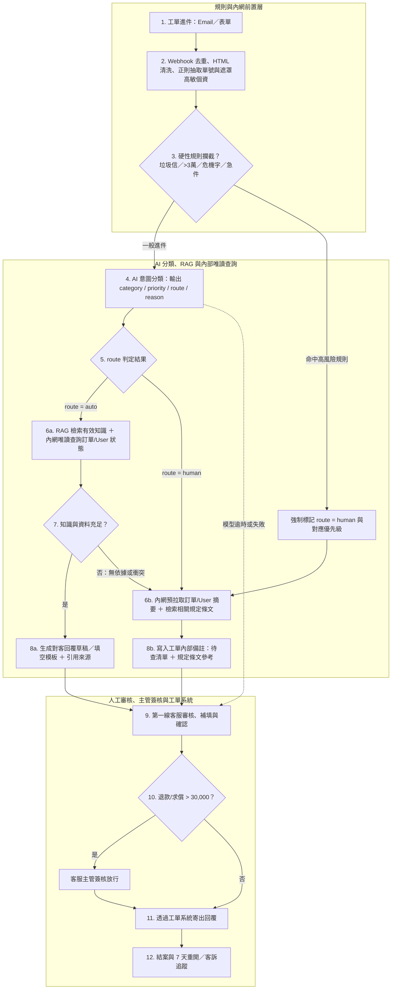

# answer

## overview

- 業務：email 與網站表單的客服工單處理。
- 工單欄位：ticket_id, created_at, channel, customer_name, subject, body。
- 業務分類：
  - 訂單查詢：約 40%。
  - 產品詢問：約 30%。
  - 退改需求（含取消與退款）：約 20%。
  - 投訴：暫估 5%。
  - 其他／待釐清（unknown）：暫估 5%。
- context:
  - 每天平均約 350 件工單，旺季會翻倍；目前由 8 位客服處理，平均首次回覆時間為 6 小時，旺季可能超過 24 小時。
  退款金額超過 30,000 元一定要主管簽核
  - 戶個資不得傳輸到未經評估與簽約的外部服務
  - 尚無經評估與簽約的 LLM 供應商
  - 內部文件分散，版本尚未釐清。

## Q1. 場景判斷

```
Q: 請評估三個構想各自的適用性、風險與前置條件，並明確指出：這個情境裡有哪些子問題其實不該用 AI 解（或不該現在解），你建議的推進順序與理由。
```

### 三個做法的評估

| 做法 | 適用性 | 主要風險 | 前置條件 |
| --- | --- | --- | --- |
| A：全部自動回覆 | 目前不適合；後續僅針對極少數有固定依據的低風險問題開放 | 錯答、不當交易承諾或個資外洩直接影響客戶 | 明確的允許範圍、嚴格品質驗證、轉人工與一鍵停用機制 |
| B：AI 分流＋草擬，人工確認 | **作為主要推進方向**；同步解決佇列優先級混亂，並透過預拉取資料與草擬大幅減少客服查找與寫信時間 | 分類錯誤、客服未攔截錯誤草稿，或內部系統未串接前需人工補填欄位 | 分類與分流規則、可靠知識源、內部系統唯讀權限與審核介面 |
| C：內部知識庫問答 | 適合先驗證知識檢索品質，但無法解決工單分流與跨系統查詢痛點 | 引用舊版文件、漏掉適用條件 | 確認唯一有效版本、維護負責人與存取權限 |

* **合規共同前提**：三者皆受相同的資安與個資限制；內部使用或有人工確認，不代表可將客戶個資（特別是信件內文的身分證、電話、銀行帳號）傳送至未經評估與簽約的外部 LLM 服務。
* **樣本反映的真實痛點**：檢視 48 筆工單樣本，進件除一般詢問外，還混雜了**非客服雜訊**（博弈廣告、B2B 報價、履歷、業配、媒體採訪）、**高時效急件**（明日出發遇颱風、票券未收到、旅途中飯店異常），以及**因久候衍生的重複催單與客訴升級**。因此系統必須結合「急件置頂」與「跨系統資料預拉取」，不能只做文字生成。

### 現階段不該用 AI 解（或不該現在解）的子問題

* **交給確定性規則（Deterministic Rules）與表單防呆**：
  * **垃圾信過濾與必填檢查**：外部廣告與測試單直接由規則攔截；針對內文過短且無訂單號的進件（如僅寫「可以退嗎」），應於網站表單改為必填欄位或觸發制式補件詢問，而非讓 AI 猜測。
  * **內文個資遮罩（PII Masking）、API 限流與權限控管**：身分證、電話、銀行帳號的正則遮罩，以及低 QPS 內部 API 的排隊限流。
  * **高額退款簽核流**：超過 30,000 元退款強制轉呈主管簽核，屬確定性商業規則，不由 AI 判斷。
* **交給真人權責負責人（Process & Governance）**：
  * **知識版本裁決**：散落的 Word、Excel 與舊版 FAQ 衝突時，由資深客服與業務單位拍板唯一有效版本。
  * **外部供應商資安審核、特殊退改通融與客訴賠償決策**。
* **現階段暫緩（Wait for Readiness）**：
  * **全面自動回信、自動執行訂單異動或直接呼叫退款 API**：在合規環境、API 配額與準確率穩定前，不開放 AI 直接修改資料庫或匯款。
  * **一次清洗所有歷史文件**：不先建置龐大的知識管理平台，僅先整理高頻問題即可啟動。

### 推進順序與理由

建議推進順序為：**`知識整理與離線 Eval → C（驗證知識檢索） → B（全工單分流＋草擬與內部資料輔助，人工確認） → A（限縮低風險自動回覆）`**。

1. **準備期 — 整理高頻知識、盤點跨系統 API 與建立 Eval**：先由資深客服裁決高頻問題的唯一有效版本；同步向資訊部盤點工單、訂單、會員（User）、發票等內部系統 API 的開放程度與時程。未獲法務核准前，以虛構樣本與 Mock 驗證。
2. **階段一 — 小範圍試用 C（驗證檢索品質）**：答案須附來源段落與版本，無依據時強制拒答。確認檢索正確且能縮短查找時間後，再進入 B。
3. **階段二 — 導入 B（主力方向：全工單分流＋協助草擬＋人工確認）**：
   * 所有進件先依「緊急度 × 影響度」排序佇列並過濾雜訊，解決急件積壓。
   * 針對標準產品、規則通則、資料補發與管道抱怨，直接產出回覆草稿或填空模板（`route = auto`）；針對訂單退改核算與重大客訴求償，則強制轉人工（`route = human`），但自動預拉取已開放之訂單／User 摘要與相關條文寫入內部備註，省去客服跨系統翻找時間。所有對外回信均經客服確認後送出。
4. **階段三 — 限縮開放 A（極少數低風險自動回覆）**：待 B 穩定且證實省時後，僅挑選答案固定、無個資與承諾風險之問題，小流量開放自動回覆。

---

## Q2. 需求收斂

```
Q: 選定你在 Q1 建議優先的方向，寫一份可以拿去跟利害關係人對齊的問題定義書，至少包含：

- 目標與非目標（明確的 out of scope）
- 使用者與使用情境
- 輸入／輸出定義
- 資料與系統的前置條件（哪些事沒到位就不該開工）
- 可量化的驗收標準
- 開工前必問利害關係人的 5 個關鍵問題，每題附上「這題想排除的風險是什麼」
```

> **文件定位**：本文件為針對 **方案 B（AI 全工單分流＋整合知識與內部唯讀資料協助草擬＋客服確認後送出）** 之開工前對齊草案。

### 1. 目標與非目標（Out of Scope）

| 項目 | 定義 |
| --- | --- |
| **目標（Goals）** | 1. **精準分流與急件置頂**：自動過濾非客服雜訊，依「緊急度 × 影響度」排序佇列，消除高風險急件積壓。<br>2. **輔助草擬與跨系統資料預拉取**：為可標準化之詢問生成附來源之回覆草稿；為需人工查證之案件預先拉取內部系統（訂單／會員 User）摘要與規定條文，降低客服切換系統與撰寫工時。 |
| **非目標（Out of Scope）** | 1. **不直接自動對客發信**（所有回覆皆須經客服確認，自動寄信留待後續階段）。<br>2. **不執行系統寫入操作**（不自動改單、取消或呼叫退款申請 API）。<br>3. **不承諾縮減 50% 客服人力**，亦不一次清洗所有歷史舊文件。 |

### 2. 開工前必問利害關係人的 5 個關鍵問題

| 關鍵問題（與詢問對象） | 這題想排除的風險是什麼 |
| --- | --- |
| **1. 問管理層／客服主管**：第一階段是以「消除旺季積壓、縮短急件等待與單筆處理工時」為驗收標準，還是硬性要求「人力減半」？最終由誰拍板驗收？ | 排除主管期待立刻砍人與全自動回信，因期望落差導致專案被判失敗。 |
| **2. 問資訊部**：「跨兩三個系統查」具體包含哪些內部系統（訂單、會員 User、發票等）？各系統能否開放唯讀 API、支援哪些反查鍵值（如 Email／手機）、QPS 上限與審核時程為何？ | 必須先確認哪些系統能串、何時開放，才能界定哪些資料能由 AI 自動查好帶入，哪些需先留填空欄位給客服查。 |
| **3. 問客服主管／資深客服**：對於需人工把關的訂單修改與退費工單，團隊希望 AI 產出「帶 `[待確認]` 欄位的回覆草稿框架」，還是僅在內部備註提供「待查摘要＋法規條文」？ | 排除尺度不當風險：給太少沒省到工時，給太完整的退費草稿又容易讓客服未查證就當成橡皮圖章誤按送出。 |
| **4. 問資深客服**：Word、Excel 與舊 FAQ 衝突時誰裁決唯一有效版本？能否在開工前先鎖定高頻問題完成簽核，並約定後續規則改版時的更新流程？ | 排除一次清洗所有歷史文件導致開工無限期延宕，或引用過期規定引發客訴賠償。 |
| **5. 問法務／資安**：目前無簽約 LLM 供應商下，最快可行的合規路徑為何（簽署企業零留存合約、內網遮罩個資後傳輸、或地端模型）？審核需時多久？ | 排除用外部 API 做完 PoC 後，才因法務資安卡關而無法接觸真實工單。 |

### 3. 使用者與使用情境

| 使用者角色 | 作業情境 | 系統處理方式 |
| --- | --- | --- |
| **第一線客服** | 處理標準產品、規則通則、資料補發、管道抱怨與補件詢問（`route = auto`） | 系統檢索核准知識庫並預拉取必要訂單資料，於回覆區提供對客草稿（或帶 `[待查填]` 之補發／補件模板）與引用來源，客服核對後送出。 |
| **第一線客服** | 處理需跨系統核算之訂單修改、取消退費與客製需求（`route = human`） | 系統不生成對客承諾草稿，改於工單「內部備註」提供結構化待查清單（抽取單號、出發日、訴求）、已串接之訂單／User 狀態與退改條文，輔助客服查證。 |
| **第一線客服** | 處理旅途中異常、近期出發急件、高額退費（> 30,000 元）或重大客訴（`route = human`） | 系統依高優先級置頂警示、自動關聯同客戶重複催單，並對 > 30,000 元案件強制標記「須轉呈主管簽核」。 |
| **第一線客服／他部門** | 面對外部商務、公關、人資信件或垃圾廣告 | 廣告與測試單自動標記歸檔（`route = auto`）；企業包團、廠商報價、媒體與履歷標記轉交對應部門（`route = human`）。 |
| **資深客服／主管** | 知識版本維護、高額簽核與品質抽查 | 資深客服維護有效知識並抽樣標註錯誤草稿；主管簽核 > 30,000 元案件，並依指標決定是否開關特定類別之草擬功能。 |

### 4. 輸入／輸出定義 與 主類別分流表

* **輸入（Input）**：工單欄位（`ticket_id`, `created_at`, `channel`, `customer_name`, `subject`, `body`，經內網遮罩高敏個資）、有效知識庫與模板、已授權之內部系統唯讀資料（訂單／User 狀態）。
* **輸出（Output）**：
  * 分流欄位：`category`（主類別）、`priority`（依「緊急度 × 影響度」判定之優先級 P1–P4）、`route`（`auto` 可自動草擬或歸檔 ／ `human` 需真人查證決策）、`reason`（分類與分流判斷依據，特別用於解釋複合意圖或邊界案例）。
  * 輔助內容：`route = auto` 輸出對客回覆草稿與引用來源；`route = human` 輸出內部待查摘要、預拉取之訂單／User 資料與相關條文。
* **主類別定義與預設分流**（複合意圖保留子標籤，並以風險最高之訴求決定 `route` 與 `priority`；更細部之子分類規則於 PoC `README.md` 實作說明）：

| 主類別 (`category`) | 涵蓋範圍說明 | 預設分流與 AI 輔助行為 (`route`) |
| --- | --- | --- |
| `product_inquiry`<br>（產品詢問） | 行程規格與費用包含項目、票券兌換、護照簽證與旅遊通則、特殊客製化需求 | **`auto`**（生成完整解答草稿＋引用來源；若屬無障礙／客製化評估或外部最新變動法規則轉 **`human`**） |
| `order_service`<br>（訂單服務） | 訂單狀態查詢、行前通知時程、點數折抵規則、確認信／票券補發、發票統編與收據修改、帳號與計價異常 | **`auto` / `human`**（常規時程、點數規則與標準補發／發票模板走 **`auto`** 草擬；明日使用急件、帳號鎖定與計價異常走 **`human`**） |
| `refund_change`<br>（退改取消） | 退改手續費級距與入帳天數通則詢問、實際申請改期／改名／加購、取消行程與退費核算 | **`auto` / `human`**（純詢問退改通則與入帳天數走 **`auto`** 草擬；實際申請改期、取消退費核算及 > 30,000 元簽核強制走 **`human`** 並預拉取訂單與條文） |
| `complaint`<br>（客訴爭議） | 客服管道久候抱怨、旅途中食宿異常、領隊失職求償、疑似重複扣款、客服報錯價爭議、揚言申訴媒體或消保官 | **`auto` / `human`**（純抱怨電話打不通＋常規詢問走 **`auto`** 草擬致歉與解答；涉及服務瑕疵、帳務爭議與求償強制走 **`human`** 置頂並關聯催單） |
| `other_non_cs`<br>（其他非客服） | 企業包團、供應商報價、媒體採訪、KOL 業配、職缺應徵、博弈推銷廣告、系統測試單 | **`auto` / `human`**（廣告與測試單標為 **`auto`** 自動歸檔；商務、公關、人資信件標為 **`human`** 轉交專責部門） |
| `unknown`<br>（待釐清） | 內文過短（如僅寫「可以退嗎」）、缺乏訂單編號與具體訴求，無法辨識意圖 | **`auto`**（生成請求補充訂單編號與具體訴求之標準補件詢問草稿供客服確認送出） |

### 5. 資料與系統的前置條件（沒到位則停留在離線 PoC，不接正式工單）

* **知識與業務端（資深客服／主管）**：完成試點範圍之唯一有效知識版本裁決（消除 Word/Excel/舊 FAQ 衝突）；抽樣標註 50–100 筆歷史工單作為測試基準（Golden Set）；指派試營運審核人力。
* **系統與資訊端（資訊部 IT）**：開通工單系統 API / Webhook 測試權限（含事件去重、寫入標籤、草稿與內部備註）；確認訂單與會員 User 等內部系統可開放唯讀 API 之範圍、查詢鍵值與 QPS 配額。
* **合規與資安端（法務／資安）**：完成外部 LLM 供應商評估與簽約（或核准合規部署環境）；核准內網個資遮罩（PII Masking）規則與可傳輸欄位白名單。

### 6. 可量化的驗收標準（初始設定，開工前與客服主管確認）

需先抽樣建立現有「單筆實際處理工時（AHT）」基準（不直接拿首次回覆等待 6 小時當成處理工時），並分階段驗證以下指標（詳細分子／分母公式與退場門檻見 Q4）：

* **離線 PoC 准入門檻**：主類別與 `route` 判定正確率 **≥ 90%**；高風險案例（實質退改核算、求償客訴、> 30,000 元、無依據問題）**誤放行率（False Auto）= 0%**；標準問題草稿正確率 **≥ 95%**。
* **試營運（方案 B）驗收門檻**：
  * **品質與成功率**：任務成功率（送出後 7 天內未因同問題重開）**≥ 95%**；草稿內容錯誤率 **≤ 5%**；系統技術錯誤率 **≤ 1%**。
  * **效率與採用率**：試點類別平均單筆處理工時（AHT）較同類人工基準下降 **≥ 15–20%**；高優先級急件首次回覆時間（FRT）顯著縮短；草稿被客服棄用重寫率 **≤ 20%**。
  * **安全防護紅線**：個資外洩與越權承諾為 **0 件**；錯誤草稿未攔截流出致客訴為 **0 件**；整體客訴率不高於同期同類人工基準。

---

## Q3. 端到端 Workflow 設計

```
Q: 針對你選定的方向，交付一張設計圖＋必要的文字說明，需涵蓋：
- 任務流與資料流（從工單進來到結案）
- AI、規則、RAG／知識庫、人工四者的分工邊界
- 人工接手的觸發條件（請列出具體規則，不要只寫「低信心時轉人工」）
- 錯誤處理與降級策略（LLM 服務掛掉／回答品質異常時系統怎麼辦）
- 個資與權限邊界（呼應法務的限制條件）
- Log 與追蹤點（為了之後能監控與除錯，你會在哪些位置記什麼）
```

### 1. 設計原則與範圍

* **規則管硬性邊界，AI 只做分類與草擬**：涉及金額門檻（> 30,000 元）、高敏個資遮罩、垃圾信過濾與權限檢查一律由確定性規則控制；AI 不具備直接改單、退費或對外發信之權限。
* **內網查詢與最小揭露**：內部 API（訂單／會員 User）查詢與身分核對皆於公司內網完成，僅將去識別化文字與必要非敏感狀態傳予經核准之模型生成草稿。
* **失敗安全（Fail-closed 回人工）**：任何檢索無依據、API 查詢失敗或模型異常，一律退回人工佇列或改為提供「待查填」框架，絕不阻塞工單收件或編造答案。

### 2. 架構圖（任務流與資料流）與四者分工邊界

#### (1) 端到端任務流與資料流（依分工職責劃分泳道）



* **兩條典型執行路徑範例**：
  * **`route = auto` 路徑（如：詢問東京團費用內含項目、或查詢常規訂單狀態）**：進件去重與清洗 → AI 分類為 `product_inquiry`（或 `order_service`）→ 檢索核准知識庫（並由內網查出訂單狀態）→ 生成附引用來源之對客草稿 → 客服核對無誤後送出結案。
  * **`route = human` 路徑（如：18.6 萬骨折取消退費申請）**：進件抽取金額 `186,000 > 30,000` → 硬性規則強制標記 `route = human`、高優先級並附註須主管簽核 → 內網預拉取該訂單明細與傷病退費規定條文寫入「內部備註」（不產出承諾草稿）→ 客服核算後轉主管簽核 → 送出結案。

#### (2) 四者分工邊界表

| 角色／模組 | 負責的事（In Scope） | 不負責／禁止的事（Out of Scope） |
| --- | --- | --- |
| **規則（Rules）** | Webhook 事件去重、HTML 雜訊清洗、正則抽取訂單號（如 `LT...`）、遮罩內文高敏個資（身分證／銀行帳號）、API 限流排隊、硬性攔截（> 30,000 元、危機字眼、垃圾信）。 | 不做複雜語意理解、不生成自然語言回覆。**規則判定轉人工時，AI 不得覆蓋。** |
| **RAG／知識庫與內部查詢** | 提供經資深客服簽核之有效知識片段與版本號；於內網透過唯讀 API 查詢訂單與會員 User 狀態並核對寄件人歸屬。 | 不收錄未審核之舊版文件；不開放模型直接無條件查詢全庫或執行寫入操作。 |
| **AI（LLM）** | 拆解複合意圖、判定分類與優先級、抽取待查重點，並嚴格依據檢索結果生成對客草稿或內部摘要。 | **不自行決定退款金額、不承諾賠償、不無依據猜測答案、不持有寄信或改單 API 權限。** |
| **人工（客服與主管）** | 客服核對草稿與引用來源、補填未串接系統欄位、處理退改核算與客訴安撫；主管簽核 > 30,000 元案件並控管各類別草擬開關。 | 不必再從零翻找散落文件或手動複製貼上基礎訂單資訊。 |

### 3. 人工接手的觸發條件（v1 具體規則）

將轉人工（`route = human` 或退出草擬）條件分為「確定性規則」與「AI／檢索訊號」兩類（以下門檻為第一版設計，上線前依 Eval 結果調整）：

| 觸發類型 | 具體觸發條件 | 對應樣本情境範例 | 系統處置行為 |
| --- | --- | --- | --- |
| **確定性規則**<br>（不經 AI 判斷，直接攔截） | 1. **高額門檻**：內文或關聯訂單金額／求償 > 30,000 元。<br>2. **外部升級關鍵字**：出現「消保官、媒體、記者、爆料、律師、爭議款、止付、社團公開」。<br>3. **緊急時效（≤ 72 小時）**：明日／後天出發遇天災、明日使用卻未收到票券 QR code。<br>4. **高敏個資匯款**：內文直接提供身分證字號與銀行帳戶要求匯款。<br>5. **重複催單**：同一客戶（Email／電話）於短時間內針對未結案件再次進件。 | 18.6 萬骨折退費、求償 4.5 萬、揚言找消保官、明日澎湖颱風、隔兩天二次催問重複扣款。 | 強制設為 `route = human`、調升 `priority` 置頂；> 30,000 元加上「需主管簽核」標籤。 |
| **AI 意圖與檢索訊號**<br>（模型分類與資料檢查） | 6. **高風險業務細項**：分類為 `訂單修改`、`訂單取消退費`、`帳號與計價異常`、`服務瑕疵與帳務求償`、`客製化需求` 或 `商務／公關／人資轉介`。<br>7. **複合意圖含高風險項**：同時詢問常規問題與申請退改／客訴。<br>8. **RAG 檢索無結果或衝突**：知識庫無匹配文件、相似度低於門檻，或涉及外部即時變動簽證法規無明確依據。<br>9. **內部 API 查無或異常**：查無對應訂單、寄件人與訂單歸屬不符，或 API 逾時失敗。 | 申請改期／改飯店／改名、曼谷飯店有蟑螂、泰國新簽證規定、12 人團退 2 人。 | 不生成對客承諾草稿；改於內部備註提供「已拉取之訂單摘要＋相關規定條文」交人工處理。 |

### 4. 錯誤處理與降級策略

| 故障或異常類型 | 偵測方式 | 降級行為（Fallback & Rollback） |
| --- | --- | --- |
| **LLM 服務逾時或掛掉** | 呼叫逾時（如 > 15 秒）、HTTP 5xx 或輸出 JSON 格式解析失敗（重試 1 次仍失敗） | **Fail-closed 回原流程**：不阻塞收件，工單僅帶基礎規則標籤直接進入人工佇列，客服依既有流程處理。 |
| **RAG 檢索無結果或衝突** | 檢索無命中片段、分數過低，或命中多份生效日衝突之文件 | **關閉草稿生成**：不呼叫草稿生成或強制不產出對客答案，轉為 `human` 並提示客服「查無唯一有效依據」。 |
| **內部訂單／User API 限流或失敗** | 收到 HTTP 429（Rate Limit）、逾時或連線失敗 | **降級為填空模板**：內網設有低 QPS 排隊佇列；若排隊逾時，不中斷流程，改生成帶 `[待客服查填訂單狀態]` 佔位符之草稿交人工查填。 |
| **特定類別草稿品質異常** | 試營運監控發現某細項草稿錯誤率超標、客服大幅重寫率過高，或該產品規則臨時改版 | **按類別局部停用草擬**：透過設定開關關閉該細項之草稿生成（退回僅提供分類與條文檢索），其餘正常類別不受影響。 |
| **Webhook 重送／重複觸發** | 工單系統因網路延遲重送相同 `event_id` | **冪等去重（Idempotency）**：以 `event_id + ticket_id` 攔截重複事件；寄信統一由工單系統控制並校驗狀態，防止重複寄信給客戶。 |
| **重大資安或系統性事故** | 發生個資外洩疑慮、大面積錯答或底層知識庫污染 | **全局 Kill Switch**：一鍵停用 AI 模組，全數工單直接走原人工佇列。 |

### 5. 個資與權限邊界（呼應法務限制）

* **未簽約前不傳真實個資**：在法務完成外部 LLM 供應商評估與簽約（如企業零資料留存協議）前，離線 PoC 僅使用虛構資料；正式環境未獲核准前不外傳任何真實工單。
* **內網完成 API 查詢 ＋ 外部模型最小揭露（解決「遮罩後如何查單與填模板」問題）**：
  1. **內網查詢**：工單進入內網前置層時，先由正則與結構化欄位抽取寄件人 Email、電話與訂單編號（`LT...`），於**公司內網**直接查詢唯讀訂單／User API 並完成身分歸屬核對。
  2. **高敏個資遮罩與代號替換**：送往外部已簽約模型前，內網將與生成無關之高風險個資（如信件內文的**身分證字號、銀行匯款帳號、信用卡號、電話**）遮罩為 `[ID_MASKED]`、`[BANK_MASKED]`，姓名與單號可用代號 `<USER_NAME>`、`<ORDER_ID>` 替換，模型僅根據非敏感訂單狀態（如「已付款、8/15 出發」）生成草稿，回傳內網後再回填真實欄位供客服審核。
* **權限隔離（Least Privilege）**：系統僅持有內部訂單／User API 之**唯讀權限**，且在程式碼層強制校驗「進件者與訂單歸屬一致」才允許讀取；AI 模組完全不具備呼叫退款申請 API、修改訂單資料庫或跨過人工審核直接對外發信之權限。

### 6. Log 與追蹤點

以 `ticket_id` 與 `trace_id` 串聯工單全生命週期，一般應用 Log **僅記錄去識別化／遮罩後文字**（原始個資與最終信件僅留存於有權限控管的工單系統）：

| 追蹤節點 | 記錄內容（Log Fields） | 用途（對應監控與除錯） |
| --- | --- | --- |
| **1. 進件與前置處理** | `ticket_id`, `event_id`, `received_at`, `channel`, 是否命中去重、遮罩之個資類別（如 `ID_NUM`, `BANK_ACCT`）、硬性規則命中項目 | 稽核個資遮罩合規性、排查 Webhook 重送與硬性規則攔截率 |
| **2. 分流與資料檢索** | 模型與 Prompt 版本、輸出之 `category / priority / route / reason`、RAG 命中文件 ID 與版本號、內部 API 查詢狀態碼（200/429/5xx）與耗時 | 追蹤分類穩定度、定位錯答是源於「檢索錯舊文件」還是「API 限流失敗」 |
| **3. 草稿與人工審核** | 草稿生成時間、審核客服 ID、**客服處置動作（直接送出／小幅修改／大幅重寫或棄用／轉主管簽核）**、修改前後差異比例 | 計算「人工接手（棄用）率」、「草稿錯誤率」與識別客服是否未審核就盲目送出 |
| **4. 寄送與結案追蹤** | `first_replied_at`, `closed_at`, 客服實際處理耗時、送出後 7 天內是否重開（Reopen）、是否關聯客訴標籤、主管抽查結果 | 計算「任務成功率」、「首次回覆時間（FRT）」、「人工處理時間（AHT）」與「客訴率」 |

---

## Q4. 指標與上線 Gate

```
Q:
- 定義試營運期間的監控指標，至少含任務成功率、人工接手率、錯誤率、處理時間；指標請寫清楚分子／分母怎麼算、資料從哪裡來。
- 至少一個防護型指標（例如客訴率），說明它防的是什麼。
- 定義 PoC → 試營運 → 正式上線的晉級條件與退場條件（什麼數字達標才往前走、什麼狀況要喊停）。
```

### 1. 試營運監控指標定義

在方案 B（AI 分流＋草擬，由客服確認後送出）下，每筆對客回覆皆經人工確認；因此下列「人工接手率」明確定義為**「原本排入 `auto` 草擬卻因異常或草稿不可用而退回人工重寫，加計直接分流至 `human` 之比例」**，不將正常的審核微調誤算為失敗接手。

| 指標類別與名稱 | 分子／分母計算公式 | 資料來源 |
| --- | --- | --- |
| **任務成功率** | **分子**：送出回覆後 7 天內未因同一問題重開（Reopen），且經抽查確認需求已正確解決之工單數<br>**分母**：已完成回覆且滿 7 天觀察期之受評試點工單總數 | 工單系統狀態、重開紀錄、資深客服／主管抽查表 |
| **人工接手率**<br>（依類別分開觀察） | **分子**：直接分流為 `route = human` 之工單數 ＋ 原為 `route = auto` 但客服棄用草稿（或大幅重寫字元 > 50%）改由人工查證撰寫之工單數<br>**分母**：進入試點流程之工單總數（每單僅計一次） | 分流 Log（`route`）、審核介面客服動作與修改差異紀錄 |
| **錯誤率 1：分流錯誤率** | **分子**：主／細項分類或 `route` 與人工標準標註不一致之工單數（另單獨計算「應轉 `human` 卻誤判為 `auto` 之高風險漏攔數」）<br>**分母**：離線 Eval 或線上抽查之受評工單總數 | 黃金測試集（Golden Set）、線上抽查標註紀錄 |
| **錯誤率 2：草稿內容錯誤率** | **分子**：經審核或抽查發現含有事實錯誤、引用過期規定、漏答核心問題或無依據承諾之草稿數<br>**分母**：受評之 AI 生成草稿總數 | 修改前原始草稿 Log、引用來源紀錄、客服標註與主管覆核 |
| **錯誤率 3：系統技術錯誤率** | **分子**：發生 LLM 逾時／格式解析失敗、RAG 異常或內部 API 重試後仍失敗之工單數<br>**分母**：進入系統嘗試處理之工單總數 | 應用系統與 API Gateway Log |
| **處理時間 1：平均單筆處理工時（AHT）** | **分子**：試點工單由客服打開審核／查證至按下送出之實際作業分鐘數總和（扣除離線長閒置）<br>**分母**：已完成回覆之試點工單總數 | 工單審核畫面作業時間戳／試點客服抽樣計時紀錄 |
| **處理時間 2：首次有效回覆時間（FRT）** | **分子**：（首次有效對客回覆時間 `first_replied_at` － 工單建立時間 `created_at`）之總和（排除自動收件通知，並同時觀察平均值與 P90）<br>**分母**：已送出首次有效回覆之工單總數 | 工單系統時間戳 |
| **防護型指標 1：客訴率** | **分子**：回覆送出後 7 天內，因回覆內容錯誤、態度不當或處理延誤而引發客戶正式投訴／升級之工單數<br>**分母**：同批已回覆之試點工單總數 | 客訴紀錄表、工單升級標籤 |
| **防護型指標 2：錯誤草稿流出數** | **分子**：AI 草稿含實質錯誤、且客服未攔截即直接送出給客戶之工單絕對件數（不取比例，直接看件數）<br>**分母**：無（以絕對件數監控） | 客訴回溯調查、主管事後抽查紀錄 |

* **防護型指標防的是什麼**：
  1. **客訴率**：防範團隊為了追求縮短「首次回覆時間（FRT）」與「處理工時（AHT）」，在未充分查證下草率送出錯誤或不當回覆，犧牲服務品質。
  2. **錯誤草稿流出數**：防範「自動化偏誤（Automation Bias／橡皮圖章效應）」——當整體處理量很大時，少數嚴重錯答（如報錯退費金額或引用舊規）會被平均百分比稀釋，因此必須以**絕對件數**作為熔斷紅線。

### 2. 晉級條件與退場條件（PoC → 試營運 → 正式上線）

* **基準與樣本務實設定**：比較處理時間與客訴率時，一律以**「同期、同細項類別之純人工處理工單」**為對照基準（不拿全體平均 6 小時直接跟簡單產品詢問相比）。考量日均 350 單、扣除高風險後每日可草擬工單有限，測試集與觀察樣本採務實規模，不設定過高標註門檻以免拖垮現有 8 名客服產能（以下數字為建議初始值，啟動前與主管確認）：

| 階段轉換 | 晉級條件（達標才往前走） | 退場／降級條件（什麼狀況要喊停） |
| --- | --- | --- |
| **1. 離線 PoC → 試營運（Pilot）** | 1. **離線測試集驗證**：完成附件 48 筆樣本分流輸出，並由資深客服協助抽樣 50–100 筆歷史工單（含高風險必攔截題與無依據題）組成 Golden Set。<br>2. **準確與安全門檻**：分流錯誤率 ≤ 10%，且**高風險案例（> 30,000 元、重大客訴、無依據問題）誤判為 `auto` 之漏攔數 = 0**；標準問題草稿正確率 ≥ 95%。<br>3. **前置到位**：合規環境核准、首批知識版本簽核、工單 API 測試通過。 | 任一高風險測試案例被誤放行產出承諾草稿，或法務／知識版本未到位，一律維持離線調整，不進入試營運。 |
| **2. 試營運 → 正式上線（全團隊人工確認模式）** | 1. **觀察規模**：先由 1–2 位客服針對已核准之 `auto` 細項試用，至少觀察 **2 週** 且累積 **100–200 筆**已結案並滿 7 天追蹤之工單。<br>2. **品質與成效門檻**：任務成功率 ≥ 95%、草稿內容錯誤率 ≤ 5%、系統技術錯誤率 ≤ 1%；客服平均單筆處理工時（AHT）較同類人工基準下降 **≥ 20%**（且草稿棄用重寫率 ≤ 20%）。<br>3. **防護門檻**：試營運期間**錯誤草稿流出致客訴件數 = 0**，整體客訴率不高於同期人工基準。 | 1. **局部降級**：單一細項每 50 筆抽查中草稿錯誤率 > 5% 或棄用重寫率 > 30%，立即關閉該細項草擬（退回僅給條文檢索）。<br>2. **全面暫停退回人工**：發生任何個資外洩、錯誤草稿未攔截流出造成客訴達 **2 件以上**，或單日技術錯誤率 > 5%，立即暫停草擬功能進行排查。 |
| **3. 正式上線後擴充：特定細項開放直接自動回覆（選配）** | 僅針對在正式環境累積至少 **200 筆**人工確認紀錄、**草稿直接採用率（零實質修改）≥ 98%**、且事實錯誤率為 **0%** 之極低風險細項（如固定規格查詢、標準補件詢問），經主管簽核後先開 10% 流量並每日全查。 | 自動回覆細項只要發生 **1 件** 錯答客訴或重大異常，無須等待統計顯著，立即一鍵退回人工確認模式。 |


## Q5. 情境追問

調整方案，先縮小 AI 的使用範圍。首次回覆縮短到 1.5 小時顯示有潛在效益，但 3 起錯答已穿過人工審核，代表現有流程不足以保護客戶。45% 自動處理率也需確認是草稿產出還是實際自動送出，不能直接當成成功率。接下來先處理事故、恢復可查證的品質，再恢復流量。

1. 立即止損，按問題範圍 rollback。若有自動送出，先退回 B；這次連人工審核也失效，受影響情境直接停用草稿，退回 C，只保留已確認正確的來源查詢。若知識本身有問題，則退回原人工流程；範圍不明時先停用全部草稿。同時由客服聯絡受影響客戶、更正資訊並處理後續。
2. 還原三起事故，修正錯誤與審核流程。保留當時的工單、來源、草稿及修改紀錄，確認問題出在知識、理解、生成還是審核。排查同版本的其他回覆，將事故與相似案例加入回歸測試；需要時還原到已驗證的知識／提示版本，不只重新提醒客服小心。
3. 分階段恢復，由客服參與驗收。先離線測試，再用真實工單背景產生草稿但不供寄送，交由資深客服覆核。修正案例通過且達到 Q4 的離線品質門檻後，恢復少量客服使用並逐筆核對來源；重新累積試營運紀錄、通過 B 的晉級條件後才擴大。自動回覆需另外通過較高門檻，不因效率回升就直接恢復。

## AI 使用說明

使用 AI 協助整理題目、調整回答用語、比較方案，並草擬流程、指標及 rollback 條件。文中的數字是待驗證的驗收設定，尚非實測結果。
