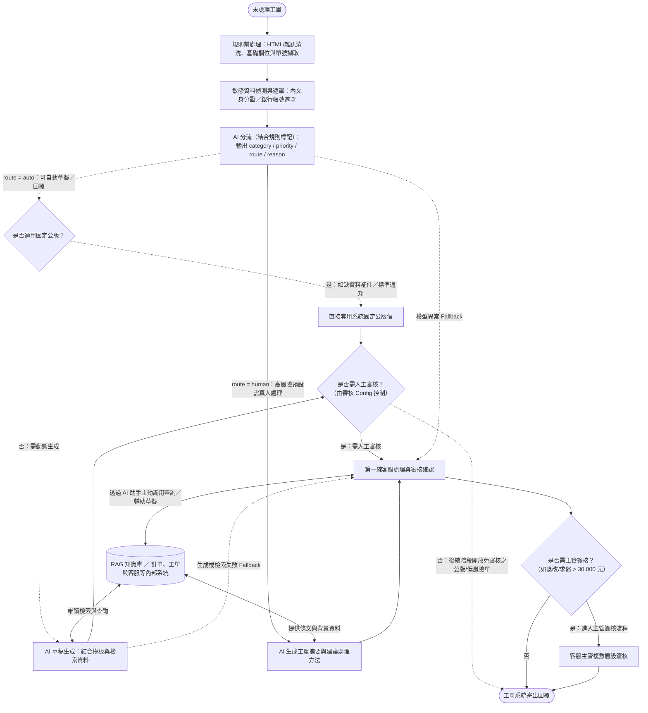

# answer

## overview

- 業務：email 與網站表單的客服工單處理。
- 工單欄位：ticket_id, created_at, channel, customer_name, subject, body。
- 業務分類：
  - 訂單查詢：約 40%。
  - 產品詢問：約 30%。
  - 退改需求（含取消與退款）：約 20%。
  - 投訴：暫估 5%。
  - 其他／待釐清（unknown）：暫估 5%。
- context:
  - 每天平均約 350 件工單，旺季會翻倍；目前由 8 位客服處理，平均首次回覆時間為 6 小時，旺季可能超過 24 小時。
  退款金額超過 30,000 元一定要主管簽核
  - 戶個資不得傳輸到未經評估與簽約的外部服務
  - 尚無經評估與簽約的 LLM 供應商
  - 內部文件分散，版本尚未釐清。

## Q1. 場景判斷

```
Q: 請評估三個構想各自的適用性、風險與前置條件，並明確指出：這個情境裡有哪些子問題其實不該用 AI 解（或不該現在解），你建議的推進順序與理由。
```

### 三個做法的評估

| 做法 | 適用性 | 主要風險 | 前置條件 |
| --- | --- | --- | --- |
| A：全部自動回覆 | 目前不適合；後續僅針對極少數有固定依據的低風險問題開放 | 錯答、不當交易承諾或個資外洩直接影響客戶 | 明確的允許範圍、嚴格品質驗證、轉人工與一鍵停用機制 |
| B：AI 分流＋草擬，人工確認 | **作為主要推進方向**；同步解決佇列優先級混亂，並透過預拉取資料與草擬大幅減少客服查找與寫信時間 | 分類錯誤、客服未攔截錯誤草稿，或內部系統未串接前需人工補填欄位 | 分類與分流規則、可靠知識源、內部系統唯讀權限與審核介面 |
| C：內部知識庫問答 | 適合先驗證知識檢索品質，但無法解決工單分流與跨系統查詢痛點 | 引用舊版文件、漏掉適用條件 | 確認唯一有效版本、維護負責人與存取權限 |

* **合規共同前提**：三者皆受相同的資安與個資限制；內部使用或有人工確認，不代表可將客戶個資（特別是信件內文的身分證、電話、銀行帳號）傳送至未經評估與簽約的外部 LLM 服務。
* **樣本反映的真實痛點**：檢視 48 筆工單樣本，進件除一般詢問外，還混雜了**非客服雜訊**（博弈廣告、B2B 報價、履歷、業配、媒體採訪）、**高時效急件**（明日出發遇颱風、票券未收到、旅途中飯店異常），以及**因久候衍生的重複催單與客訴升級**。因此系統必須結合「急件置頂」與「跨系統資料預拉取」，不能只做文字生成。

### 現階段不該用 AI 解（或不該現在解）的子問題

* **交給確定性規則（Deterministic Rules）與固定模板**：
  * **垃圾信過濾與缺資料補件**：外部廣告與測試單直接由規則過濾；針對內文過短或缺少關鍵必填資料（如未提供訂單號）之進件，統一歸入待釐清／需補件（`unknown`），由系統規則直接帶出固定補件信模板（無須呼叫 AI 生成草稿），於第一階段經審核送出，並作為後續階段最優先開放直接自動回信之項目。
  * **內文個資單向遮罩（PII Masking）、API 限流與權限控管**：信件內文之身分證、電話、銀行帳號正則掃描遮罩，以及低 QPS 內部 API 的排隊限流。
  * **高額退款簽核流**：退改或求償超過 30,000 元強制轉呈主管簽核，屬確定性商業規則，不由 AI 判斷。
* **交給真人權責負責人（Process & Governance）**：
  * **知識版本裁決**：散落的 Word、Excel 與舊版 FAQ 衝突時，由資深客服與業務單位拍板唯一有效版本。
  * **外部供應商資安審核、特殊退改通融與客訴賠償決策**。
* **現階段暫緩（Wait for Readiness）**：
  * **全面自動回信、自動執行訂單異動或直接呼叫退款 API**：在合規環境、API 配額與準確率穩定前，不開放 AI 直接修改資料庫或匯款。
  * **一次清洗所有歷史文件**：不先建置龐大的知識管理平台，僅先整理高頻問題即可啟動。

### 推進順序與理由

建議推進順序為：**`知識整理與離線 Eval → C（驗證知識檢索與查詢助手） → B（全工單分流＋低風險草擬＋人工確認） → A（限縮低風險自動回覆）`**。

1. **準備期 — 整理高頻知識、盤點跨系統 API 與建立 Eval**：先由資深客服裁決高頻問題的唯一有效版本；同步向資訊部盤點工單、訂單、會員（User）、發票等內部系統 API 的開放程度與時程。未獲法務核准前，以虛構樣本與 Mock 驗證。
2. **階段一 — 小範圍試用 C（驗證檢索品質與建立查詢助手）**：答案須附來源段落與版本，無依據時強制拒答。確認檢索正確且能縮短查找時間後，再進入 B（此階段建置之 RAG 查詢與 AI 助手工具亦保留供後續真人處理複雜工單時主動調用）。
3. **階段二 — 導入 B（主力方向：全工單分流＋協助草擬＋人工確認）**：
   * 所有進件先依「緊急度 × 影響度」排序佇列並過濾雜訊，解決急件積壓。
   * 針對標準產品、規則通則、資料補發與管道抱怨，由 AI 產出回覆草稿（`route = auto`）；針對缺資料待釐清（`unknown`）直接由系統帶出固定補件信（`route = auto`，不需 AI 生成）；針對訂單退改核算与重大客訴求償等高風險／高影響案件，預設強制轉人工（`route = human`），交由真人處理（真人可自行調用階段一之 RAG 工具與 AI 助手協助查詢與草擬）。第一階段所有對外回信均經審核後送出。
4. **階段三 — 限縮開放 A（極少數低風險自動回覆）**：待 B 穩定且證實省時後，優先針對固定補件信（`unknown`）及答案固定、無個資與承諾風險之問題，透過審核 Config 小流量開放自動回信。

---

## Q2. 需求收斂

```
Q: 選定你在 Q1 建議優先的方向，寫一份可以拿去跟利害關係人對齊的問題定義書，至少包含：

- 目標與非目標（明確的 out of scope）
- 使用者與使用情境
- 輸入／輸出定義
- 資料與系統的前置條件（哪些事沒到位就不該開工）
- 可量化的驗收標準
- 開工前必問利害關係人的 5 個關鍵問題，每題附上「這題想排除的風險是什麼」
```

> **文件定位**：本文件為針對 **方案 B（AI 全工單分流＋整合知識與內部唯讀資料協助草擬＋客服確認後送出）** 之開工前對齊草案。

### 1. 目標與非目標（Out of Scope）

| 項目 | 定義 |
| --- | --- |
| **目標（Goals）** | 1. **精準分流與急件置頂**：自動過濾非客服雜訊，依「緊急度 × 影響度」排序佇列，高風險／高影響工單預設轉人工處理，消除急件積壓。<br>2. **標準工單草擬與查詢工具輔助**：為可標準化之詢問生成附來源之回覆草稿（缺資訊之 `unknown` 工單由系統直接帶出固定補件信）；為需真人處理之案件提供分流標籤與主動式 RAG／AI 查詢助手，降低查找與撰寫工時。 |
| **非目標（Out of Scope）** | 1. **第一階段不直接自動對客發信**（所有回覆皆須經審核確認，自動寄信留待後續階段依審核 Config 開放）。<br>2. **不執行系統寫入操作，亦不接管工單系統既有職責**（不自動改單或呼叫退款 API；工單狀態管理、事件去重與多輪對話歸戶維持由既有工單系統負責）。<br>3. **不承諾縮減 50% 客服人力**，亦不一次清洗所有歷史舊文件。 |

### 2. 開工前必問利害關係人的 5 個關鍵問題

| 關鍵問題（與詢問對象） | 這題想排除的風險是什麼 |
| --- | --- |
| **1. 問管理層／客服主管**：第一階段是以「消除旺季積壓、縮短急件等待與單筆處理工時」為驗收標準，還是硬性要求「人力減半」？最終由誰拍板驗收？ | 排除主管期待立刻砍人與全自動回信，因期望落差導致專案被判失敗。 |
| **2. 問資訊部**：「跨兩三個系統查」具體包含哪些內部系統（訂單、會員 User、發票等）？各系統能否開放唯讀 API、支援哪些反查鍵值（如 Email／手機）、QPS 上限與審核時程為何？ | 必須先確認哪些系統能串、何時開放，才能界定哪些資料能由系統自動查好帶入，哪些需先由客服查詢。 |
| **3. 問客服主管／資深客服**：對於預設轉人工（`route = human`）的訂單退改與爭議工單，第一版由真人主動調用 RAG 知識庫與 AI 助手工具協助查詢草擬是否符合團隊習慣？ | 排除系統自動塞入過多未確認之退費草稿，導致客服未查證就當成橡皮圖章誤按送出。 |
| **4. 問資深客服**：Word、Excel 與舊 FAQ 衝突時誰裁決唯一有效版本？能否在開工前先鎖定高頻問題完成簽核，並約定後續規則改版時的更新流程？ | 排除一次清洗所有歷史文件導致開工無限期延宕，或引用過期規定引發客訴賠償。 |
| **5. 問法務／資安**：目前無簽約 LLM 供應商下，最快可行的合規路徑為何（簽署企業零留存合約、內網遮罩個資後傳輸、或地端模型）？審核需時多久？ | 排除用外部 API 做完 PoC 後，才因法務資安卡關而無法接觸真實工單。 |

### 3. 使用者與使用情境

| 使用者角色 | 作業情境 | 系統處理方式 |
| --- | --- | --- |
| **第一線客服** | 處理標準產品、規則通則、常規訂單查詢、資料補發與管道抱怨（`route = auto`） | 系統存取 RAG 知識庫、內部唯讀訂單／User 系統與模板，直接產出對客回覆草稿與引用來源，客服核對後送出。 |
| **第一線客服** | 處理資訊不足或缺少關鍵資料之進件（`unknown`，`route = auto`） | **不呼叫 AI 生成**；系統直接套用固定補件模板請客戶補充訂單號或具體訴求，第一階段經客服審核送出（後續優先開放自動回信）。 |
| **第一線客服** | 處理高風險／高影響工單：訂單修改、取消退費、旅途中異常、近期出發急件、高額（> 30,000 元）或重大客訴（預設 `route = human`） | 系統依優先級置頂，**不生成對客承諾草稿，改於內部備註自動附上「工單摘要與建議處理方法（含相關條文參考）」**交由真人處理；客服亦可自行調用 RAG 工具與 AI 助手協助查詢與草擬，> 30,000 元案件強制進入主管簽核流。 |
| **第一線客服／他部門** | 面對外部商務、公關、人資信件或垃圾廣告 | 廣告與測試單由規則直接過濾（`route = auto`）；企業包團、廠商報價、媒體採訪與履歷標記轉交對應部門（`route = human`）。 |
| **資深客服／主管** | 知識版本維護、複數層級審核與審核 Config 控管 | 資深客服維護有效知識；主管透過審核系統簽核 > 30,000 元案件，並透過審核 Config 控制各細項之審核層級或開關自動回信。 |

### 4. 輸入／輸出定義 與 主類別分流表

* **系統邊界前提**：工單處理狀態（Open / Pending / Closed）、事件去重與多輪信件歸戶由既有工單系統管理；本系統聚焦於進件時之單次解答分流與首次回覆輔助。
* **輸入（Input）**：工單欄位（`ticket_id`, `created_at`, `channel`, `customer_name`, `subject`, `body`，經內網遮罩高敏個資與代號替換）、有效知識庫與模板、已授權之內部系統唯讀資料（訂單／User 狀態）。
* **輸出（Output）**：
  * 分流欄位：`category`（主類別）、`priority`（依緊急度 × 影響度分為 `P1` 緊急／`P2` 高／`P3` 一般／`P4` 低）、`route`（`auto` 可自動草擬或規則處理 ／ `human` 預設由真人處理）、`reason`（分類與分流判斷依據）。
  * 輔助內容：`route = auto` 輸出 AI 對客回覆草稿（或 `unknown` 固定補件信）；`route = human` 輸出**工單摘要與建議處理方法（附條文參考）**交真人處理（真人並可主動調用 RAG／AI 助手工具）。
* **主類別定義與預設分流**（複合意圖以影響度與風險最高之訴求決定 `route` 與 `priority`；**`priority`（P1–P4）初始定義與 `sub_category` 細項規格詳見獨立附件 [taxonomy-and-priority-spec.md](file:///Users/james/projects/playground-fde/taxonomy-and-priority-spec.md)**）：

| 主類別 (`category`) | 涵蓋範圍說明 | 預設分流與系統行為 (`route`) |
| --- | --- | --- |
| `product_inquiry`<br>（產品詢問） | 行程規格與費用包含項目、票券兌換、護照簽證與旅遊通則、特殊客製化需求 | **`auto`**（生成完整解答草稿＋引用來源；若屬無障礙／客製化評估或外部無依據之最新法規則預設轉 **`human`**） |
| `order_service`<br>（訂單服務） | 訂單狀態查詢、行前通知時程、點數折抵規則、確認信／票券補發、發票統編與收據修改、帳號與計價異常 | **`auto` / `human`**（常規時程、點數規則與標準補發／發票模板走 **`auto`** 草擬；明日使用急件、帳號鎖定與計價異常預設走 **`human`**） |
| `refund_change`<br>（退改取消） | 退改手續費級距與入帳天數通則詢問、實際申請改期／改名／加購、取消行程與退費核算 | **`auto` / `human`**（純詢問退改通則與入帳天數走 **`auto`** 草擬；實際申請改期、取消退費核算及 > 30,000 元案件預設走 **`human`** 交真人處理並調用工具） |
| `complaint`<br>（客訴爭議） | 客服管道久候抱怨、旅途中食宿異常、領隊失職求償、疑似重複扣款、客服報錯價爭議、揚言申訴媒體或消保官 | **`auto` / `human`**（純抱怨電話打不通＋常規詢問走 **`auto`** 草擬致歉與解答；涉及服務瑕疵、帳務爭議與求償預設走 **`human`** 置頂由真人處理） |
| `other_non_cs`<br>（其他非客服） | 企業包團、供應商報價、媒體採訪、KOL 業配、職缺應徵、博弈推銷廣告、系統測試單 | **`auto` / `human`**（廣告與測試單標為 **`auto`** 由規則直接過濾；商務、公關、人資信件標為 **`human`** 轉交專責部門） |
| `unknown`<br>（待釐清／需補件） | 內文過短（如僅寫「可以退嗎」）、漏附圖檔、或缺少必填關鍵資料（如未給訂單號），無法直接處理 | **`auto`**（**不呼叫 AI 生成草稿**；由系統規則直接帶出固定補件信模板，第一階段經審核送出，後續優先開放自動回信） |

### 5. 資料與系統的前置條件（沒到位則停留在離線 PoC，不接正式工單）

* **知識與業務端（資深客服／主管）**：完成試點範圍之唯一有效知識版本裁決（消除 Word/Excel/舊 FAQ 衝突）；抽樣標註 50–100 筆歷史工單作為測試基準（Golden Set）；指派試營運審核人力。
* **系統與資訊端（資訊部 IT）**：開通工單系統讀寫測試權限（讀取未處理工單、寫入分流標籤與草稿）；確認訂單與會員 User 等內部系統可開放唯讀 API 之範圍、查詢鍵值與 QPS 配額。
* **合規與資安端（法務／資安）**：完成外部 LLM 供應商評估與簽約（或核准合規部署環境）；核准內網高敏個資單向遮罩（PII Masking）規則與可傳輸欄位白名單。

### 6. 可量化的驗收標準（初始設定，開工前與客服主管確認）

需先抽樣建立現有「單筆實際處理工時（AHT）」基準（不直接拿首次回覆等待 6 小時當成處理工時），並依業務風險邊界分階段驗證以下指標（詳細分子／分母公式與退場門檻見 Q4）：

* **離線 PoC 准入門檻**：主類別與 `route` **分流錯誤率 ≤ 10%**（看不懂或信心不足可保守轉 `human` 或 `unknown`，但**高風險／高影響案例誤判為 `auto` 之誤放行率 False Auto = 0%**）；標準問題草稿錯誤率 **≤ 5%**。
* **試營運（方案 B，至少觀察 2 週且累積至少 100 筆適用工單）驗收門檻**：
  * **品質與錯誤率**：任務成功率（送出後 7 天內未因同問題重開）**≥ 95%**；草稿內容錯誤率 **≤ 5%**；系統技術錯誤率 **≤ 1%**。
  * **效率與採用率**：試點類別平均單筆處理工時（AHT）較同類人工基準下降 **≥ 15%**；高優先級急件首次回覆時間（FRT）顯著縮短；草稿被客服棄用重寫率 **≤ 20%**。
  * **安全防護紅線（重大業務零容忍）**：個資外洩、越權承諾與 > 30,000 元漏簽核為 **0 件**；錯誤草稿未攔截流出致重大客訴為 **0 件**；整體客訴率不高於同期同類人工基準。

---

## Q3. 端到端 Workflow 設計

```
Q: 針對你選定的方向，交付一張設計圖＋必要的文字說明，需涵蓋：
- 任務流與資料流（從工單進來到結案）
- AI、規則、RAG／知識庫、人工四者的分工邊界
- 人工接手的觸發條件（請列出具體規則，不要只寫「低信心時轉人工」）
- 錯誤處理與降級策略（LLM 服務掛掉／回答品質異常時系統怎麼辦）
- 個資與權限邊界（呼應法務的限制條件）
- Log 與追蹤點（為了之後能監控與除錯，你會在哪些位置記什麼）
```

### 1. 設計原則與範圍

* **規則管硬性邊界，高風險／高影響預設轉人工**：涉及金額門檻（> 30,000 元）、高敏個資遮罩、垃圾信過濾與固定公版套用一律由確定性規則控制；高風險工單預設 `route = human`，AI 不具備直接改單、退費或對外發信之權限。
* **職責邊界清晰與最小揭露**：工單狀態管理與事件去重由既有工單系統負責；內網前處理設置獨立之「敏感資料偵測與遮罩」步驟，直接遮罩信件內文之身分證字號與銀行帳號等高敏個資，僅將合規文字與必要狀態傳予經核准之模型。
* **失敗安全（Fail-closed 回人工）**：任何檢索無依據、API 查詢失敗或模型異常，一律跳過生成直接退回第一線客服處理，絕不阻塞工單收件或編造答案。

### 2. 架構圖（任務流與資料流）與四者分工邊界

#### (1) 端到端任務流與資料流



* **典型執行路徑說明**：
  * **`route = auto` 路徑（虛線）**：
    * **適用固定公版（如：缺資料待補件 `unknown`、標準收據／通知）**：AI 分流判定適用公版 → **不呼叫 AI 自由生成**，直接套用系統寫好之固定公版信 → 經「是否需人工審核」判斷（第一階段進第一線客服審核確認，後續階段可由審核 Config 開放直接寄出）→ 工單系統寄出回覆。
    * **需動態生成之標準詢問（如：東京團費用包含項目、常規訂單狀態查詢）**：AI 分流判定為 `auto` → 存取共用的「RAG 知識庫／訂單與客服等內部系統」生成附來源之對客草稿 → 進入第一線客服審核確認 → 不需主管簽核，由工單系統寄出回覆。
  * **`route = human` 路徑（實線，如：18.6 萬骨折取消退費申請）**：分流判定為高影響／高風險，預設標記 `route = human` 與高優先級置頂 → **系統不生成對客承諾草稿，改為結合知識庫與內部系統生成「工單摘要與建議處理方法」** → 進入「第一線客服處理與審核確認」（客服亦可透過 AI 助手主動調用 RAG 知識庫與訂單／工單系統協助查證與草擬）→ 經過「是否需主管簽核」判斷（因 > 30,000 元強制走客服主管複數層級簽核）→ 回到工單系統寄出回覆。
  * **異常 Fallback 路徑（點虛線）**：當模型逾時或檢索失敗時，**不進入摘要或草稿生成節點**，直接跳轉至「第一線客服處理與審核確認」由真人依原流程處理。

#### (2) 四者分工邊界表

| 角色／模組 | 負責的事（In Scope） | 不負責／禁止的事（Out of Scope） |
| --- | --- | --- |
| **規則（Rules）** | 初步過濾垃圾信與測試單、檢查缺漏資訊直接套用固定補件模板、HTML 雜訊清洗、單向遮罩高敏個資（身分證／銀行帳號）與記憶體內 Key 代號替換回填、API 限流排隊、硬性高風險標記（> 30,000 元、危機字眼）與審核 Config 路由控制。 | 不做複雜語意理解、不負責工單系統既有之狀態機與事件去重。**規則判定轉 `human` 時，AI 不得覆蓋。** |
| **RAG／知識庫與內部查詢** | 提供經資深客服簽核之有效知識片段與版本號；於內網透過唯讀 API 查詢訂單與會員 User 狀態；作為獨立查詢工具供真人客服處理 `human` 工單時主動調用。 | 不收錄未審核之舊版文件；不開放模型無條件查詢全庫或執行寫入操作。 |
| **AI（LLM）** | 判定分類與優先級、輸出分流原因（`reason`）；針對 `route = auto` 標準單生成對客草稿；針對 `route = human` 高風險單生成**內部工單摘要與建議處理方法**，並於真人主動調用時提供問答輔助。 | **不為 `unknown` 缺資料單無依據瞎猜、不自行決定退款金額、不承諾賠償、不持有寄信或改單 API 權限。** |
| **人工（客服與主管）** | 一線客服審核 `auto` 草稿、參考摘要與建議處理 `human` 複雜退改與客訴（並可主動調用 RAG／AI 助手）；客服主管執行 > 30,000 元複數層級簽核並管理審核 Config。 | 不必再手動過濾垃圾信、為缺單號進件重打補件信，或從零翻找散落文件。 |

### 3. 人工接手的觸發條件（v1 具體規則）

高風險與高影響工單一律預設 `route = human`。將觸發條件分為「確定性規則」與「AI 分流／檢索訊號」兩類（以下門檻為第一版設計，上線前依 Eval 結果調整）：

| 觸發類型 | 具體觸發條件 | 對應樣本情境範例 | 系統處置行為 |
| --- | --- | --- | --- |
| **確定性規則**<br>（不經 AI 判斷，直接攔截） | 1. **高額退改／求償門檻**：涉及退改、退款或求償且金額 > 30,000 元。<br>2. **客訴升級關鍵字**：於投訴或爭議語境出現「消保官、媒體、記者、爆料、律師、爭議款、止付、社團公開」。<br>3. **緊急時效（≤ 72 小時）**：明日／後天出發遇天災、明日使用卻未收到票券 QR code。<br>4. **高敏個資匯款要求**：內文直接提供身分證字號與銀行帳戶要求退款匯款。<br>5. **重複催單**：同一客戶針對未結案件再次來信催問。 | 18.6 萬骨折退費、求償 4.5 萬、揚言找消保官、明日澎湖颱風、隔兩天二次催問重複扣款。 | 強制設為 `route = human`、調升 `priority`（P1/P2）置頂；退改或求償 > 30,000 元於審核分支強制標記「須主管簽核」。 |
| **AI 分流與檢索訊號**<br>（模型分類、信心與資料檢查） | 6. **高風險／高影響業務分類**：分類屬實質 `訂單修改`、`訂單取消退費`、`帳號與計價異常`、`服務瑕疵與帳務求償`、`客製化需求` 或 `商務／公關／人資轉介`（如正常媒體採訪 `TK-1047` 轉公關但優先級為 P4）。<br>7. **複合意圖含高風險項**：同時詢問常規問題與申請退改／客訴。<br>8. **模型信心不足或 RAG 檢索無結果／衝突**：分類信心度低於門檻、知識庫無匹配文件、相似度過低或涉及外部即時變動簽證法規無明確依據。<br>9. **內部 API 查無或異常**：`route = auto` 查無對應訂單、寄件人與訂單歸屬不符，或 API 逾時失敗。 | 申請改期／改飯店／改名、曼谷飯店有蟑螂、泰國新簽證規定、12 人團退 2 人。 | 預設或退回 `route = human`（不自動生成對客承諾草稿），直接排入真人處理佇列，由客服按需調用 RAG／AI 助手處理。 |

### 4. 錯誤處理與降級策略

| 故障或異常類型 | 偵測方式 | 降級行為（Fallback & Rollback） |
| --- | --- | --- |
| **LLM 服務逾時或掛掉** | 呼叫逾時（如 > 15 秒）、HTTP 5xx 或輸出 JSON 格式解析失敗（重試 1 次仍失敗） | **Fail-closed 回原流程**：不阻塞收件，工單僅帶基礎規則標籤直接進入人工佇列，客服依既有流程處理。 |
| **RAG 檢索無結果或衝突** | 檢索無命中片段、分數過低，或命中多份生效日衝突之文件 | **退回真人佇列**：不生成對客草稿，自動轉為 `route = human` 並於 `reason` 提示客服「查無唯一有效依據」。 |
| **內部訂單／User API 限流或失敗** | 收到 HTTP 429（Rate Limit）、逾時或連線失敗 | **降級為填空模板或轉人工**：內網設有低 QPS 排隊佇列；若排隊逾時，不中斷流程，改生成帶 `[待查填訂單狀態]` 佔位符之草稿或轉 `human` 由客服處理。 |
| **特定類別草稿品質異常** | 試營運監控發現某細項草稿錯誤率超標、客服棄用率過高，或該產品規則臨時改版 | **透過審核 Config 局部停用草擬**：於審核 Config 將該細項改設為 `route = human`（真人仍可查閱知識庫），其餘正常類別不受影響。 |
| **重大資安或系統性事故** | 發生個資外洩疑慮、大面積錯答或底層知識庫污染 | **全局 Kill Switch**：一鍵停用 AI 草擬模組，全數工單直接走原人工佇列。 |

### 5. 個資與權限邊界（呼應法務限制）

* **未簽約前不傳真實個資**：在法務完成外部 LLM 供應商評估與簽約（含外部生成、Embedding 與評估工具之資料流審核）前，離線 PoC 僅使用虛構資料；正式環境未獲核准前不外傳任何真實工單。
* **敏感資料偵測與遮罩（第一階段聚焦高敏個資單向遮罩）**：
  1. **內網唯讀查詢**：需要核對訂單狀態時，於**公司內網**直接查詢唯讀訂單／User API 並核對歸屬。
  2. **獨立敏感資料遮罩步驟**：送往外部已簽約模型前，內網透過獨立之「敏感資料偵測與遮罩」模組，將客戶於信件內文自行貼上之高敏個資（如**身分證字號、銀行匯款帳號、信用卡號**）直接遮罩為 `[ID_MASKED]`、`[BANK_MASKED]`（對客回信本就不應再次印出此類資訊，第一階段無須建置複雜的雙向代號回填系統；若後續有雙向遮罩需求，則必須於進入人工審核前完成還原，確保客服審核時能看見完整資訊）。
* **權限隔離（Least Privilege）**：系統僅持有內部訂單／User API 之**唯讀權限**，且在程式碼層強制校驗「進件者與訂單歸屬一致」才允許讀取；AI 模組完全不具備呼叫退款申請 API、修改訂單資料庫或跨過審核 Config 直接對外發信之權限。

### 6. Log 與追蹤點

以 `ticket_id` 串聯分流與審核全流程，一般應用 Log **僅記錄去識別化／遮罩後文字**（原始個資與最終信件留存於受權限控管的工單系統）：

| 追蹤節點 | 記錄內容（Log Fields） | 用途（對應監控與除錯） |
| --- | --- | --- |
| **1. 規則過濾與前處理** | `ticket_id`, `received_at`, `channel`, 命中之過濾規則（垃圾信／缺資料 `unknown`／高額 >3萬／急件）、被遮罩之個資類型標籤 | 稽核個資遮罩合規性、統計垃圾信過濾與固定補件信觸發比例 |
| **2. AI 分流與檢索草擬** | 模型與 Prompt 版本、輸出之 `category / priority / route / reason`、信心分數、RAG 命中文件 ID 與版本號、內部 API 查詢狀態碼（200/429/5xx）與耗時 | 追蹤分流錯誤率、定位草稿異常是源於「檢索錯舊文件」還是「API 限流失敗」 |
| **3. 審核分支與真人工具調用** | 審核層級（一線客服／主管簽核）、審核 Config 版本、`human` 工單是否主動調用 RAG／AI 助手、**客服對草稿處置動作（直接採用／小幅修改／棄用重寫／標記實質錯誤）** | 計算「人工接手（棄用）率」、「草稿錯誤率」與識別客服是否未審核就盲目送出 |
| **4. 工單系統寄送與追蹤** | `first_replied_at`, 客服實際處理耗時、送出後 7 天內工單系統是否重開（Reopen）或關聯客訴標籤 | 結合工單系統狀態計算「任務成功率」、「首次回覆時間（FRT）」、「人工處理時間（AHT）」與「客訴率」 |

---

## Q4. 指標與上線 Gate

```
Q:
- 定義試營運期間的監控指標，至少含任務成功率、人工接手率、錯誤率、處理時間；指標請寫清楚分子／分母怎麼算、資料從哪裡來。
- 至少一個防護型指標（例如客訴率），說明它防的是什麼。
- 定義 PoC → 試營運 → 正式上線的晉級條件與退場條件（什麼數字達標才往前走、什麼狀況要喊停）。
```

### 1. 試營運監控指標定義

在方案 B（AI 分流＋草擬，經審核確認後送出）下，指標聚焦於**「分流錯誤率（特別是高風險誤放行 False Positive）」**與**「草稿實質錯誤率」**。下列「人工接手率」定義為「預設轉 `human` 之工單，加計原為 `auto` 卻因異常或草稿不可用而退回人工重寫之比例」，不將正常的審核確認誤算為失敗接手。

| 指標類別與名稱 | 分子／分母計算公式 | 資料來源 |
| --- | --- | --- |
| **任務成功率** | **分子**：送出回覆後 7 天內未因同一問題重開（Reopen），且經抽查確認需求已正確解決之工單數<br>**分母**：進入試點且已滿 7 天觀察期之受評進件總數（含超時未結案工單，避免排除難題高估成功率） | 工單系統狀態、重開紀錄、資深客服／主管抽查表 |
| **人工接手率**<br>（依類別分開觀察） | **分子**：直接分流為 `route = human` 之工單數 ＋ 原為 `route = auto` 但客服按下「棄用重寫」或標記草稿實質錯誤而改由人工撰寫之工單數<br>**分母**：進入試點流程之工單總數（每單僅計一次） | 分流 Log（`route`）、審核介面客服處置動作紀錄 |
| **錯誤率 1：分流錯誤率與高風險誤放行率** | **分子**：分類或 `route` 與人工標準標註不一致之工單數；**另單獨計算「應為 `human` 之高風險／高影響工單卻誤判為 `auto`（False Positive / False Auto）」之件數**<br>**分母**：離線 Eval 或線上抽查之受評工單總數 | 黃金測試集（Golden Set）、線上抽查標註紀錄 |
| **錯誤率 2：草稿內容錯誤率** | **分子**：經審核或抽查發現含有事實錯誤、引用過期規定、漏答核心問題或無依據承諾之草稿數（搭配系統技術失敗率一併監控）<br>**分母**：受評之 AI 生成草稿總數 | 修改前原始草稿 Log、引用來源紀錄、客服標記與主管覆核 |
| **處理時間：單筆處理工時（AHT）與首次回覆時間（FRT）** | **AHT**：客服打開審核／查證至按下送出之實際作業分鐘數總和 ÷ 已完成回覆之試點工單總數<br>**FRT**：（首次有效回覆時間 `first_replied_at` － 建立時間 `created_at`）總和 ÷ 已回覆試點工單總數（同時看平均與 P90，並附列超時未回覆件數） | 工單審核畫面作業時間戳、工單系統時間戳 |
| **防護型指標 1：客訴率** | **分子**：回覆送出後 7 天內，因回覆內容錯誤、態度不當或處理延誤而引發客戶正式投訴／升級之工單數<br>**分母**：同批已滿觀察期之試點工單總數 | 客訴紀錄表、工單升級標籤 |
| **防護型指標 2：錯誤草稿流出數** | **分子**：AI 草稿含實質錯誤、且審核未攔截即直接送出給客戶之工單絕對件數（不取比例，直接看件數）<br>**分母**：無（以絕對件數監控） | 客訴回溯調查、主管事後抽查紀錄 |

* **防護型指標防的是什麼**：
  1. **客訴率**：防範團隊為了追求縮短「首次回覆時間（FRT）」與「處理工時（AHT）」，在未充分查證下草率送出錯誤或不當回覆，犧牲服務品質。
  2. **錯誤草稿流出數**：防範「自動化偏誤（Automation Bias／橡皮圖章效應）」——當日均 350 件（旺季 700 件）處理量很大時，少數嚴重錯答（如報錯退費金額或引用舊規）會被平均百分比稀釋，因此必須以**絕對件數**作為熔斷紅線。

### 2. 晉級條件與退場條件（PoC → 試營運 → 正式上線）

* **從業務量與風險邊界反推門檻**：考量日均 350 單（旺季 700 單），將指標切分為兩類反推——(1) **重大業務與高風險紅線（> 30,000 元簽核、實質退改與求償誤放行、錯誤承諾流出）容忍度為 0 件**（透過硬性規則攔截＋預設轉 `human` 保障，寧可看不懂保守轉 `human` 或 `unknown`，絕不容許 False Positive 誤放行）；(2) **一般低風險分流與草稿**則以能否替 8 名客服顯著省時為基準（分流錯誤率 ≤ 10%、草稿錯誤率 ≤ 5% 即具備正向工時效益）。比較處理時間時一律以「同期、同細項之純人工工單」為基準（以下為初始設定，啟動前與主管確認）：

| 階段轉換 | 晉級條件（達標才往前走） | 退場／降級條件（什麼狀況要喊停） |
| --- | --- | --- |
| **1. 離線 PoC → 試營運（Pilot）** | 1. **離線測試集驗證**：完成附件 48 筆樣本分流輸出，並由資深客服抽樣 50–100 筆歷史工單（含高風險必攔截題與缺資料題）組成 Golden Set。<br>2. **錯誤率與安全門檻**：整體分流錯誤率 ≤ 10%，且**高風險／高影響案例誤判為 `auto` 之誤放行數（False Auto）= 0 件**；標準問題草稿錯誤率 ≤ 5%。<br>3. **前置到位**：合規環境核准、首批知識版本簽核、工單 API 測試通過。 | 任一高風險測試案例被誤判為 `auto` 產出承諾草稿，或法務／知識版本未到位，一律維持離線調整，不進入試營運。 |
| **2. 試營運 → 正式上線（全團隊人工審核模式）** | 1. **觀察規模**：先由 1–2 位客服試用，至少觀察 **2 週** 且累積 **至少 100 筆**已結案並滿 7 天追蹤之適用工單（若單一細項日均流量較低則延長觀察至達標）。<br>2. **品質與成效門檻**：任務成功率 ≥ 95%、草稿內容錯誤率 ≤ 5%、系統技術錯誤率 ≤ 1%；客服平均單筆處理工時（AHT）較同類人工基準下降 **≥ 15%**（且草稿棄用重寫率 ≤ 20%）。<br>3. **防護門檻**：試營運期間**錯誤草稿未攔截流出致重大客訴件數 = 0 件**，整體客訴率不高於同期人工基準。 | 1. **局部降級**：單一細項每 50 筆抽查中草稿錯誤率 > 5%、棄用率 > 30%，或**發生 1 件錯誤草稿未攔截流出致客訴**，立即透過審核 Config 關閉該細項草擬。<br>2. **全面暫停退回人工**：發生任何個資外洩、**錯誤草稿流出致客訴累計達 2 件以上（或事故範圍不明）**、或單日技術錯誤率 > 5%，立即全面暫停對客草擬功能（退回僅保留分類與主動查詢工具 C）。 |
| **3. 正式上線後擴充：特定細項開放直接自動回信（階段三）** | 優先針對**無須 AI 生成之固定補件信（`unknown`）**，以及在正式環境累積至少 **200 筆**審核紀錄、**直接採用率 ≥ 98%** 且事實錯誤率為 **0%** 之極低風險細項，經主管於審核 Config 簽核後先開 10% 流量並每日全查。 | 自動回信細項只要發生 **1 件** 錯答客訴或重大異常，無須等待統計顯著，立即於審核 Config 一鍵退回人工審核模式。 |


## Q5. 情境追問

```
Q: 假設方案上線試營運四週後，數據如下：
- 自動處理率 45%，平均首次回覆時間從 6 小時降到 1.5 小時
- 但發生 3 起 AI 草擬內容錯誤、客服未攔截就送出，造成客訴
- 客服團隊開始不信任系統，幾乎全面改走人工，接手率明顯回升
請寫一份給決策者的半頁建議：續行、調整、還是暫停？以及你會立刻執行的前三個具體行動。
```

### 給決策者的建議：**調整方案（局部暫停高風險草擬、保留分流與固定公版，不全面終止專案）**

* **四週數據診斷（為何選擇「調整」而非「續行擴量」或「全面廢止」）**：
  1. **核心價值已驗證，不應全面廢止**：平均首次回覆時間（FRT）由 6 小時大幅縮短至 1.5 小時，證明「工單自動分流、急件置頂、固定公版與基礎知識檢索」能有效解決排隊積壓痛點。但須向團隊釐清，「45% 自動處理率」目前僅代表系統產出草稿之比例（非零錯誤結案率），不能作為直接續行擴量的依據。
  2. **雙重防線失效，必須立即收斂範圍**：發生 3 起 AI 錯答且穿過人工審核引發客訴，已觸發 Q4 退場紅線（≥ 2 件），顯示**「AI 自由草擬開放範圍過寬」**且**「人工審核流於形式（橡皮圖章效應）」**。
  3. **客服棄用源於「怕背鍋」與「改稿比自寫更累」**：客服全面改走人工，是因為出事後擔心背負客訴責任，且檢查劣質草稿的隱藏錯誤反而增加心智負擔，導致連原本好用的標準類別也一併被放棄。

### 立刻執行的前三個具體行動

1. **行動一：立即止損與收斂草擬範圍（回應 3 起客訴與 Q4 熔斷紅線）**
   * **客訴補救與同批清查**：立即由資深客服聯繫 3 起受影響客戶更正資訊並安撫；同時從 Log 撈出四週內同類別、引用相同知識版本之已寄出工單進行回溯清查，主動攔截潛在未爆彈。
   * **依 Q4 Gate 調整審核 Config**：先依熔斷機制**關閉出事類別及所有涉及退改條件、金額計算之「AI 自由草稿生成」**（改設為 `route = human`，僅提供工單摘要與條文查詢），但**保留無錯答風險的「全工單分流排序置頂」與「固定公版信」**，守住 FRT 縮短的核心效益。
2. **行動二：根因拆解與「防橡皮圖章」審核介面改版（解決 AI 錯答 ＋ 客服未攔截）**
   * **技術根因定位與回歸測試**：調閱 3 起事故之 Trace Log，確認錯因是「RAG 檢索到未清理之舊版文件」、「無依據卻硬生成」還是「分流誤將高風險判為 `auto`」，修正後將該 3 題與相似案例納入 Golden Set 回歸測試。
   * **審核防呆改造（以介面機制取代口頭要求客服小心）**：針對保留草擬之類別，於審核畫面**強制並列高亮顯示引用之知識庫原文與版本號**；若草稿涉及日期、天數或費用規定，改以 **`[待客服勾選核對]` 必填槽位**呈現，客服未勾選確認關鍵欄位前系統鎖定「送出」按鈕，從流程上杜絕盲目送出。
3. **行動三：消除使用阻力與分階段重建客服信任（解決客服全面棄用、接手率飆升）**
   * **制度免責與一鍵棄用機制**：與客服主管共同宣布「試營運期間主動退回或標記錯誤草稿屬正向貢獻，不計入個人疏失」；並於審核介面增設**「一鍵棄用草稿（快速勾選原因：引用過期／答非所問）」**按鈕，讓客服丟棄壞草稿只需 1 秒鐘，不必為了怕麻煩而全盤不用系統。
   * **Shadow Mode 驗證與白名單重啟**：修正後的類別先在背景執行 Shadow Mode（生成草稿僅供資深客服離線抽查，不推上前台干擾一線作業）；待連續通過 Q4 準確率門檻後，先由客服團隊票選「最常重複打字、最需要幫忙」的 2–3 個純標準詢問類別重新開放，每週公開改善成果與省時數據，逐步贏回團隊信任。

## AI 使用說明

使用 AI 協助整理題目、調整回答用語、比較方案，並草擬流程、指標及 rollback 條件。文中的數字是待驗證的驗收設定，尚非實測結果。
