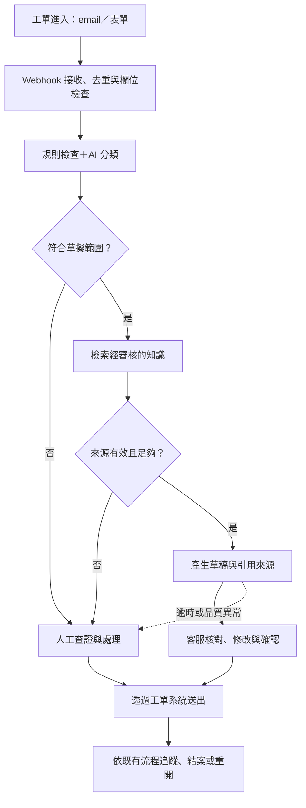

# answer

## overview

- 業務：email 與網站表單的客服工單處理。
- 工單欄位：ticket_id, created_at, channel, customer_name, subject, body。
- 業務分類：
  - 訂單查詢：約 40%。
  - 產品詢問：約 30%。
  - 退改需求（含取消與退款）：約 20%。
  - 投訴：暫估 5%。
  - 其他／待釐清（unknown）：暫估 5%。
  - 以上比例來自客服主管的概略描述；題目僅指出投訴與其他問題合計約 10%，各占 5% 是待驗證的假設，需再以工單樣本及實際營運資料確認。
- context:
  - 每天平均約 350 件工單，旺季會翻倍；目前由 8 位客服處理，平均首次回覆時間為 6 小時，旺季可能超過 24 小時。
  - 尚無經評估與簽約的 LLM 供應商
  - 內部文件分散，版本尚未釐清。

## Q1. 場景判斷

推進順序是：先整理知識，以小範圍的 C 驗證回答品質，再導入 B 驗證客服效率，最後開放部分低風險工單自動回覆。先確認能穩定減少多少工作量，再討論人力配置。

### 三個做法的評估

| 做法 | 適用性 | 主要風險 | 前置條件 |
| --- | --- | --- | --- |
| A：全部自動回覆 | 目前不適合；後續僅開放低風險問題 | 錯答、不當承諾或個資外洩直接影響客戶 | 明確的適用範圍、品質驗證、轉人工與停用機制 |
| B：AI 分流＋草擬，人工確認 | 作為主要方向，減少讀信、查資料與撰寫時間 | 分類錯誤、客服未攔截錯誤草稿，或修改反而更費時 | 分類規則、可靠知識與可執行的審核流程 |
| C：內部知識庫問答 | 適合先驗證知識，但不能取代跨系統查詢 | 引用舊版文件、漏掉適用條件 | 確認有效版本、維護負責人與存取權限 |

三者都受相同的個資限制；內部使用或人工確認，不代表可以將個資送到未核准的外部服務。

### 推進階段

1. **整理知識與 eval。**先處理高頻產品問題，由資深客服確認答案、分類及轉人工條件。測試涵蓋一般問題、多重需求、文件衝突、退改、投訴與 unknown，並與開發案例分開。尚未取得真實資料使用核准前，以虛構資料和 mock 驗證。
2. **小範圍試用 C。**答案須附來源，無依據時不作答。回答正確率達 95%，且測試集中應拒答的案例全部攔截後，才交由少數客服試用；確認查找與查證時間確實縮短，再進入 B。不必先做一套完整的知識管理平台。
3. **導入 B。**先開放一般產品詢問的分類與草稿，分類及草稿正確率各達 95%，高風險測試案例全部轉人工。所有回覆經客服確認；退改、投訴與 unknown 先做標記及摘要。訂單查詢等身分驗證、唯讀 API 權限與限流到位後再加入。
4. **限縮開放 A。**B 穩定後，僅挑選有固定依據、不涉及個資、即時價格或交易承諾的情境。候選情境回答正確率達 99%、無重大錯誤，且 B 的平均處理時間降低至少 20%，才開放小流量自動回覆。未達標就維持人工確認。

門檻、樣本量及退場條件見 Q4；48 筆樣本只能驗證 PoC，不能直接作為正式上線的依據。

### 不需要 AI，或現階段不做的事

- **交給規則：**收件通知、必填欄位檢查、API 限流、權限控管及超過 30,000 元退款的主管簽核。unknown 可以先通知已收件，但不能當作問題已解決。
- **交給負責人：**文件版本裁決、資料使用核准、特殊退改與補償決定。
- **初期不做：**全面自動回覆、自動修改訂單或退款，以及一次整理所有文件。

## Q2. 需求收斂

### 問題定義

客服的時間花在讀信、找資料與撰寫回覆，旺季容易累積待辦。優先驗證 B 能否在不增加錯誤與客訴的情況下，縮短一般產品詢問的處理時間；C 作為前期知識驗證。

| 項目 | 定義 |
| --- | --- |
| 目標 | 減少重複查找與撰寫，平均人工處理時間降低至少 20% |
| 非目標 | 初期不自動寄信、不執行訂單異動或退款、不承諾人力減半 |
| 使用者與情境 | 第一線客服處理新工單、核對來源及修改草稿；主管確認例外案件並抽查品質 |
| 輸入 | 工單欄位、經審核的產品知識與回覆模板；初期不依賴訂單 API |
| 輸出 | category、route、reason，以及適用案件的草稿與來源；保留人工修改和最終回覆 |
| 分類 | 訂單查詢、產品詢問、退改、投訴、unknown；多重需求保留標籤，以風險最高的需求決定分流 |
| 分流 | auto 代表可自動草擬，仍須人工確認；human 代表需人工查證或處理，不產生可直接送出的答案 |

**開工條件：**真實資料使用方式獲法務與資安核准、試點知識有有效版本及負責人、客服有時間標註與審核、工單 API／webhook 權限與回退流程可用。任一項未到位，先停留在離線 PoC，不接正式工單。

**驗收：**分類與草稿正確率各至少 95%，高風險測試案例全部轉人工；試營運平均處理時間降低至少 20%，無重大錯誤，且客訴率未高於原人工流程。計算方式與觀察期間依 Q4。

### 開工前的五個問題

| 問題 | 要排除的風險 |
| --- | --- |
| 第一階段優先改善回覆速度、處理工時，還是減少人力？誰決定驗收？ | 目標不同，最後無法判斷是否成功 |
| 哪些情境可以草擬，哪些必須交給客服或主管？ | AI 越權處理、承諾補償或漏掉急件 |
| 哪一份文件才是有效版本，誰負責確認與更新？ | 將過期或衝突資訊當成標準答案 |
| 哪些資料可以送到哪個環境？供應商評估與簽約何時完成？ | PoC 可行，但正式資料無法使用 |
| 工單 API／webhook 的限制、重送行為與權限是什麼？誰能參與試點與抽查？ | 重複處理、整合受阻，或沒有足夠人力驗證效益 |

## Q3. 端到端 Workflow 設計

### 分工與人工接手

- **規則：**去重、欄位檢查、權限與高風險限制；規則要求轉人工時，AI 不得覆蓋。
- **AI：**辨識需求、分類、摘要與草擬，不自行決定退款、補償或操作訂單。
- **知識庫：**提供經審核的內容及來源版本。文件與客戶文字都是資料，不能用其中的指令改變工具權限。
- **人工：**核對需求與來源、處理例外、決定回覆及結案。查不到資料時，透過原有系統查證。

以下情況直接轉人工：退改或投訴、需求無法辨識、多重需求含高風險項目、缺少必要資訊、無有效來源或來源衝突、涉及即時價格或交易承諾，以及目前尚未整合的訂單查詢。退款超過 30,000 元另走主管簽核。

### 降級、個資與追蹤

- **服務失敗：**LLM／檢索逾時或輸出格式錯誤時，保留工單並轉人工，不阻塞佇列。重送以事件 ID 去重；送信沿用工單系統，避免重試造成重複寄送。
- **品質異常：**停用受影響類別的草稿，退回知識查詢；若來源本身不可信，連查詢也停用，改走原人工流程。
- **個資與權限：**原始工單留在核准環境，只提供必要欄位給核准服務；一般產品問答不需姓名、電話或證號。模型沒有寄信、修改訂單與退款權限，客服沿用既有帳號權限。
- **Log：**以 ticket_id 串接接收、分類、檢索、草擬、人工修改、送出及結案時間；記錄分流原因、來源版本、模型／提示版本、錯誤碼及審核者。一般 log 不寫原始個資，需追查的草稿與回覆留在有權限控管的工單紀錄中。

## Q4. 指標與上線 Gate

### 監控指標

B 的每筆草稿都須人工確認，因此「人工接手」專指退出草擬流程、改由人工查證或自行撰寫，不把正常審核算成接手。

| 指標 | 計算方式 | 資料來源 |
| --- | --- | --- |
| 任務成功率 | 抽查中正確、完整解決需求，且送出後 7 天內未因同一問題重開的工單數／已滿 7 天觀察期的抽查結案工單數 | 工單狀態、重開原因、客服主管覆核 |
| 人工接手率 | 直接分到 human 或草擬後改由人工接手的工單數／進入試點流程的工單數；每單只計一次 | route、客服接手紀錄 |
| 分類正確率 | 與人工標註一致的工單數／受評工單數；多標籤需完整符合 | 獨立 eval、抽查標註 |
| 草稿正確率／錯誤率 | 正確／有實質錯誤的草稿數，各除以受評草稿數；漏答、無依據承諾也算錯誤 | 修改前草稿、來源與人工覆核 |
| 技術錯誤率 | 發生逾時、檢索或格式失敗的工單數／嘗試 AI 處理的工單數 | 系統 log |
| 平均人工處理時間 | 已完成試點工單的實際處理分鐘總和／已完成試點工單數，包含查證、修改與轉人工後的時間 | 客服工時紀錄 |
| 平均首次回覆時間 | 首次有效回覆時間減收件時間的總和／已有有效回覆的工單數；排除收件通知，另列未回覆數與等待時間 | 工單時間戳 |
| 客訴率（防護） | 有已確認服務客訴的已回覆工單數／同批已回覆工單數，每單只計一次，觀察送出後 7 天 | 客訴與工單關聯紀錄 |

客訴率用來避免以速度換取錯誤回覆；另追蹤「錯誤草稿已送出件數」，避免整體比例掩蓋個別事故。人工接手率按類別觀察，不設定越低越好的目標。

### 晉級與退場

下列為試點門檻，啟動前由客服主管確認。比較效率與客訴時，使用同期同類型的人工工單作為基準；不直接拿全體 6 小時與低風險試點比較。

| 階段 | 開放與晉級條件 | 未達標或退場 |
| --- | --- | --- |
| PoC → 小範圍試用 | 48 筆樣本完整產出分流結果；另準備至少 200 筆獨立測試案例，其中至少 50 筆涵蓋高風險及無答案情境。一般問題回答正確率 ≥95%；B 的分類也須 ≥95%；應轉人工／拒答案例全數攔截。資料及權限條件到位 | 任一條件未達，維持離線驗證 |
| B 試營運 → 正式開放人工確認模式 | 少數客服先試用，至少觀察 2 週、累積 200 筆完成工單，全部覆核且滿 7 天追蹤。分類、草稿與任務成功率各 ≥95%；人工處理時間降低 ≥20%；技術錯誤率 ≤1%；無重大錯誤，客訴率不高於同期人工組 | 未達標不擴大；每批 50 筆覆核若草稿錯誤率 >5%，停用相關類別草稿；單日技術錯誤率 >5% 且至少 5 件，退回人工 |
| B → 低風險自動回覆 | 候選情境的獨立 eval 與近期人工確認紀錄各至少 300 筆，正確率均 ≥99%，無重大錯誤；先開放候選流量的 10%，每日覆核。至少 2 週、100 筆自動回覆且滿 7 天追蹤，維持相同品質與客訴門檻才擴大 | 最近 100 筆錯誤率 >1%，退回 B；有個資外洩、錯誤退款／補償承諾等重大事件，立即停用相關功能，不等累積樣本 |

所有階段若發現回覆造成客訴，立即凍結相關情境的擴量並查核；重大事件若影響範圍不明，先全面停用相關 AI 功能。上述樣本門檻是試營運的起點，不能據此宣稱罕見風險已排除。

## Q5. 情境追問

**調整方案，先縮小 AI 的使用範圍。**首次回覆縮短到 1.5 小時顯示有潛在效益，但 3 起錯答已穿過人工審核，代表現有流程不足以保護客戶。45% 自動處理率也需確認是草稿產出還是實際自動送出，不能直接當成成功率。接下來先處理事故、恢復可查證的品質，再恢復流量。

1. **立即止損，按問題範圍 rollback。**若有自動送出，先退回 B；這次連人工審核也失效，受影響情境直接停用草稿，退回 C，只保留已確認正確的來源查詢。若知識本身有問題，則退回原人工流程；範圍不明時先停用全部草稿。同時由客服聯絡受影響客戶、更正資訊並處理後續。
2. **還原三起事故，修正錯誤與審核流程。**保留當時的工單、來源、草稿及修改紀錄，確認問題出在知識、理解、生成還是審核。排查同版本的其他回覆，將事故與相似案例加入回歸測試；需要時還原到已驗證的知識／提示版本，不只重新提醒客服小心。
3. **分階段恢復，由客服參與驗收。**先離線測試，再用真實工單背景產生草稿但不供寄送，交由資深客服覆核。修正案例通過且達到 Q4 的離線品質門檻後，恢復少量客服使用並逐筆核對來源；重新累積試營運紀錄、通過 B 的晉級條件後才擴大。自動回覆需另外通過較高門檻，不因效率回升就直接恢復。

## AI 使用說明

使用 AI 協助整理題目、調整回答用語、比較方案，並草擬流程、指標及 rollback 條件。文中的數字是待驗證的驗收設定，尚非實測結果。
