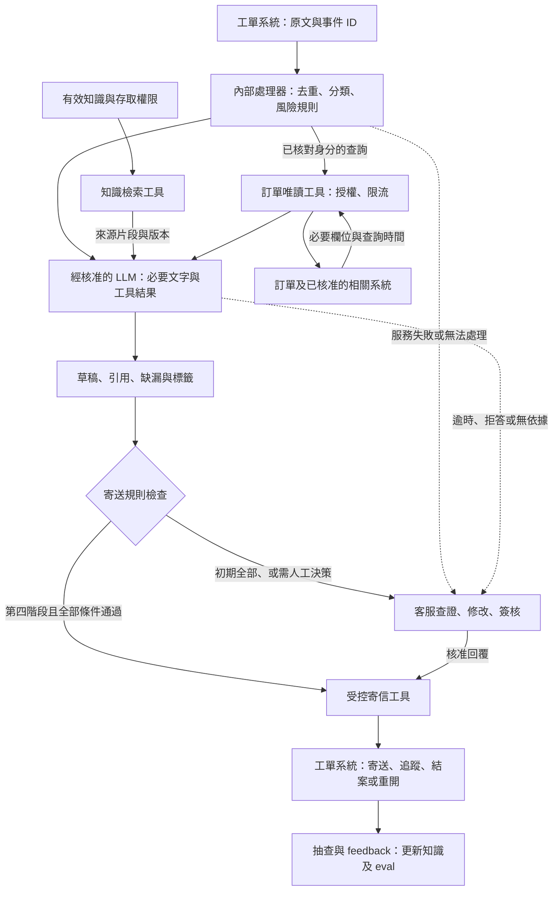

# Senior Field Deployment Engineer 面試前作業

## 情境與範圍

- 每日約 350 件工單，旺季約 700 件；8 位客服處理，首次回覆平均 6 小時，旺季超過 24 小時。
- 需求約為訂單 40%、產品 30%、退改 20%，其餘為投訴及其他問題。
- 主要限制：知識版本混亂、訂單 API 權限與低 QPS、跨系統查詢，以及尚無經評估與簽約的 LLM 供應商。
- 以下為落地方案；PoC 只實作離線分流，RAG 與草稿作為有限範圍的展示，不操作真實訂單或寄信。

## Q1. 場景判斷

優先處理「找不到正確資料」與「重複閱讀、撰寫」兩個問題。先整理知識，再讓 AI 協助分類、查詢與草擬；確認品質與客服效益後，才開放低風險自動回覆。

| 構想 | 適用性 | 風險 | 前置條件 |
| --- | --- | --- | --- |
| AI 自動回覆所有工單 | 目前不適合；後續僅開放有固定依據的低風險問題 | 錯答、個資外洩、不當承諾直接影響客戶 | 清楚的允許情境、品質驗證、寄送前檢查與停用機制 |
| AI 分流與草擬，人工確認 | 作為主要方向，保留客服判斷，同時減少查找與撰寫 | 分類錯誤、草稿誤導客服，或修改比自行撰寫更慢 | 有效知識、分類與審核規則、客服回饋 |
| 內部知識庫問答 | 適合先解決查資料問題，也是草擬的基礎 | 引用舊文件、漏掉適用條件；無法取代即時訂單查詢 | 文件負責人、有效版本、引用來源與更新流程 |

推進順序為：**資料與權限準備 → 知識查詢與草稿 → 訂單唯讀查詢 → 低風險自動寄信**。評估與回饋從試用開始持續進行，各階段交付與驗收見 Q3、Q4。

訂單查詢占比高，不能長期排除，但必須先確認跨查哪些系統、身分核對方式與 API 配額。低日均量不代表不會限流，批次進件、單筆多次查詢與重試都可能碰到限制。

不需要 AI 或暫時不做的部分：

- 收件通知、欄位檢查、權限、限流與退款簽核交給規則及既有流程；退款超過 30,000 元必須由主管核准。
- 文件版本、例外退改與補償由負責人決定，AI 只整理資訊。
- 初期不自動修改訂單、送退款申請或承諾補償，也不以人力減半作為既定成果。
- 不一次重建所有文件；先整理試點需要的內容。

## Q2. 需求收斂

### 目標、非目標與驗收

| 階段 | 目標 | 驗收摘要 |
| --- | --- | --- |
| 資料準備 | 查得到可信的知識，明確知道哪些問題不能回答 | 試點文件全部有來源、版本與負責人；eval 有分類、轉人工及引用依據 |
| 客服輔助 | 草稿正確且減少修改負擔 | 草稿正確率 ≥95%；客服評分 4–5 分占比 ≥80%；實際處理時間較同類人工流程降低 ≥10% |
| 訂單整合 | 在授權範圍內查到正確訂單 | 授權測試全數通過、越權成功數為 0；查詢成功率 ≥95%，失敗可轉人工 |
| 自動寄信 | 低風險工單可獨立完成回覆 | 候選情境正確率 ≥99%；無重大事故，且可立即停止自動寄送 |

數字是試點的初始驗收設定，啟動前與客服主管確認。省時 10% 是是否值得擴大的最低效益門檻，不是對現況的推估；需先量測實際工時，不能拿「首次回覆 6 小時」當成人工處理時間。

**Out of scope：**訂單異動、退款執行、補償決策、簽證與即時價格的無依據判斷，以及全面自動回覆。真人接手仍可使用安全的摘要、來源與模板。

### 使用者與使用情境

| 使用者／情境 | 系統協助 | 人工責任 |
| --- | --- | --- |
| 客服：一般產品問題 | 找有效來源、產生草稿 | 核對條件與語氣後送出 |
| 客服：訂單、付款或票券問題 | 身分核對後唯讀查詢；未整合前提供待查清單 | 確認客戶與訂單關聯，處理異常 |
| 客服：退改、投訴、多重需求 | 標記各需求、提高 priority、摘要與有限草稿 | 決定處理方式；需簽核時交主管 |
| 客服：內容太少、附件缺失、來源衝突 | 列出缺漏，不補造資訊 | 補問或查證；收件通知不算解決 |
| 客服：模型或 API 失敗 | 保留工單、標記原因、轉原流程 | 自行查詢與回覆 |
| 主管 | 看事故、品質與客服評分 | 簽核、決定試點範圍與功能恢復 |
| 知識／系統負責人 | 取得錯答、過期來源與服務異常紀錄 | 更新文件、修復服務與處理權限 |

### 輸入與輸出

| 能力 | 輸入 | 輸出 |
| --- | --- | --- |
| 工單分類 | ticket_id、created_at、channel、subject、body；姓名只在確有需要時使用 | category、priority、route、reason；多重需求保留標籤 |
| RAG 與草擬 | 問題、有效文件、回覆模板及 instruction | 草稿、引用來源／版本、缺漏資訊 |
| 訂單查詢 | 已核對的客戶與訂單關聯、允許查詢的欄位 | 必要訂單資訊、查詢時間或錯誤原因 |
| 寄信與回饋 | 已核准草稿，或符合自動寄信條件的回覆 | 寄送狀態、審核紀錄、客服評分與修改原因 |

- **category：**訂單、產品、退改、投訴、帳號、其他、unknown。發票歸訂單；招募、供應商、合作與垃圾信歸其他並標記用途。多重需求以風險最高的需求為主類別，其他保留為標籤。
- **priority：**urgent＝旅途中需立即協助、24 小時內出發／使用票券、疑似帳號入侵；high＝付款爭議、重大投訴、高額退改；其餘 normal。相對日期以工單建立時間判斷，無法確認時提示客服核對。
- **route：**auto＝可自動草擬；human＝需人工查證或決策，可附摘要或補問模板。是否自動寄信另外檢查，不能只憑 route。

### 開工前置條件

- **離線 PoC：**確認樣本是虛構資料；知識若未提供，使用明確標示的示範文件，不宣稱是真實公司規定。
- **真實工單試點：**資料流及部署方式經法務／資安核准；外部服務須完成評估與簽約。客服完成文件確認、模板與標註，並安排審核人力。
- **訂單整合：**資訊部提供跨系統清單、API 規格、QPS 與專用服務身分；工具端驗證訂單權限。API 存取審核與退款主管簽核是不同流程。
- **自動寄信：**工單寄送權限、重送保護、停止開關、事件負責人與 rollback 流程都已驗證。

未取得訂單權限只阻擋訂單整合，不必阻擋離線 PoC。Local LLM 是部署選項，但仍需確認容量、存取、log 與資料外送情況，不能視為自動合規。

### 開工前的五個問題

| 問題 | 想排除的風險 |
| --- | --- |
| 各部門的需求、優先順序及第一階段範圍是什麼？ | 做錯重點或範圍持續增加 |
| 各項需求目前的基準、最低驗收值與驗收人是誰？ | 對「準確」「省時」的定義不同 |
| 哪些情況最不能發生？誰有權停用及處理客訴？ | 風險沒有限制，事故無人決策 |
| 知識、各系統、API 與資安的窗口是誰？能提供哪些資料及權限？ | 文件、跨系統查詢或核准流程卡住 |
| 資料整理、權限審核、開發、客服試用與 review 各排在哪個時間點？ | 只估開發時間，忽略跨部門依賴 |

## Q3. 方案與 Workflow

### 分階段實作

| 階段 | 交付 | 主要合作對象／開放條件 |
| --- | --- | --- |
| 1. 資料與權限 | 有效知識、模板、instruction、eval、資料流與權限清單 | 客服、資訊、法務／資安確認；先做離線測試 |
| 2. 客服輔助 | 分類、priority、RAG、草稿、monitor 與 feedback | 少數客服試用；所有寄信需人工確認 |
| 3. 訂單與寄信整合 | 訂單唯讀工具、限流與人工核准寄送 | 資訊部開權限；身分、配額與重送測試通過 |
| 4. 低風險自動寄信 | 允許情境、寄送前檢查、停用開關 | 客服主管驗收，依 Q4 小流量開放 |
| 5. 持續改善 | 抽查、事故回歸、知識與 eval 更新 | 從第二階段持續執行，不等待第四階段結束 |

### 任務流與資料流

**分工：**AI 理解與草擬；RAG 提供可追溯的知識；規則控制權限、風險與寄送；人工查證與決策。知識與訂單工具可透過 MCP 提供，先分清權限，不要求 PoC 部署兩個 server。模型不持有可任意寄信、修改訂單或退款的憑證。

### 接手與降級規則

- 退改、補償、投訴、帳號安全、即時價格／政策、資料缺漏、來源衝突、查詢無權限或失敗 → human；可保留安全摘要，但不能產生無依據承諾。
- 自動寄信須同時滿足：已開放情境、normal priority、沒有高風險標籤、有效來源充分、沒有缺漏、工單未被人工接手且尚未回覆。任一項不符即轉人工。
- LLM／工具失敗 → 記錄原因並進人工佇列；初期每次逾時 30 秒、最多重試一次，避免工單卡住。
- 訂單 API 配額由資訊部確認；初期併發為 1，按核准 QPS 排隊，429 依服務回覆等待，重試失敗就轉人工。不能以每日量低推定可忽略限流。
- 同一 webhook 重送，以事件／訊息 ID 辨識已處理事件。寄送另用工單訊息版本與核准回覆 ID 防重複；客戶後續補充仍是新事件。

### 個資、權限與 log

- 原文留在核准環境；只傳必要文字與欄位。知識檢索先依權限過濾，訂單工具再次驗證客戶與訂單關聯；不能只相信 prompt 中的指令。
- 外部生成、embedding、judge 與監控服務都納入資料流審核；遮罩是減少暴露，不等於免除核准。
- 用 ticket_id 串起事件、分類、來源版本、模型／prompt 版本、工具結果狀態、草稿修改、核准人、寄送與結案時間。一般 log 不存完整個資；內容留在受限工單紀錄，保存期限與存取人由資安確認。

## Q4. 指標與上線 Gate

### 監控與初始值

試點先用工單紀錄與應用 log 做每日報表。資訊部處理系統告警，客服主管每日看品質與事故，每週決定是否擴大。離線 eval 用人工標註；上線抽樣覆核，LLM-as-judge 只協助找問題。

| 重要性／指標 | 分子／分母與來源 | 初始目標／處置 |
| --- | --- | --- |
| 安全：重大錯誤 | 個資外洩、越權、錯誤交易承諾、重複寄信件數；來自 log 與事故紀錄 | 0 件；一件即停止相關能力並通報 |
| 防護：AI 相關客訴率 | 已確認與 AI 回覆有關的客訴工單數／同批 AI 輔助或自動回覆工單數；各單寄出後觀察 7 天，每單只計一次 | 自動寄信試點 0 件；疑似事件先停相關自動寄送，確認後決定擴大停用範圍 |
| 品質：分類正確率 | 主類別與風險標籤皆符合人工標註的件數／受評件數；eval 與抽查 | ≥90%；另要求高風險測試不得誤放 auto |
| 品質：生成錯誤率 | 有事實、漏答、引用不符或不當語氣的草稿數／受評草稿數；同單多錯只計一次，另列錯誤類型 | 草稿 ≤5%，自動回覆 ≤1%；重大錯誤另外計數，不能被平均掩蓋 |
| 成效：任務成功率 | 收件後 7 天內由主管覆核確實解決的件數／同批已滿 7 天觀察期的受評進件數；未解決也進分母 | 試點一般詢問 ≥95%；已知需長期處理的案件分開看，不中途排除失敗單 |
| 成效：人工接手率 | route=human 或後續因異常轉人工的工單數／進入試點的工單數；每單只計一次，取自狀態紀錄 | 先建基準，不以越低越好；正常確認草稿不算異常接手 |
| 成效：客服草稿評分 | 4–5 分件數／有評分草稿數，另列評分覆蓋率；取自審核畫面 | 試點逐筆評分，4–5 分 ≥80%；低分勾選原因 |
| 時間：人工處理／首次回覆 | 已完成工單的處理分鐘總和／完成數；有效首次回覆等待分鐘總和／已回覆數；工時與工單時間戳 | 人工處理時間下降 ≥10%；首次回覆不劣於同期同類人工組，另列未回覆件數及等待時間 |
| 系統：error rate／查詢成功率 | 重試後仍失敗的工具或模型操作數／操作總數；成功訂單查詢數／合法有效訂單查詢數；來自 log | 系統失敗 ≤1%，訂單查詢成功 ≥95%；同時列受影響工單數 |

客服評分：5＝可直接使用、4＝小幅修改、3＝需補充、2＝大幅重寫、1＝不可用。高分不等於事實正確，仍需抽查。email 不追求秒回，但也不刻意延遲；生成時間與客戶等待時間分開量測。

### 晉級、停止與樣本

| 階段 | 往前走的條件 | 停止／回退 |
| --- | --- | --- |
| PoC → 客服試點 | 原 48 筆逐筆輸出；另補至少 12 筆人工確認的邊界案例。開發與保留測試分開，分類 ≥90%、高風險誤放 auto 為 0；有答案測試的草稿正確率 ≥95%，無依據不得編答。資料與權限已核准 | 未達標留在離線，不接正式自動寄送 |
| 客服試點 → 擴大人工輔助 | 至少 2 週、100 筆完成的適用工單且追蹤成熟；逐筆覆核，品質、任務成功、評分及省時達上表門檻；無重大錯誤 | 每批 50 筆錯誤率 >5% 或評分 4–5 分 <80%，停止擴量，主管決定停哪類草稿 |
| 訂單工具 → 客服使用 | 越權、錯誤綁定、限流及失敗回退測試全部通過；合法查詢成功率 ≥95% | 越權即停工具；連續 3 次失敗先切人工查詢並告警 |
| 低風險自動寄信 | 同類候選回覆至少 100 筆經人工覆核，正確率 ≥99%、無重大錯誤；寄送防重複與停用測試通過。先開候選量的 10%，每日全查；至少 2 週、100 筆且滿寄出後 7 天觀察，維持品質與客訴門檻才擴量 | 任何 AI 相關客訴先停該情境自動寄送；最近 100 筆錯誤率 >1% 退回人工確認；重大事件不等樣本累積 |

以產品詢問 30%、其中 10% 試點估算，350 × 30% × 10% 約每天 10.5 件；真正適用案件可能更少，因此同時看期間與樣本數，不到就延長。人工基準取同期同類工單；抽查量與客服主管先排定。這些門檻用於有限試營運，不代表已證明罕見風險不存在。

## Q5. 情境追問

**調整方案，暫停擴量。**首次回覆變快值得保留，但三起錯誤已穿過人工審核，不能只看 45% 自動處理率。先確認這個比例指草稿還是自動寄信，再依事故範圍與客服負擔決定保留哪些功能。

1. **止損與分階段 rollback。**若有自動寄信，先停受影響情境，改由人工確認。草稿若仍有幫助且可查核，由主管決定加強審核後保留；若持續誤導客服或需要重寫，停該類草稿，只留可信來源與摘要。若涉及個資、越權或來源全面失效，停受影響工具，回到原人工流程；範圍無法確認時擴大停用。同時更正三起回覆並處理客訴。
2. **定位事故，修正知識與流程。**還原來源、草稿、人工修改及最終回覆，排查同版本其他案件，確認是資料、生成還是審核問題。把事故與相似案例加入回歸測試，讓客服共同確認修正，不能只要求客服更小心。
3. **用結果恢復信任，再恢復功能。**先離線測試，再由少數客服逐筆查核；品質、評分與實際工時達標後擴大人工輔助。自動寄信另過較高 Gate，不能因效率回升就直接恢復。每週公開改善與失敗案例，保留客服認為有用的能力。

## AI 使用說明

使用 AI 協助整理題目與 review、潤飾用語、草擬流程及比較 PoC 方案。驗收數字是設計設定，尚非實測結果；API 選型及 PoC 實作將另行驗證。
