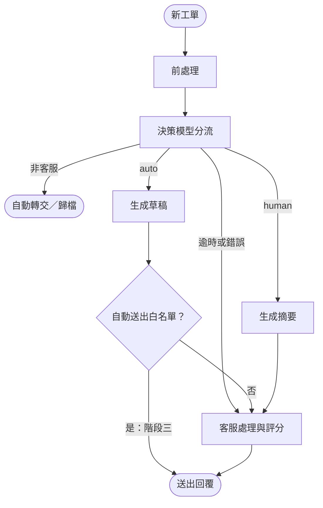

# T 旅遊 AI 客服導入方案

## 情境摘要

- 業務：email 與網站表單的文字客服工單，平日約 350 件／天，旺季約 700 件／天；8 位客服，平均首次回覆 6 小時，旺季超過 24 小時。
- 進件比例（客服主管口述）：訂單約 40%、產品約 30%、退改約 20%，其餘為投訴與雜項。
- 限制條件：
  - 客戶個資不得傳到未經評估與簽約的外部服務；目前沒有簽約的 LLM 供應商。
  - 訂單 API 需申請權限，QPS 很低。
  - 知識文件分散在 Word、Excel 與舊 FAQ，版本混亂。
  - 退款金額超過 30,000 元須主管簽核。

## Q1. 場景判斷

```
Q: 請評估三個構想各自的適用性、風險與前置條件，並明確指出：這個情境裡有哪些子問題其實不該用 AI 解（或不該現在解），你建議的推進順序與理由。
```

### 判斷依據：樣本觀察

48 筆樣本中，除了一般詢問，還有三類進件：
- 非客服雜訊：博弈廣告、B2B 報價、履歷、業配、媒體採訪。
- 高時效急件：明日出發遇颱風、票券未收到、旅途中飯店異常。
- 久候衍生的重複催單與客訴升級。

因此系統的價值不只在生成文字，更在於「分流＋急件置頂＋預先查好資料」。

### 三個構想的評估

| 構想 | 適用性 | 主要風險 | 前置條件 |
| --- | --- | --- | --- |
| A：AI 自動回覆所有工單 | 目前不適合；之後只對少數答案固定的低風險細項開放 | 錯答或不當承諾直接送到客戶手上，無人攔截 | 明確的開放範圍、經驗證的品質數據、一鍵停用機制 |
| B：AI 分流＋草擬，客服確認後送出 | **主要推進方向**；同時解決佇列排序與查找、撰寫工時 | 分流錯誤；客服未細看就送出錯誤草稿 | 類別與分流規則、有效知識源、訂單唯讀 API、審核介面 |
| C：內部知識庫問答工具 | 適合先驗證知識檢索品質；單獨做無法解決分流與急件積壓 | 引用舊版文件、漏掉適用條件 | 確認有效版本、維護負責人 |

**共同的合規前提與 concern**：
- 三者都需要先有法務核准的 LLM 供應商或部署環境，才能接觸真實工單。內部使用或有人工確認，都不構成例外。
- 樣本中有客戶在信件內文自行貼上身分證字號與銀行帳號。本方案**假設決策模型與生成式 LLM 都在內網地端部署**，工單內容不出內網，因此 B 階段不做個資遮罩。
- 開工前須請法務確認地端部署是否足以滿足個資要求。若最後只能使用外部模型服務，就需要另立個資遮罩專案（送出前遮罩、審核前還原），上線時程會延後。

### 不該用 AI 解（或不該現在解）的子問題

- **交給確定性規則與固定模板**：
  - 垃圾信與測試單分類後直接歸檔，不生成回覆。
  - 細項已在 auto 白名單、但缺少查詢所需的訂單號等資料時，套用固定補件模板；看不出訴求的工單（`other/unclear`）一律轉人工。
  - 訂單 API 的排隊與限流。
  - 訂單金額 > 30,000 元的退改或求償，一律轉人工（用訂單資料判斷的確定性規則，不讓 AI 判斷）。
- **交給真人與既有流程**：
  - 知識版本衝突的裁決。
  - 退款、改單、通融與賠償決策，包含 > 30,000 元主管簽核，都維持在既有系統處理，不納入本系統。
  - LLM 供應商的資安評估。
- **現在不做**：
  - 全面自動回信，以及 AI 直接寫入訂單或呼叫退款 API。
  - 個資遮罩系統（本階段假設地端部署；只有改用外部模型服務時才需要，見上方 concern）。
  - 一次清洗所有歷史文件（只先整理高頻問題）。

### 推進順序與理由

**B 是目標方向，C 是 B 的知識檢索元件**：C 以小範圍內部工具先行驗證，不作為獨立產品。Q2 以 B 為對象撰寫。

`準備期 → 階段一：C 驗證檢索 → 階段二：B 上線 → 階段三：限縮開放 A`

1. **準備期**：
   - 資深客服裁決高頻問題的有效知識版本。
   - 向資訊部盤點訂單、會員、發票等系統的 API 範圍與時程。
   - 建立離線評估集。
   - 法務核准前，只用虛構樣本與 mock 開發。
2. **階段一（C）**：給少數客服試用知識問答，答案必須附來源與版本，沒有依據時拒答。檢索品質達標後進入 B。此工具保留下來，供 B 階段真人處理工單時主動查詢。
3. **階段二（B）**：
   - 全部進件先分流，依急迫度、影響程度排序。
   - 標準詢問由 AI 草擬回覆；缺少訂單號等查詢資料的工單套用固定補件模板。
   - 高風險或高影響的工單轉人工。
   - 所有對外回覆都經客服確認後送出。
4. **階段三（A）**：B 穩定且證實省時後，先針對固定補件信，以及答案固定、無承諾風險的細項，以小流量開放自動回信。

---

## Q2. 需求收斂

```
Q: 選定你在 Q1 建議優先的方向，寫一份可以拿去跟利害關係人對齊的問題定義書，至少包含：
- 目標與非目標（明確的 out of scope）
- 使用者與使用情境
- 輸入／輸出定義
- 資料與系統的前置條件（哪些事沒到位就不該開工）
- 可量化的驗收標準
- 開工前必問利害關係人的 5 個關鍵問題，每題附上「這題想排除的風險是什麼」
```

> **文件定位**：方案 B（AI 分流＋草擬，客服確認後送出）的開工前對齊草案。

### 1. 目標與非目標

| 項目 | 內容 |
| --- | --- |
| 目標 | 1. **分流與急件置頂**：過濾非客服雜訊，依急迫度、影響程度排序佇列，高風險工單轉人工。<br>2. **縮短處理工時**：標準詢問產出附來源的回覆草稿；轉人工的工單附上摘要與建議處理方式。 |
| 非目標（Out of Scope） | 1. B 階段不自動對客發信，所有回覆都經客服確認。<br>2. 不寫入任何系統：不改單、不呼叫退款 API、不處理簽核；真人沿用既有系統處理。<br>3. 不建置個資遮罩系統（本階段假設模型地端部署）。<br>4. 不接管工單系統既有職責：狀態管理、合併工單、多封信歸戶。本系統只讀取「同一客戶是否有未結案件」作為分流訊號。<br>5. 不承諾人力減半；不一次整理所有歷史文檔。 |

### 2. 使用者與使用情境

| 使用者 | 情境 | 系統提供 |
| --- | --- | --- |
| 一線客服 | 處理 `route = auto` 工單 | AI 草稿（附引用來源）或固定補件模板。客服確認或修改後送出，並為草稿評分（1–5 分）；2 分（含）以下改為人工撰寫 |
| 一線客服 | 處理 `route = human` 工單 | 工單上附 AI 摘要與建議處理方式，客服為摘要評分（1–5 分）。客服在既有系統查單、退改、走簽核並撰寫回覆，需要時使用知識庫查詢助手 |
| 資深客服 | 知識維護與品質抽查 | 維護有效知識版本、標註評估集、抽查草稿 |
| 客服主管 | 監控與控管 | 看監控指標，透過審核 Config 開關個別細項的草擬或自動回信 |

### 3. 輸入／輸出定義

- **輸入**：
  - 工單欄位：`ticket_id`, `created_at`, `channel`, `customer_name`, `subject`, `body`。
  - 有效知識庫與模板。
  - 訂單唯讀資料。
- **輸出**：
  - 分流欄位：`category`、`sub_category`、`route`、`urgency`、`impact`、`reason`（分類信心；轉人工時註明原因）。
  - `route = auto`：有兩種處理方式。草擬：系統產出 AI 草稿或固定模板，客服確認後送出。自動轉交或歸檔：非客服信件自動轉給對應部門或直接歸檔，客服不需處理。
  - `route = human`：系統只提供內部摘要與建議，由真人處理並自行撰寫回覆。
  - 佇列排序：依急迫度 → 影響程度 → 進件時間排序。不另設優先等級。
- **分類原則**：
  - **auto = AI 能決定回覆的絕大部分內容，而且不急迫**；其餘都是 `human`。需要在既有系統寫入、需要調查或查證、需要人判斷補償、需要向供應商個案確認的，都屬於 AI 無法決定內容。
  - 一張工單有多個訴求時，以風險最高的訴求決定類別。
  - 看不出訴求的工單，以及系統分類信心不足的工單，都歸到 `other/unclear`（待人工判斷）。只有「允許 auto 的細項，且急迫度、影響程度都不是 high」才是 `auto`，其餘一律 `human`；例外是 `other/irrelevant`（廣告、測試單、自動回覆）不論程度一律 `auto` 歸檔（見 Q3-4）。
  - 細項、邊界、分流條件與排序規則的完整定義見附件 [category-spec.md](category-spec.md)。

| 主類別 (`category`) | 涵蓋範圍 | 預設 `route` |
| --- | --- | --- |
| `product`（產品與規定詢問） | 行程與費用、旅遊規定（證照、簽證、天候通則）、退改規定、客製或團體需求 | 一般詢問 `auto`；客製或團體需求 `human` |
| `order_inquiry`（訂單查詢） | 訂單狀態、退款進度、文件索取、會員點數；只需唯讀查詢 | `auto` |
| `order_change`（訂單異動） | 改期、改人數、加購、取消與退費、資料或發票更正；需在既有系統寫入 | `human` |
| `system_issue`（系統異常） | 帳號登入、結帳與扣款異常 | `human` |
| `trip_incident`（旅途異常） | 已出發後需即時協助的狀況 | `human` |
| `complaint`（客訴） | 服務抱怨（無求償）；求償申訴 | 服務抱怨 `auto`（AI 草擬致歉與回答）；求償 `human` |
| `other`（非客服與無法判斷） | 供應商、合作、媒體、求職等對外往來；廣告、測試單、自動回覆；看不出訴求或系統信心不足的工單（`other/unclear`） | 對外往來自動轉交、無關信件歸檔，皆為 `auto`；`other/unclear` 為 `human` |

### 4. 資料與系統的前置條件（未到位則停在離線 PoC，不接正式工單）

- **知識與業務**：完成試點範圍的有效知識版本裁決；標註 50–100 筆歷史工單作為評估集；安排試營運審核人力。
- **系統**：工單系統 API 測試權限（讀取工單、寫入標籤與草稿）；訂單／會員唯讀 API 的範圍、查詢鍵值與 QPS 配額。
- **合規**：法務核准 LLM 供應商或部署環境，Embedding 與評估工具一併納入審核；確認可傳給模型的欄位範圍。

### 5. 可量化的驗收標準（初始值，開工前與客服主管確認；推導與公式見 Q4）

- 先抽樣量測現有單筆處理工時（AHT）作為基準。首次回覆 6 小時是等待時間，不能直接當成處理工時。
- **AI 輸出評分（1–5 分）**：送出者評分衡量草稿是否好用；送出者以外的資深客服每日獨立抽查，作為生成錯誤與流出的判定依據（定義見 Q4 開頭的評分說明）。
- **離線 PoC**：
  - 分流錯誤率 ≤ 10%；高風險誤放行（False Auto）= 0 件。
  - 資深客服離線評分：AI 輸出平均 ≥ 4.0 分，1 分（含錯誤）≤ 5%。
- **試營運**（至少 2 週，累積至少 100 筆適用工單）：
  - 任務成功率 ≥ 80%；AI 輸出平均 ≥ 4.0 分；生成錯誤率 ≤ 5%；系統錯誤率 ≤ 1%。
  - 首次回覆時間中位數 ≤ 2 小時；AHT 較同類人工基準下降 ≥ 15%。
  - 自動客服工單客訴率不高於同類人工回覆；錯誤回覆流出 = 0 件。

### 6. 開工前必問利害關係人的 5 個關鍵問題

| 問題（對象） | 想排除的風險 |
| --- | --- |
| 1. （管理層／客服主管）B 階段的成功標準是縮短等待與處理工時，還是硬性要求人力減半？由誰驗收？ | 期望落差：主管期待全自動與立即減人，專案即使有成效仍被判失敗 |
| 2. （資訊部）「跨兩三個系統查」具體是哪些系統？各自能否開唯讀 API、用什麼鍵值查詢、QPS 上限與審核時程？ | 範圍誤判：設計依賴拿不到的資料，草擬只能停在半成品 |
| 3. （客服主管）現在有沒有單筆處理工時與首次回覆時間的基準數據、歷史工單分類紀錄？ | 無法驗收：沒有基準，「工時下降 15%」無從比較 |
| 4. （資深客服）Word、Excel 與舊 FAQ 衝突時由誰裁決？能否先鎖定高頻問題，並約定改版時的更新流程？ | 引用過期規定導致錯答；或為了清洗全部文件而無限延宕 |
| 5. （法務／資安）地端部署模型是否足以滿足個資要求？若只能用外部服務（企業零留存合約），需時多久、是否要求先遮罩個資？ | 合規卡關：PoC 做完才發現無法接真實工單；若改用外部服務且要求遮罩，需另立專案，時程延後 |

---

## Q3. 端到端 Workflow 設計

```
Q: 針對你選定的方向，交付一張設計圖＋必要的文字說明，需涵蓋：
- 任務流與資料流（從工單進來到結案）
- AI、規則、RAG／知識庫、人工四者的分工邊界
- 人工接手的觸發條件（請列出具體規則，不要只寫「低信心時轉人工」）
- 錯誤處理與降級策略（LLM 服務掛掉／回答品質異常時系統怎麼辦）
- 個資與權限邊界（呼應法務的限制條件）
- Log 與追蹤點（為了之後能監控與除錯，你會在哪些位置記什麼）
```

### 1. 設計原則

- **條件規則管分流，確定性規則管結構化資料**：決策模型只回答選擇題，`route` 由設定檔的條件規則決定，佇列依急迫度與影響程度排序。金額門檻、出發日、未結案件等確定性規則作用在訂單與工單系統的結構化資料上，不對信件文字做關鍵字比對；規則判定轉人工時，AI 不得覆蓋。
- **AI 只讀不寫**：AI 只做分流、草稿與摘要，沒有寄信、改單或退款權限。真人沿用既有系統處理。
- **分流與生成用不同模型**：分流是有限選項的選擇題，用決策模型（如 Jev／Clef／Kev）。決策模型給定選項後一次計算就輸出各選項的機率與信心度，不生成文字，因此比讓 LLM 直接分類更快、更省，也不會有格式錯誤或自創類別。每張工單問 3 題：細項分類、急迫度、影響程度。草稿與摘要才用生成式 LLM。Clef（GGUF 透過 `llama.cpp` 部署）與 Kev 可於內網自架；生成式 LLM 也採地端部署，對應 Q2 第 5 題的「地端模型」路徑。
- **失敗時回人工**：LLM 異常、檢索無依據或 API 失敗時，一律跳過生成，轉給真人處理；不阻塞收件，也不編造答案。

### 2. 任務流與資料流



**各區塊說明**

| 區塊 | 做什麼 | 資料與元件 |
| --- | --- | --- |
| 前處理 | 整理欄位、移除 HTML 標籤 | 工單系統 webhook |
| 決策模型分流 | 決策模型回答 3 題（細項、急迫度、影響程度），條件規則決定 `route` 與佇列順序；分類信心不足歸 `other/unclear` 轉人工 | 地端決策模型、`routing.toml` 白名單 |
| 自動轉交／歸檔 | 供應商、媒體、求職信轉給對應部門；廣告、測試單直接歸檔 | 部門信箱對照表 |
| 生成草稿 | 依知識庫與訂單資料產生附來源的草稿；缺少訂單號等查詢資料時改用固定補件模板；檢索無依據或 API 失敗時改為轉人工 | 地端生成式 LLM、RAG 知識庫、訂單唯讀 API |
| 生成摘要 | 為轉人工的工單整理訴求、訂單狀態與相關條文 | 同上 |
| 自動送出白名單 | 客服主管在審核 Config 指定可免審核送出的細項。B 階段白名單為空，所有草稿都經客服確認；階段三才依 Q4 的條件逐項開放 | 審核 Config |
| 客服處理與評分 | auto：確認或修改草稿後送出；human：依摘要在既有系統處理並回覆。兩者都為 AI 輸出評 1–5 分 | 工單系統、既有訂單與退款系統 |
| 送出回覆 | 由工單系統送出；客戶後續回信視為新進件 | 工單系統 |

**服務範圍**：以「單次服務」為單位，從進件到送出一次回覆。工單狀態、多封信歸戶與結案都由工單系統管理，不在本系統範圍。

**考慮過、本階段先不做的區塊**

| 區塊 | 為什麼先不做 | 之後插入的位置 |
| --- | --- | --- |
| RAG 知識庫（正式版） | 知識文件版本混亂，要先完成有效版本的裁決（Q2 前置條件） | 先以階段一的查詢助手（C）驗證檢索品質，通過後接到「生成草稿」與「生成摘要」，同時作為客服的查詢工具 |
| 結構化確定性規則 | 需要訂單、工單系統的 API 權限 | 「決策模型分流」之後、`route` 確定之前：訂單金額 > 30,000 元、72 小時內出發、有未結案件，一律轉人工（§4） |
| 個資遮罩 | 本階段假設模型地端部署，資料不出內網 | 若改用外部模型：插在「生成草稿／摘要」之前遮罩，「客服處理」之前還原（§6） |
| 草稿自動檢查 | 檢查規則需要用真實草稿實測 | 「生成草稿」與「自動送出白名單」之間：核對引用來源與版本、比對日期與金額，不符就轉人工 |
| 低信心二次分類 | 可能把「真的看不懂」的工單逼出確定答案，造成 False Auto | 分類信心不足、歸 `other/unclear` 之前：只用前 3 名重新分類，並用真實資料驗證 |

### 3. 四者分工邊界

| 角色 | 負責 | 不負責 |
| --- | --- | --- |
| 規則與設定檔 | 前處理（欄位整理、移除 HTML 標籤）；依條件規則把模型輸出轉成 `route`，並依急迫度、影響程度排序佇列；結構化資料規則（訂單金額、出發日、未結案件，見第 4 節）；API 限流；審核 Config | 語意理解；對信件文字做關鍵字判斷；工單狀態與合併 |
| RAG／知識庫 | 提供已簽核的有效知識片段與版本號；透過唯讀 API 查訂單與會員狀態；作為客服的查詢工具 | 收錄未審核的舊文件；任何寫入操作 |
| AI | 決策模型：分 3 次選擇題輸出細項分類、急迫度、影響程度的各選項機率與信心值；地端生成式 LLM：auto 工單生成草稿、human 工單生成摘要與建議 | 決定 `route` 與佇列順序（由條件規則與排序規則決定）；決定退款金額、承諾賠償、寄信或改單；資料不足時猜測答案 |
| 人工 | 確認或修改草稿，並為 AI 輸出評分；在既有系統處理 human 工單（含退改與簽核）；維護知識；調整審核 Config | 手動過濾垃圾信、重打補件信、從零翻找文件 |

### 4. 人工接手的觸發條件（v1，上線前依評估結果調整）

| 類型 | 條件 | 情境範例 |
| --- | --- | --- |
| 條件規則（模型輸出 → 設定檔） | 只有同時符合以下三項才是 `auto`，其餘一律 `human`：<br>1. 細項在 auto 白名單內（AI 能決定回覆內容的 10 個細項）；需寫入既有系統、需調查、需人判斷補償、需個案確認的細項都不在白名單<br>2. 急迫度不是 high<br>3. 影響程度不是 high<br>例外：`other/irrelevant`（廣告、測試單、自動回覆）不論程度一律 `auto` 歸檔<br>另外，分類信心 < 0.5 時歸到 `other/unclear`（待人工判斷） | 申請改期、旅途中住宿異常、揚言向消保官申訴、出發前一天遇颱風 |
| 確定性規則（結構化資料，模型不可覆寫） | 4. 訂單金額 > 30,000 元的退改或求償：`human`，影響程度視為 high（退改本就由真人處理，此規則用於排序，並作為誤分類的安全網）<br>5. 訂單出發日或使用日在 72 小時內：`human`，急迫度視為 high<br>6. 工單系統顯示同一客戶有未結案件又再次來信：`human` | 高額傷病取消退費、二次催問扣款問題 |
| 檢索與 API 訊號（草擬階段） | 7. 知識庫無命中、版本衝突，或外部法規無明確依據<br>8. 訂單 API 查無資料、寄件人與訂單不符，或 API 逾時 | 詢問最新簽證規定，但知識庫沒有有效版本 |

**為什麼用條件規則**：每張工單為什麼是 `auto` 或 `human` 都能用一句話說明，客服主管可以直接讀懂、直接修改白名單，也沒有需要用樣本調整的權重。False Auto 必須為 0，在此前提下其他指標越高越好。

**為什麼確定性規則不用關鍵字**：對信件文字比對金額、日期、升級字眼很容易誤判，也容易寫成只適用樣本的規則。這些條件在訂單與工單系統裡都有結構化資料可用；PoC 沒有串接這些系統，因此由模型的急迫度與影響程度判斷代替。

**處置方式**：
- 設為 `route = human`，依急迫度、影響程度排入人工佇列。
- LLM 可用時附上 AI 摘要，再排入真人佇列。

### 5. 錯誤處理與降級策略

| 異常 | 偵測 | 降級行為 |
| --- | --- | --- |
| 模型逾時或服務中斷（決策模型或 LLM） | 逾時、HTTP 5xx、輸出格式錯誤（重試 1 次仍失敗） | 歸為 `other/unclear` 轉人工，並記錄 log（題目、錯誤類型、重試次數）；客服依原流程處理 |
| 知識庫無結果或衝突 | 無命中、分數過低、命中多個衝突版本 | 改為 `human`，`reason` 註明「查無唯一有效依據」 |
| 訂單 API 限流或失敗 | HTTP 429、逾時、連線失敗 | 排隊等待；逾時則改為 `human`，不產出缺資料的草稿 |
| 特定細項品質異常 | 監控發現該細項的 AI 輸出評分偏低或生成錯誤率超標，或規則臨時改版 | 透過審核 Config 將該細項改為 `human`，其他細項不受影響 |
| 重大事故 | 個資外洩疑慮、大面積錯答、知識庫被污染 | Kill switch：停用所有 AI 生成，全部工單回到人工佇列 |

### 6. 個資與權限邊界

- **核准前不碰真實資料**：法務核准 LLM 供應商或部署環境前（含 Embedding 與評估工具），只用虛構資料開發。
- **最小傳輸**：只把法務核准範圍內的必要欄位（主旨、內文、必要的訂單狀態）傳給核准的模型。
- **地端部署，本階段不做遮罩**：決策模型與生成式 LLM 都部署在內網，工單內容不出內網，因此 B 階段不實作個資遮罩。若日後改用外部模型服務，需先經法務核准供應商，並在送出前加入獨立的遮罩系統（生成前遮罩、審核前還原），作為上線前置條件（見 Q1 concern、Q2 第 5 題）。
- **最小權限**：
  - 系統只持有訂單與會員 API 的唯讀權限，並在程式中檢查寄件人與訂單相符才能讀取。
  - AI 模組沒有寄信、改單或退款 API 的權限。
- **Log 不存信件全文**：原文與草稿保留在有權限控管的工單系統內，應用 log 只記 ID 與結構化欄位。

### 7. Log 與追蹤點（以 `ticket_id` 串聯）

| 追蹤點 | 記錄內容 | 用途 |
| --- | --- | --- |
| 1. 前處理與結構化規則 | `ticket_id`、`received_at`、`channel`、前處理動作、命中的結構化規則（金額門檻／72 小時／未結案件） | 檢查資料品質與規則誤判 |
| 2. AI 分流與生成 | 模型與設定檔版本、`category`、`route`、`reason_code`（判斷原因代碼，例如 `not_in_whitelist`、`urgency_high`、`low_confidence`）、3 題的機率與信心分數、知識庫命中文件 ID 與版本、API 狀態碼與耗時 | 分流錯誤率；依 `reason_code` 統計各轉人工原因的占比，找出接手率上升的來源；判斷錯誤來自舊文件、無依據生成，還是 API 失敗 |
| 3. 客服處置與評分 | 審核 Config 版本、AI 草稿或摘要的評分（1–5）、是否改為人工撰寫、human 工單是否使用查詢助手 | 任務成功率、人工接手率、生成錯誤率、AI 輸出平均分 |
| 4. 送出 | 送出時間、送出內容是否為 AI 草稿（原樣／修改後）、客服從開啟到送出的耗時 | AHT；事後抽查流出錯誤時的追溯依據 |
| 5. 客訴回溯 | 客戶後續來信或客訴所對應的前一次回覆 `ticket_id`，以及該回覆是否為 AI 草稿 | 自動客服工單客訴率；錯誤回覆流出數 |

---

## Q4. 指標與上線 Gate

```
Q:
- 定義試營運期間的監控指標，至少含任務成功率、人工接手率、錯誤率、處理時間；指標請寫清楚分子／分母怎麼算、資料從哪裡來。
- 至少一個防護型指標（例如客訴率），說明它防的是什麼。
- 定義 PoC → 試營運 → 正式上線的晉級條件與退場條件（什麼數字達標才往前走、什麼狀況要喊停）。
```

本節的 Gate 都針對方案 B；Q1 的階段一（C）併入離線 PoC 一起驗證。

**衡量範圍與資料來源**：
- 以「單次服務」為單位：一張工單從進件，到本系統完成分流並送出一次回覆。
- 資料來自本系統的 log 與審核介面紀錄（Q3-7）、客服的 AI 輸出評分，以及工單系統的客訴紀錄。

**AI 輸出評分（1–5 分）**：同一套分數，有兩個來源，用途不同：
- **送出者評分**：客服處理每張工單時，為 AI 產出的草稿（`auto`）或摘要（`human`）評分，只多一個動作。用來計算任務成功率、人工接手率與平均分，回答「草稿好不好用」。送出者已經看過並同意了草稿，抓不到自己漏看的錯，所以**不當作品質防線**。
- **獨立抽查評分**：由送出者以外的資深客服，每日抽查已送出的 AI 草稿（初始比例 10%；含日期、金額或退改規定的細項 30%，約 20–30 件／天）。生成錯誤率與錯誤回覆流出數以這份評分為準。兩份評分落差大，代表送出者在漏看或過度信任草稿。

| 分數 | 定義 |
| :---: | --- |
| 5 | 直接可用，未修改 |
| 4 | 小幅修改：措辭或補一句話 |
| 3 | 中度修改：補資訊或調整重點，主體仍可用 |
| 2 | 大幅改寫：主體不可用，但沒有錯誤資訊 |
| 1 | 含錯誤：事實錯誤、引用過期規定、無依據承諾，或因分流錯誤而不適用 |

### 1. 試營運監控指標

| 指標 | 分子／分母 | 資料來源 |
| --- | --- | --- |
| 任務成功率 | 分子：分流為 `auto` 且屬草擬類型，草稿評分 ≥ 4 分並送出的工單數<br>分母：分流為 `auto` 且屬草擬類型的工單數（不含自動轉交、歸檔的非客服信件，因為它們不產生草稿）<br>`human` 工單的表現由分流錯誤率與摘要評分衡量，不計入成功率，避免「轉人工」本身被算成成功 | 分流 log、評分紀錄 |
| 人工接手率（依類別分開看） | 分子：分流為 `human` 的工單數 ＋ 分流為 `auto` 但草稿評分 ≤ 2 分、改由客服自行撰寫的工單數<br>分母：試點工單總數<br>兩部分分開呈現：前者是設計內的轉人工，後者代表草稿不被信任，是 Q5 情境的早期訊號 | 分流 log、評分紀錄 |
| AI 輸出平均分 | 草稿與摘要分開計算：評分總和 ÷ 已評分件數 | 評分紀錄 |
| 分流錯誤率 | 分子：`category` 或 `route` 與人工標註不一致的工單數；另外單獨計算高風險誤放行（False Auto：應為 `human` 卻判為 `auto`）的件數<br>分母：受評工單總數 | 評估集、線上抽查標註 |
| 生成錯誤率 | 分子：獨立抽查評分為 1 分的 AI 草稿數<br>分母：獨立抽查的 AI 草稿數<br>送出者評分為 1 分的比例另列，與抽查結果對照；`human` 工單摘要的品質以送出者評分觀察 | 獨立抽查紀錄 |
| 系統錯誤率 | 分子：因模型逾時、輸出格式錯誤或檢索失敗而觸發降級的工單數<br>分母：試點工單總數 | 分流與生成 log |
| 處理時間 | 系統處理時間：進件到分流與草稿（或摘要）就緒的秒數，看 P50 與 P90<br>AHT：客服從開啟工單到送出的作業分鐘數總和 ÷ 已送出工單數；與同類純人工工單的抽樣基準比較 | 系統 log、審核介面時間戳 |
| 首次回覆時間（FRT） | 每張工單從進件到第一次回覆送出的時間，取中位數；依 `route` 分開看<br>這是客戶實際感受到的等待時間，也是導入的主要目標（現況約 6 小時） | 工單系統的進件與回覆時間戳 |
| 防護 1：自動客服工單客訴率 | 分子：送出 AI 草稿的工單中，客戶在 7 天內針對該回覆表達不滿或提出客訴的件數<br>分母：送出 AI 草稿的工單數<br>對照組：同期、同類別、純人工回覆工單的客訴率 | 工單系統客訴紀錄、客訴回溯（Q3-7） |
| 防護 2：錯誤回覆流出數 | 已送出、經獨立抽查或客訴確認含實質錯誤的 AI 草稿**件數**（不取比例） | 每日獨立抽查、客訴回溯 |

**防護型指標防什麼**：
- **自動客服工單客訴率**：防止為了速度犧牲回覆品質。評分是客服的內部視角，可能因為疲勞或過度信任而漏看；客訴率是客戶視角，能抓到客服沒發現的問題。與同類人工回覆比較，排除旺季、天災等外部因素。
- **錯誤回覆流出數**：防止錯誤內容送到客戶手上。量大時少數嚴重錯答會被百分比稀釋，所以用絕對件數設紅線。
- 首次回覆時間衡量客戶等多久，AHT 衡量客服花多少力氣，兩者分開看：分流與排序主要縮短前者，草稿好不好用則影響後者。

### 2. 門檻初始值的粗估

工單量以平日 350 件／天計，約每週 2,450 件；旺季加倍。以下為粗估，用來決定初始值，上線前依實測基準調整：

| 指標 | 初始值 | 粗估依據 |
| --- | --- | --- |
| 高風險誤放行 | 0 件 | 錯放行會產生對客的錯誤承諾或金額錯誤，代價無法用效率抵銷；看不懂就保守轉 `human` |
| 分流錯誤率 | ≤ 10% | 10% 約為 35 件／天分錯。每件多花約 3 分鐘改分類，合計約 1.75 人時／天，約占 8 人產能（64 人時）的 3%，低於草擬預期省下的工時（AHT 降 15% 約為 9 人時） |
| 任務成功率 | ≥ 80% | 草擬類 `auto` 工單分流正確率約 90% × 草稿評分 ≥ 4 分的比例約 90% ≈ 81% |
| 人工接手率中「草稿 ≤ 2 分改由客服撰寫」的比例 | ≤ 15% | 與任務成功率 ≥ 80% 對應；超過代表客服開始不信任草稿（Q5 的早期訊號） |
| AI 輸出平均分 | ≥ 4.0 | 平均 4 分代表多數只需小幅修改；低於 3.5 表示客服花在修改的時間接近自己寫，草擬不再省工時 |
| 生成錯誤率 | ≤ 5% | auto 草稿約 175 件／天，5% 約為 9 件／天，由客服審核攔截，攔截成本可接受；未攔截的流出另以紅線控管 |
| 首次回覆時間 | 中位數 ≤ 2 小時 | 現況約 6 小時。auto 工單在幾分鐘內就有草稿，人工佇列依急迫度排序，中位數降到 2 小時內是合理目標；不分平日與旺季 |
| 自動客服工單客訴率 | 不高於人工對照組 | 目標是不讓品質變差；高於對照組 1.5 倍即視為異常 |
| 試營運樣本 | 至少 2 週、100 筆 | 1–2 位客服每人約處理 40 件／天，2 週內可累積足量適用工單；低流量細項則延長觀察 |

### 3. 晉級與退場條件

| 階段 | 晉級條件 | 退場或降級條件 |
| --- | --- | --- |
| 離線 PoC → 試營運 | 1. 完成 48 筆樣本分流輸出；建立 50–100 筆評估集，包含必須攔截的高風險題與缺資料題<br>2. 分流錯誤率 ≤ 10%、False Auto = 0<br>3. 資深客服離線評分：AI 輸出平均 ≥ 4.0 分、1 分 ≤ 5%（需另做草擬試作；PoC 程式只涵蓋分流）<br>4. 合規核准、首批知識版本簽核、工單 API 測試通過 | 任一高風險題被判為 `auto`，或合規、知識版本未到位：留在離線調整 |
| 試營運 → 正式上線（全團隊，仍需客服確認） | 1. 1–2 位客服試用至少 2 週、至少 100 筆工單<br>2. 首次回覆時間中位數 ≤ 2 小時、任務成功率 ≥ 80%、AI 輸出平均 ≥ 4.0 分、生成錯誤率 ≤ 5%、系統錯誤率 ≤ 1%、AHT 下降 ≥ 15%<br>3. 自動客服工單客訴率不高於人工對照組；錯誤回覆流出 = 0 件<br>4. 草稿 ≤ 2 分改由客服撰寫的比例 ≤ 15% | **局部降級**：單一細項每 50 筆中平均分 < 3.5、生成錯誤率 > 5%，或發生 1 件錯誤回覆流出，就關閉該細項草擬；單一細項草稿 ≤ 2 分的比例連續一週 > 30%，暫停該細項草擬並訪談客服<br>**全面暫停**：錯誤回覆流出累計 ≥ 2 件或範圍不明、自動客服工單客訴率高於對照組 1.5 倍、任何個資外洩、單日系統錯誤率 > 5%，則暫停所有 AI 草擬；保留分流、置頂、固定模板與查詢助手 |
| 正式上線 → 開放自動回信（階段三） | 先開放固定補件信；其他細項須累積 ≥ 200 筆審核紀錄、5 分（直接採用）比例 ≥ 98%、1 分 0 件，經主管核准後先開 10% 流量並每日全查 | 自動回信細項發生 1 件錯答流出，就立即退回客服確認模式 |

正式上線（全團隊）後，持續適用上列的局部降級與全面暫停條件。

---

## Q5. 情境追問

```
Q: 假設方案上線試營運四週後，數據如下：
- 自動處理率 45%，平均首次回覆時間從 6 小時降到 1.5 小時
- 但發生 3 起 AI 草擬內容錯誤、客服未攔截就送出，造成客訴
- 客服團隊開始不信任系統，幾乎全面改走人工，接手率明顯回升
請寫一份給決策者的半頁建議：續行、調整、還是暫停？以及你會立刻執行的前三個具體行動。
```

### 結論：調整。立即暫停 AI 草擬，保留分流、排序與固定模板；修正後逐類重啟，專案不終止

### 狀況分析

- **價值已經出現，但來源不是草擬。** 首次回覆從 6 小時降到 1.5 小時，主要來自分流、急件排序與固定模板，這幾項沒有錯答風險，應該保留（需用 log 比對有草稿與無草稿工單的回覆時間確認）。「自動處理率 45%」只代表產出草稿的比例，不代表草稿可用。
- **草擬的品質防線失效。** 3 起錯誤流出已超過 Q4 的全面暫停紅線（累計 ≥ 2 件）。送出者自評擋不住自己漏看的錯，獨立抽查只覆蓋部分草稿，客訴回溯又是事後彙整，所以到第 3 件才發現。
- **客服已不信任草稿，草擬實際上已停擺。** 全面改走人工，代表檢查草稿比自己寫還累，或擔心出錯要背責任，需要訪談確認。
- **因此續行與終止都不合理。** 續行會讓錯誤繼續流出，而且客服已經不用草稿；終止則會連同已證明有效的分流與排序一起丟掉。

### 立刻執行的三個行動

| 行動 | 時程與負責人 | 內容 | 完成標準 |
| --- | --- | --- | --- |
| 1. 止損 | 24 小時內；我與客服主管 | 依 Q4 全面暫停 AI 草擬；資深客服聯繫 3 位客戶更正致歉，並回溯複核同細項、引用相同知識版本的已送出草稿 | 草擬已關閉；3 位客戶已處理；回溯複核確認沒有其他流出 |
| 2. 找根因並補防線 | 1 週內；我與資深客服 | 追查 3 起事故是引用舊文件、無依據生成還是分流誤判，修正後加入評估集；含日期、金額或退改規定的細項改為全數獨立複核，客訴回溯改為每日 | 3 題回歸測試通過；全數複核與每日回溯開始運作 |
| 3. 重建信任後逐類重啟 | 2–4 週；我與客服主管 | 宣布試營運期間給低分或退回草稿不算個人疏失；修正後的細項先跑 shadow mode（只給資深客服離線評分），通過 Q4 門檻後，從客服最想要的 2–3 個細項重新開放 | 重啟細項都通過 Q4 門檻；草稿 ≤ 2 分比例與客訴率回到正常範圍 |

**需要決策者支持的事**：同意「低分不追責」原則；4 週內每週撥出資深客服約 4 小時，負責複核與 shadow mode 評分。

---

## AI 使用說明

- **答題流程**：看完題目後，先由我擬出整體大綱，再請 AI 依大綱草擬各題；接著用多個 AI（ChatGPT、Gemini、Claude）交叉修改每一題，反覆來回多輪，方向與取捨由我決定（例如選 B、把 C 降為 B 的元件、False Auto 必須為 0、Gate 的紅線）。
- **PoC 方法**：用決策模型（Clef）做分流是我的想法；我請 AI 提出其他做法比較（例如讓生成式 LLM 直接分類、傳統分類模型、關鍵字規則），比較後維持決策模型。程式由 AI 輔助撰寫；分類定義、分流規則與標準答案由我決定，並以 Clef 實跑驗證。
- **審閱**：請不同的 AI 以面試官角度分別審閱，再交叉比對它們的意見，依此修正分類描述引用樣本內容（overfitting）、分類邊界不清、關鍵字規則過硬與文件不一致等問題。
- 文中門檻與數字皆為待驗證的初始設定，PoC 的準確率只代表 48 筆樣本。
