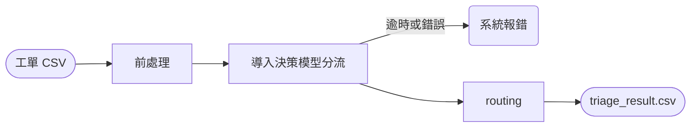

# Implement Plan（歷史紀錄）

> **接下來要做的事請看 [implement-plan-phase-2.md](implement-plan-phase-2.md)。** 本文件保留各輪的討論與紀錄。

- **第三輪（本節，待討論後執行）**：依 Clef 實跑結果與作者意見，重新審視標準答案、分流定義與流程。
- 第一、二輪已完成，紀錄在文末。第二輪當時沒有先寫計畫，已補記；第一輪中被推翻的內容在附錄中註明。

---

# 第三輪：標準答案審視、分流定義與流程修正

## 0. 作者已確定的原則

1. **False Auto 絕對禁止**：寧可多轉人工（False Human），也不能讓應由人處理的工單進 auto。
2. **先審視標準答案，再改流程**：評估差可能是標準答案本身不合理。
3. **進件時間不放進模型輸入**，並在 README 說明原因。
4. **human 的定義**：AI 無法決定回覆的絕大部分內容，或工單具急迫性，就是 human。反過來說，**auto = AI 能決定回覆的絕大部分內容，且不急迫**。標準答案若與此定義不符，應調整。
5. README 要補充：pipeline 各模組的職責、分類邏輯；answer、spec 也要對齊。
6. 流程圖只畫主要階段，不寫細節；以作者提供的版本為準（見 A3）。
7. **前處理只做真正需要的事**：整理、清洗輸入；用不到或太麻煩的先不做，README 也不寫沒用到的處理（見 A4）。

## 1. 這次 Clef 實跑的診斷摘要（作為修正依據）

| 指標 | 上一版 Clef | 這次 Clef | 主因 |
| --- | --- | --- | --- |
| 主類別／細項 | 95.8% | 95.8% | 沒變。分類信心 ≥ 0.70 的 40 筆全部正確 |
| route | 93.8% | 85.4% | ① 2 筆 False Auto：類別是 auto，急迫度也判成 high，但 route 不看程度<br>② 5 筆 False Human：分類正確但信心 < 0.70 |
| priority | 89.6% | 75.0% | 拿掉了「程度信心 < 0.70 視為 low」，11 筆低信心的急迫度 high 被採用，判成 P4 |
| 平均分類信心 | 0.84 | 0.80 | 改寫描述（加入「不含」）或加入進件時間，兩者同時上線，原因待分離 |

用同一份 Clef 輸出模擬「類別決定 route，急迫度或影響程度為 high 時強制 human，程度信心門檻 0.70」：細項 46/48、route 43/48、priority 46/48、**False Auto 0**。

---

## Phase A：討論與定案（不動檔案）

### A1. 標準答案逐筆審視

依原則 4 重新檢查 48 筆，下表是有疑問或模糊的項目。其餘 35 筆在新定義下沒有爭議。

| # | 工單 | 目前標註 | 疑問 | 選項 | 我的建議 |
| --- | --- | --- | --- | --- | --- |
| 1 | TK-1004 打電話 40 分鐘沒人接（順帶問行程表） | complaint/service_complaint · human · P2 | 回覆內容（致歉＋行程表寄送時間）AI 寫得出來，依新定義可能是 auto | a. 維持 human<br>b. 改 auto | **a**。客訴的關鍵是要不要補償、怎麼安撫，這是人的判斷，AI 決定不了。spec 補上「客訴一律 human」的理由 |
| 2 | TK-1024 電話都打不通（匿名、一句話） | complaint/service_complaint · human · P2 | 同上，而且內容極短，也可視為 `unclear` | a. 維持 complaint · human<br>b. 改 unclear · auto（補件模板） | **a**。有明確的不滿，不是資訊不足 |
| 3 | TK-1009 郵輪艙房可否指定樓層 | product/product_info · auto · P2 | 兩次 Clef 信心都偏低（0.54、0.31），會和 custom_request 混淆；能否指定通常要看郵輪公司 | a. 維持 auto<br>b. 改 custom_request · human | **a**。知識庫可以回答「是否保證指定、如何備註需求」，AI 能決定內容。模型的混淆由描述修正處理 |
| 4 | TK-1045 加購托運行李要加多少錢、出發前三天來得及嗎 | product/product_info · auto · P2 | 客戶似乎已有訂單，價格要看該筆訂單的航空公司，比較像 order_inquiry | a. product/product_info<br>b. order_inquiry（需唯讀查詢訂單） | **b**，route 仍為 auto。spec 中 product 與 order_inquiry 的界線是「需不需要訂單資料」，這筆需要 |
| 5 | TK-1040 泰國簽證最近有變，要不要辦電子簽 | product/travel_rule · auto · P2 | 客戶問的是最新變動，知識庫可能過期，AI 不一定能決定內容 | a. 維持 auto（草擬階段查無有效依據再轉 human）<br>b. 改 human | **a**。分流階段無法得知知識庫新不新；這是草擬階段的降級，不是分流錯誤。answer Q3 §4 已有規則 |
| 6 | TK-1030 網頁標價與結帳金額不同 | system_issue/checkout_error · human · P2 | 價差可能是正常的日期加價（AI 可解釋），也可能是系統錯誤 | a. 維持 human<br>b. 改 auto | **a**。是不是錯誤要查系統才知道，AI 無法決定內容 |
| 7 | TK-1016 帳號被鎖，有待付款訂單 | system_issue/account_access · human · **P2** | 你先前認為是 P3，後來又說「交易無法完成」影響不大 | P2 或 P3 | 請你決定。若選 P3，影響程度 high 的定義要加回「待付款訂單可能逾期」這類通用描述，不能只為這筆調整 |
| 8 | TK-1031 再次催問重複扣款，揚言今天就請銀行止付 | system_issue/checkout_error · human · P3 | 「今天再不回就止付」是當日期限，急迫度可能是 high，也就是 P4 | P3 或 P4 | **P3**。急迫度的定義是出發或使用時間；客戶設定的回覆期限不算急迫，算影響程度 high |
| 9 | TK-1019 飯店與網頁不符，揚言找消保官 | complaint/compensation_claim · human · P3 | 看不出客人是否還在住，若仍在旅途中應歸 trip_incident · P4 | a. compensation_claim · P3<br>b. trip_incident · P4 | **a**。內文沒有在旅途中的訊號，以客訴與申訴為主 |
| 10 | TK-1044 客服報錯價，要求退還 1,500 元 | complaint/compensation_claim · human · P3 | 金額小，P3 來自「求償類下限 P3」；是否所有求償都該 P3 | a. 維持下限 P3<br>b. 取消下限，改由影響程度決定 | **a**。求償涉及公司對外承諾，維持下限比較簡單、好解釋 |
| 11 | TK-1028 護照英文名拼錯，兩週後出發 | order_change/data_correction · human · P2 | 名字不符可能無法登機，影響程度可能是 high，也就是 P3 | P2 或 P3 | **P3**。影響程度 high 的定義補上「可能導致無法成行」 |
| 12 | TK-1033 「可以退嗎」 | unclear/insufficient_info · auto · P2 | 模型兩次都判 cancel_policy；兩者 route 都是 auto | 維持 unclear | **維持**。不知道是哪筆訂單、退什麼，回覆只能是補件模板 |
| 13 | TK-1047 記者採訪，截稿本週五 | other/business · human · P1 | 有截稿期限，排在最後是否合理 | 維持 P1 或 P2 | **維持 P1**。轉交公關即可，不佔客服佇列 |

### A2. 流程定案

依原則 1 和原則 4，建議流程如下：

1. Clef 回答 3 題：細項分類、急迫度、影響程度。
2. **route**：
   - 細項對應表決定預設 route：AI 能否決定回覆內容。
   - 急迫度 high，或影響程度 high（且該程度的信心 ≥ 0.70）→ 強制 human。程度只能把 route 往 human 升，不能反過來。
   - 分類信心 < 0.70 → 歸到「待人工判斷」，route = human。
3. **priority**：急迫度 × 影響程度對應表（程度信心 < 0.70 視為 low）→ 套用細項下限 → `other` 固定 P1。
4. **模型逾時或錯誤**：route = human、P3，並在 `run.log` 記錄發生在哪一題、錯誤類型、重試次數。

需要你決定的事：

| # | 決策 | 選項 | 我的建議 |
| --- | --- | --- | --- |
| D1 | 低信心工單歸到哪裡 | a. `other`（你原本的想法）<br>b. 新增 `unclear/low_confidence`「待人工判斷」，route = human，優先級依程度決定 | **b**。這次低信心的 8 筆裡有取消申請、團體退出，歸到 `other` 會被固定成 P1、沉到佇列最底 |
| D2 | 影響程度 high 是否也強制 human | a. 只有急迫度 high<br>b. 急迫度或影響程度 high | **b**。False Auto 絕對禁止，多一道安全網；這份樣本模擬下不會增加 False Human |
| D3 | 權重調整（急迫度、影響程度比分類重） | 先不做 | **先不做**。這次資料中，分類是最可靠的訊號，急迫度最不可靠（48 筆中有 30 筆信心 < 0.70）。若之後要加權重，建議用在 priority，不用在 route |
| D4 | 分類信心門檻 | 0.70 或 0.50 | **維持 0.70**。False Auto 絕對禁止的前提下，寧可多 5 筆 False Human |

### A3. 流程圖（作者版本，已定案）

`poc/README.md` 採用作者提供的流程圖：



只補兩處文字，不加節點：

- `Fail` 改為「系統報錯：寫 log、轉人工」。False Auto 絕對禁止，所以要明示錯誤時的去向。
- `Map` 改為「routing：對應表決定 route／priority」，讓讀者知道這一步是查表、不是模型。

細節（3 題、程度強制 human、低信心去向）寫在流程圖下方的文字說明與「分類邏輯」一節。answer Q3 §2 的端到端流程圖範圍比較大（含草擬與人工），維持原圖，但同樣精簡節點文字。

### A4. 前處理範圍（依原則 7 重新確認）

拿掉關鍵字規則後，NFKC 等清理已經失去原本的用途（原本是為了讓 regex 抓得到），決策模型可以直接讀原文。逐項檢查 48 筆樣本：

| 處理 | 樣本中實際出現 | 是否需要 | 建議 |
| --- | --- | --- | --- |
| 只讀前 6 欄、去除前後空白 | 48 筆都有 20 個空欄 | 需要，不做就讀不進來 | **保留** |
| 移除 HTML 標籤（`<br>` 轉換行） | 1 筆 | 標籤對模型是雜訊，處理成本一行 | **保留** |
| NFKC 全形轉半形 | 2 筆 | 原本是為了 regex，現在用不到；還會順帶改掉中文標點 | **移除** |
| 手機簽名檔 | 1 筆 | 不影響分類 | **移除** |
| HTML entity | 0 筆 | 樣本沒有 | **移除** |
| 行首縮排 | 0 筆 | 樣本沒有 | **移除** |

README 的「資料發現」照樣列出全形字、簽名檔等觀察，但處置欄寫「不處理：模型可直接閱讀」，不宣稱做了沒做的事。`review.html` 的資料發現區塊也同步。

---

## Phase B：定義對齊（answer、spec、README）

| 檔案 | 修改 |
| --- | --- |
| `category-priority-spec.md` §1 | route 原則改寫為原則 4：「auto = AI 能決定回覆的絕大部分內容，且不急迫；其餘為 human」。原本「依需要的動作決定」改成這個原則下的說明：需寫入系統、需調查或判斷責任、需供應商確認，都屬於「AI 無法決定內容」 |
| spec §2 | 依 A1 結果調整邊界；客訴補上「是否補償與如何安撫屬人的判斷」；影響程度 high 補上「可能導致無法成行」（若採 A1 #11） |
| spec §3、§4 | 寫入 A2 的流程：程度強制 human、程度信心門檻、低信心去向、錯誤處理 |
| spec §3 | 移除「模型輸入包含進件時間」 |
| answer Q2 §3 | 分類原則與 route 定義改成原則 4 的說法；類別表維持大類層級 |
| answer Q3 §1、§4 | 對應表的轉人工條件改為 A2 的版本 |
| answer Q3 §2 | 流程圖改用你的版本並補充（A3） |

完成標準：三份文件的 route 定義、轉人工條件、優先級規則逐字一致。

---

## Phase C：修訂標準答案

- 依 A1 決定修改 `poc/data/expected_labels.csv`。
- 每一筆修改都要能用 spec 的定義解釋，不為了提高分數改標註。
- 一個 commit：`data(poc): revise expected labels after review`。

---

## Phase D：PoC 修正（依 A2 定案）

| 檔案 | 修改 |
| --- | --- |
| `pipeline/preprocess.py` | 依 A4 只保留「讀前 6 欄、去空白、移除 HTML 標籤」；模型輸入移除進件時間，只保留主旨與內文 |
| `config/routing.toml` | 新增程度強制 human 的設定（`[route_override]`）、程度信心門檻（`level_conf_threshold`）、低信心去向（依 D1） |
| `config/labels.toml` | 新增 `unclear/low_confidence`（若採 D1-b）；A1 涉及的邊界同步；急迫度描述移除「距進件時間」，改為「信件中提到 72 小時內要出發或使用」 |
| `pipeline/router.py` | 依 A2 的 4 個步驟重寫；`reason` 維持只寫分類信心，若被程度強制轉 human 或歸到低信心，再加一句說明 |
| `triage.py` | 模型錯誤寫入 `run.log`：題目、錯誤類型、重試次數 |
| `evaluate.py`／`review_template.html` | False Auto 不為 0 時，報表最上方顯示紅色警示；列出 False Auto 的工單 |

---

## Phase E：驗證（需要作者用 Clef 實跑）

1. **主要執行**：Phase D 完成後跑一次，目標是 False Auto = 0，並檢查 False Human 是否都屬於可接受的保守判斷。
2. **對照組（選做）**：用相同的模型輸入，分別以上一版和這一版的 `labels.toml` 各跑一次，確認信心下降是不是「不含」寫法造成的。若是，「不含」改成只寫在 spec，不放進給模型的描述。

---

## Phase F：README 補充

| 章節 | 內容 |
| --- | --- |
| Pipeline 各模組 | 新增一節，逐一說明 `triage.py`、`preprocess.py`、`models.py`、`router.py`、`evaluate.py`、`review_template.html`、`labels.toml`、`routing.toml` 的職責、輸入輸出，以及彼此怎麼串接 |
| 分類邏輯 | 新增一節：3 題各自問什麼、細項怎麼決定 route（原則 4）、程度怎麼強制 human、低信心去向、priority 怎麼算，並附 2–3 個例子走一遍 |
| 為什麼不放進件時間 | 說明：急迫度只依信件中的相對日期（今天、明天）判斷；精確的 72 小時應由訂單 API 的出發日計算（正式環境）；加入進件時間後信心下降，原因未確認前先不使用 |
| 流程圖 | 換成 A3 的作者版本（只補 `Fail`、`Map` 兩處文字） |
| 前處理與資料發現 | 依 A4 改寫：只描述實際做的處理；其餘列為「觀察，不處理」 |

---

## Phase G：收尾

- 每個 Phase 一個 commit。
- 檢查 answer 與 spec 中沒有工單 ID。
- 確認 spec、`routing.toml`、`labels.toml`、answer、README 五處的 route 定義與轉人工條件一致。

---

# 附錄：前兩輪紀錄（已完成）

## 第二輪：依作者 review 修正（已完成，commit `d536778` → `94ef51d`）

第二輪是直接依作者的 review 清單執行，當時沒有先寫計畫，以下補記。**第一輪中與此衝突的內容，以第二輪為準。**

| 作者意見 | 決定 | 結果 | 後續 |
| --- | --- | --- | --- |
| 個資遮罩應該是「提出但這次不做」 | 假設決策模型與生成式 LLM 都地端部署，本階段不遮罩 | answer Q1／Q2／Q3、spec §5、README 同步；流程圖移除遮罩節點 | — |
| Q4 的接手率、棄用率、草稿錯誤率應改為生成回應評分（5 分制） | 草稿與摘要都由客服評 1–5 分，任務成功率、人工接手率、生成錯誤率、平均分都由評分計算 | Q2 §5、Q3 §7、Q4、Q5 全部改用評分 | — |
| 盲送率沒有意義 | 移除 | Q4 已移除 | — |
| 防護指標應是自動客服工單客訴率 | 新增，與同類人工回覆對照；保留「錯誤回覆流出數」為紅線 | Q4 §1–§3 | — |
| Q5 要更詳細 | 改為數據解讀、建議理由、三個行動（時程、負責人、完成標準）、需要決策者支持的事 | Q5 | 面試官觀點：題目要求半頁，之後可再精簡 |
| taxonomy 改名 | 改為 `category-priority-spec.md` | 連結全部同步 | — |
| README 要有 prerequisites | 補上 Python ≥ 3.13、uv、llama.cpp ≥ v0.6.0（含 Clef 與 `/v1/systemone`）、Clef-flash GGUF | README §1 | llama.cpp 版本請作者用實際環境確認 |
| 是否改讀 `sample_tickets.xlsx` | 不改。內容與 CSV 相同，只有日期存成 Excel 序號；題目附件名稱就是 CSV | — | — |
| 前處理：移除縮排，不做惡意輸入檢查 | 加入縮排移除；不做惡意輸入檢查 | `preprocess.py` | **第三輪 A4 推翻**：縮排在樣本中不存在，改為只保留必要處理 |
| `signals.py` 沒有意義，關鍵字太硬 | 移除 `signals.py` 與所有文字關鍵字規則；確定性規則改寫為「正式環境用訂單、工單系統的結構化資料」 | PoC、answer Q3 §4、spec §4 | 第三輪改由「程度強制 human」補回安全網（A2） |
| router 應該用 config mapping | 新增 `routing.toml`：細項 → route、急迫度 × 影響程度 → priority、細項下限、`other` 固定 P1 | `router.py` 重寫 | **第三輪 A2 修正**：route 也要看程度；程度要有信心門檻 |
| 影響程度 high 寫「金額 > 30,000」「交易無法完成」太硬 | 改為金錢爭議或損失、揚言申訴、人身安全 | `labels.toml`、spec；帳號鎖定的標註改為 P2 | 第三輪 A1 #7 再確認 |
| output 只要 `result-<時間>/` | 輸出改為 `output/result-<時間>/` | `triage.py` | 執行時誤把作者既有的 Clef 結果搬到 `archieve/clef-run-20261030_221956/`（不是作者要求的） |
| review.html 要更華麗 | 改版：數字卡片、route 比例條、分佈長條圖、篩選、深淺色模式；版面獨立為 `review_template.html` | `evaluate.py` | — |

**第二輪造成的退步（第三輪修正）**

- 拿掉了程度的信心門檻 → priority 從 89.6% 掉到 75.0%。
- route 只看細項，不看程度；也拿掉了 72 小時規則 → 出現 2 筆 False Auto。
- 改寫描述（加入「不含」）與加入進件時間 → 平均分類信心從 0.84 降到 0.80，原因待分離。

## 第一輪：分類機制重構與文件一致性修正（已完成，commit `c499b37` → `1b57826`）

> 以下保留原文。其中 `signals.py`、`regex_rules.toml`、`route_rules.toml`、關鍵字硬性規則、`make_submission.sh` 都已在第二輪移除；優先級改用 `routing.toml` 的對應表。


對應 `review-claude.md`。目標：

1. 移除「看答案」式的分類描述與規則，讓 PoC 的結果經得起追問。
2. 重新設計分類與 route：細項單一概念、邊界清楚。
3. answer、taxonomy spec、PoC 三者一致。
4. 精簡程式碼，但保留 `review.html`。

**範圍原則**
- 不另做合成資料，只用 48 筆樣本（小專案不過度工程）。
- **工單 ID 規則**：answer 相關文件（`answer-v0-gemini.md`、`taxonomy-and-priority-spec.md`）不出現工單 ID，也不出現樣本特有情節，避免讓人以為是看答案寫的。PoC 的 `review.html`、`triage_result.csv`、`expected_labels.csv`、README 的資料發現可以有 ID。
- **PoC 不能看答案**：`labels.toml` 描述、mock 關鍵字、regex 規則都只能寫通用定義，不能寫入樣本句子、金額、地名或人數。

| Phase | 內容 | 主要檔案 | 預估 |
|---|---|---|---|
| 1 | 定案 taxonomy v2，重寫 spec | `taxonomy-and-priority-spec.md` | 1h |
| 2 | PoC 分類與 route 機制 | `config/*.toml`、`pipeline/*.py` | 2h |
| 3 | 依新標準重新標註 `expected_labels.csv` | `poc/data/expected_labels.csv` | 0.5h |
| 4 | 精簡 `evaluate.py`，保留 `review.html` | `evaluate.py`、`triage.py` | 1h |
| 5 | README 更新 | `poc/README.md` | 0.5h |
| 6 | answer 同步 | `answer-v0-gemini.md` | 1h |
| 7 | `.gitignore` 與一致性檢查 | `.gitignore` | 0.5h |
| 8 | 交付包 | `submission/`、`submission.zip` | 0.5h |

---

## Phase 1：taxonomy v2

### 1.1 兩條分類原則

1. **細項只代表一個概念**：命名不用 and／or；需要用 and 描述的，就拆成兩個細項。
2. **route 由「完成工單需要的動作」決定**：

| 需要的動作 | 預設 route |
|---|---|
| 不需訂單資料，查知識庫即可回答 | `auto`（草擬） |
| 需要唯讀查詢訂單或會員資料 | `auto`（草擬） |
| 需要在既有系統寫入（改單、退款、發票更正） | `human` |
| 需要調查或判斷責任（系統異常、旅途異常、客訴） | `human` |
| 非客服：需轉交其他部門 | `human`（轉交） |
| 非客服：無關信件 | `auto`（歸檔，不生成） |
| 資訊不足 | `auto`（固定補件模板） |

`auto` 一律代表「產出草稿，經客服確認後送出」，B 階段不直接寄信。

### 1.2 類別表（8 大類、18 個細項，全部由模型選；單題選項數 < 20）

| 大類 | 細項 | 定義（通用） | 不含 | route | 預設 priority |
|---|---|---|---|---|---|
| `product` 產品與規定詢問 | `product_info` | 行程內容、費用包含項目、計價方式、加購項目的價格與期限、票券兌換與使用、艙房或座位規則 | 要求客服代為修改已成立訂單 | auto | P2 |
| | `travel_rule` | 證照、簽證、入境規定、天候或不可抗力時的出團與退費通則 | 旅途中正在發生的異常 | auto | P2 |
| | `cancel_policy` | 取消或改期的手續費規定、定型化契約級距 | 實際申請取消 | auto | P2 |
| | `custom_request` | 需要另外評估或向供應商確認的需求：團體包團報價、無障礙、特殊飲食 | 標準規則即可回答 | human | P2 |
| `order_inquiry` 訂單查詢 | `order_status` | 訂單是否成立、行前通知或行程表寄送時間 | 要求修改訂單 | auto | P2 |
| | `refund_status` | 已申請退款的進度與入帳時間 | 申請退款 | auto | P2 |
| | `document` | 補寄確認信或電子憑證、開立新收據 | 已開立單據的更正 | auto | P2 |
| | `member_points` | 會員點數餘額、折抵與到期規則 | — | auto | P2 |
| `order_change` 訂單異動 | `booking_change` | 已成立訂單的變更與費用調整：改期、改人數、改接送地點、代為加購、取消、退費、提供退款帳戶 | 只詢問規定或價格 | human | P2 |
| | `data_correction` | 旅客資料或已開立發票的更正 | 新開收據 | human | P2 |
| `system_issue` 系統異常 | `account_access` | 無法登入、帳號鎖定、收不到驗證碼 | — | human | P2 |
| | `checkout_error` | 付款失敗、重複扣款、結帳金額與標價不符 | 退款進度查詢 | human | P2 |
| `trip_incident` 旅途異常 | `disruption` | 已出發後需要即時協助：住宿問題、人員未到、證件遺失、受傷、滯留 | 出發前的天候詢問（歸 `travel_rule`）；事後求償（歸客訴） | human | P4 |
| `complaint` 客訴 | `service_complaint` | 對服務品質或聯絡管道的抱怨，沒有具體求償 | — | human | P2 |
| | `compensation_claim` | 要求賠償、退還費用，或揚言申訴 | — | human | P3 |
| `other` 非客服 | `business` | 需要轉交其他部門的對外往來：供應商、合作提案、媒體、求職 | 客戶的團體詢價（歸 `custom_request`） | human | P1 |
| | `irrelevant` | 廣告、測試單、自動回覆等無關信件 | — | auto | P1 |
| `unclear` 待補件 | `insufficient_info` | 看不出訴求，或缺少處理所需的訂單資訊 | — | auto | P2 |

**相較現行版本的主要變動**

- 抱怨全部改為 `human`。
- 團體包團詢價移到 `product/custom_request`，優先級為 P2。
- 已開立發票的更正改為 `order_change/data_correction`，route 為 `human`。
- 帳號問題與結帳異常獨立成 `system_issue`。
- 新增 `trip_incident`，用來和事後客訴區分。
- 「詢問」和「申請執行」拆開：詢問規定或價格歸 `product`／`order_inquiry`（auto）；要求客服對已成立訂單做變更歸 `order_change/booking_change`（human）。
- 改期、改人數、取消、退費常伴隨費用調整，合併為單一細項 `booking_change`。
- `product` 和 `order_inquiry` 的界線是「需不需要訂單資料」。
- 移除 `too_short` 規則類別；資訊不足由模型選 `unclear/insufficient_info`。

### 1.3 優先級（維持 P1 低 → P4 最高）：分類 × 急迫度 × 影響程度

模型每筆回答 3 題：分類、急迫度（`urgency`）、影響程度（`impact`）。優先級依下列順序決定：

1. **急迫度 × 影響程度對應表**（模型信心 < 0.70 的程度視為 `low`）

| 急迫度 \ 影響程度 | high | medium | low |
|---|---|---|---|
| **high** | P4 | P4 | P4 |
| **medium** | P3 | P2 | P2 |
| **low** | P3 | P2 | P2 |

2. **分類下限**：取「對應表結果」與「細項預設 priority」的較高者，例如 `trip_incident` 至少 P4，`compensation_claim` 至少 P3。
3. **規則調升**：

| 規則 | 至少調升到 |
|---|---|
| 72 小時內出發或使用 | P4 |
| 金額 > 30,000 且有金錢語境 | P3 |
| 升級字眼（消保官、律師、提告、媒體、爆料、公開、銀行爭議款、止付；排除採訪邀約語境） | P3 |
| 重複催單 | P3 |

4. `other` 大類固定為 P1，不受上述調升。

**程度定義（通用）**

| 維度 | high | medium | low |
|---|---|---|---|
| 急迫度 | 72 小時內出發或使用、旅途中、當日必須處理 | 兩週內出發或使用，或有明確截止期限（付款、報帳） | 其他 |
| 影響程度 | 金額 > 30,000、重複扣款、求償、揚言申訴、人身安全、交易無法完成（如待付款卻無法登入或付款） | 需要修改訂單或調整費用 | 資訊詢問、非客服信件 |

### 1.4 spec 文件修改

- 開頭寫明：「本文件為類別、route、priority 的唯一定義來源；`labels.toml` 與 answer Q2 皆以此為準。P4 為最高。」
- 章節：route 原則 → 類別表 → priority → 硬性轉人工規則 → 複合意圖（以風險最高的訴求決定，由模型選出的細項承擔）→ 已知未涵蓋（表揚、個資刪除請求，由低信心轉人工承接）。
- 不出現工單 ID 與樣本情節。

---

## Phase 2：PoC 分類與 route

### 2.1 `config/labels.toml`

- 依 1.2 重寫 18 個選項，描述只寫「定義」和「不含」，不寫任何樣本內容。
- 每個選項保留 `route` 與 `priority` 欄位。
- 移除 `precheck_only` 選項。

### 2.2 模型呼叫：維持每筆 3 次

- `classification`（18 選 1）、`urgency_level`、`impact_level` 各一次。
- 3 題的選項描述都依 1.2 與 1.3 改寫為通用定義，不含樣本內容。

### 2.3 `router.py`：4 步驟

1. **規則歸檔**：廣告或測試單 → `other/irrelevant`，不呼叫模型。
2. **模型 3 題**：取得細項與分類信心，查表得到預設 route；依 1.3 計算 priority。
3. **硬性規則**：命中 1.3 任一規則 → route 改為 `human`，priority 調升；`human` 不會被改回 `auto`。
4. **信心門檻**：分類信心 < 0.70 → `human`。

模型失敗或逾時 → `human`、P3（fail-closed）。

**`reason` 格式**：分類信心，有命中規則時再附上規則名稱。

- `分類信心 0.91`
- `分類信心 0.88；轉人工：72 小時內出發`
- `分類信心 0.55；轉人工：信心不足`

### 2.4 `regex_rules.toml` 與 `signals.py`

- **刪除**：
  - 針對個別樣本的特例字眼
  - 短信判斷中排除特定字詞的寫法
  - `too_short` 規則
  - 外部法規變動 regex（改由草擬階段的知識庫檢索判斷有無依據）
- **72 小時**：解析內文日期（沒有年份時取最近的未來日期）與相對日期（今天、今晚、明天、明日、後天），與 `created_at` 比較；需同時出現出發、使用、入住、搭乘、進場等語境。
- **金額**：支援逗號、「萬」與中文數字；排除萬粉、萬人等非金額用法。
- **升級字眼與重複催單**：使用 1.3 的通用清單。重複催單由通用字眼（再次、還沒回、到底、催）加上同名比對判斷。
- **`has_inline_pii`**：只標記，不影響 route，作為外部遮罩系統的觸發訊號。

### 2.5 `preprocess.py`

- `<br>`、`<p>` 轉為換行，移除其他標籤，HTML entity 解碼。
- 移除手機簽名（如「從我的 iPhone 傳送」、「Sent from my」）、`>` 開頭的引用行，以及原始郵件分隔線之後的內容。
- 記錄每種清理的件數，供 `review.html` 的資料發現區塊使用。

### 2.6 `models.py`

- `MockDecisionModel` 改用依 spec 定義建立的通用詞庫，不含樣本句子；README 註明 mock 只用來確認流程可以執行。
- `JevAPIClient` 保留，CLI 說明標示「遠端模式僅限虛構資料，真實工單須經法務核准」。

**完成條件**：在 `config/` 與 `pipeline/` 中搜尋樣本特有的金額、地名、人名、商品名，結果為 0。

---

## Phase 3：依新標準重新標註 `expected_labels.csv`

- 依 1.2 與 1.3 標註，草稿見**附錄 A**。
- 欄位：`ticket_id, category, sub_category, priority, route`。
- 作者確認附錄 A 後才寫入 CSV，之後不再為了提高分數修改。
- README 誠實說明：48 筆是開發時看過的資料，準確率只代表開發集；正式驗收要用 Q2 提到的 50–100 筆真實歷史工單。

---

## Phase 4：精簡 `evaluate.py`，保留 `review.html`

- **保留**：`review.html`（含工單 ID）、`triage_result.csv`、`run.log`、每次執行的目錄、`--serve`。
- **`review.html` 內容**：
  - 執行摘要：類別分佈、需人工比例、priority 分佈
  - 資料發現（題目要求）
  - 評估：大類、細項、route 準確率；False Auto 件數；信心 ≥ 0.70 與 < 0.70 各自的準確率
  - 逐筆表格：工單 ID、預測、標準答案、`reason`、是否一致，可篩選
- **精簡**：
  - 逐階段計時改為只在 `run.log` 記錄，HTML 只顯示每筆總耗時與平均值。
  - HTML 模板與計算邏輯分開，目標從 503 行降到約 250 行。

---

## Phase 5：README（`poc/README.md`）

1. 執行方式：mock（乾淨環境）、llamacpp（地端）、jev（遠端，僅限虛構資料）
2. **決策模型說明**（新增）：
   - Jev／Kev／Clef 是決策模型：給定狀態與選項，一次計算就輸出各選項機率，不生成文字。
   - 相較讓 LLM 直接分類：更快、更省，沒有格式解析錯誤或幻覺類別，信心度可以直接設門檻。
   - Clef 以 GGUF 搭配 llama.cpp 地端部署，工單不出內網。
   - 信心度是否可靠，以 `review.html` 的信心分箱結果檢驗。
3. 分類與 route 原則（摘要，連到 spec）
4. Router 4 步驟與 `reason` 格式
5. 資料發現與處置（可列工單 ID）：尾端空欄、全形字、HTML 標籤與簽名檔、廣告與測試單、同名重複來信、內文個資、英文信件、非客戶寄件者、沒有年份的日期、非金額的「萬」
6. 評估：開發集定位與限制
7. 設計取捨：不生成草稿、不做個資遮罩（外部系統）、不做簽核（既有系統）、不合併工單、不做合成資料
8. 已知限制
9. 進正式環境最重要的三件事

---

## Phase 6：answer 同步（`answer-v0-gemini.md`）

| 位置 | 修改 |
|---|---|
| Q2 §2 非目標 | 「不接管去重、歸戶」改為：「不合併工單；只讀取工單系統的未結案件狀態，作為分流訊號」 |
| Q2 §3 類別表 | 換成 8 大類與 route 原則，細項連到 spec |
| Q3 §1 | 補一句決策模型說明；保留「分 3 次 Choice」，並補上「優先級 = 急迫度 × 影響程度對應表，再套用分類下限與規則調升」 |
| Q3 §2 流程圖 | 生成節點前後加上外部系統：「個資遮罩 → LLM 生成 → 還原 → 客服審核」 |
| Q3 §3 分工表 | AI 欄：分類、急迫度、影響程度；規則欄：對應表、分類下限、規則調升與 route 覆寫 |
| Q3 §4 觸發條件 | 與 spec 和 `route_rules.toml` 逐條對應；外部法規改為「檢索無依據」；範例改為通用情境 |
| Q3 §6 | 寫明遮罩與還原由外部系統負責；決策模型地端部署時，分流階段不需遮罩 |
| 全文 | 刪除工單 ID 與樣本特有情節 |
| Q4（次要） | 任務成功率改為 auto、human 分開計算；人工接手率拆成「設計內轉人工」與「auto 被推翻」 |
| Q5（次要） | 「回覆時間改善主要來自分流」改寫成待以 log 驗證的假設 |
| AI 使用說明 | 寫出具體環節與工具 |

依作者決定：Q1、Q2 不引用 PoC 數字；優先級方向不改。

---

## Phase 7：`.gitignore` 與一致性檢查

### 7.1 `.gitignore`（專案根目錄，只排除產生物）

```
.DS_Store
**/__pycache__/
*.pyc
.venv/
poc/output/run/
submission/
*.zip
```

草稿與 review 檔留在 repo 方便追蹤，不放進交付包（見 Phase 8）。

### 7.2 檢查清單

- [ ] spec、`labels.toml`、answer Q2 的類別與 route 一致
- [ ] spec、`route_rules.toml`、answer Q3 §4 的硬性規則與優先級對應表一致
- [ ] answer 與 spec 搜尋 `TK-`，結果為 0
- [ ] `config/`、`pipeline/` 不含樣本特有字串
- [ ] 乾淨環境執行 `uv run python triage.py --model mock`，產出 48 筆結果與 `review.html`

---

## Phase 8：交付包（最後一步）

建立 `submission/` 與 `submission.zip`，只放題目要求的內容：

```
submission/
├── answers.md                       # 由 answer-v0-gemini.md 改名，連結改為相對路徑
├── taxonomy-and-priority-spec.md
└── poc/
    ├── README.md
    ├── pyproject.toml
    ├── uv.lock
    ├── triage.py
    ├── evaluate.py
    ├── pipeline/
    ├── config/
    ├── data/                         # sample_tickets.csv、expected_labels.csv
    └── output/                       # 最新一次的 triage_result.csv、review.html、run.log
```

不放：草稿與 review 檔、`archieve/`、`docs/note.md`、`output/run/` 歷史、`.git`。打包後在乾淨目錄解壓、照 README 執行一次。

---

## 附錄 A：`expected_labels.csv` 標註草稿（依 taxonomy v2）

route 與 priority 已套用 1.3 的對應表與規則；「依據」欄說明非預設值的原因。

| ticket_id | category | sub_category | priority | route | 依據 |
|---|---|---|---|---|---|
| TK-1001 | order_inquiry | order_status | P2 | auto | 確認訂單是否成立 |
| TK-1002 | order_change | booking_change | P2 | human | 申請取消 |
| TK-1003 | product | product_info | P2 | auto | |
| TK-1004 | complaint | service_complaint | P2 | human | 抱怨加查詢，以風險較高者為準 |
| TK-1005 | order_change | booking_change | P2 | human | 加購 |
| TK-1006 | product | custom_request | P2 | human | 團體包團報價 |
| TK-1007 | order_change | booking_change | P2 | human | 改期 |
| TK-1008 | other | irrelevant | P1 | auto | 廣告 |
| TK-1009 | product | product_info | P2 | auto | 艙房規則 |
| TK-1010 | order_change | data_correction | P2 | human | 發票更正 |
| TK-1011 | complaint | compensation_claim | P3 | human | 要求退費並揚言公開 |
| TK-1012 | order_change | booking_change | P2 | human | 改接送地點 |
| TK-1013 | system_issue | checkout_error | P3 | human | 重複扣款，金額 > 3 萬，銀行爭議款 |
| TK-1014 | product | travel_rule | P2 | auto | 天候出團通則 |
| TK-1015 | order_change | booking_change | P3 | human | 申請取消退費，金額 > 3 萬 |
| TK-1016 | system_issue | account_access | P3 | human | 影響程度 high：待付款訂單無法完成 |
| TK-1017 | other | business | P1 | human | 供應商 |
| TK-1018 | product | travel_rule | P2 | auto | |
| TK-1019 | complaint | compensation_claim | P3 | human | 揚言消保官、媒體；重複反映 |
| TK-1020 | order_inquiry | order_status | P2 | auto | |
| TK-1021 | product | travel_rule | P4 | human | 天候詢問；72 小時內出發 |
| TK-1022 | product | custom_request | P2 | human | 特殊飲食 |
| TK-1023 | order_change | booking_change | P2 | human | 提供退款帳戶（含個資） |
| TK-1024 | complaint | service_complaint | P2 | human | |
| TK-1025 | product | product_info | P2 | auto | |
| TK-1026 | other | business | P1 | human | 求職 |
| TK-1027 | order_inquiry | member_points | P2 | auto | |
| TK-1028 | order_change | data_correction | P2 | human | 旅客資料更正 |
| TK-1029 | complaint | compensation_claim | P3 | human | 求償 > 3 萬 |
| TK-1030 | system_issue | checkout_error | P2 | human | 標價與結帳不符 |
| TK-1031 | system_issue | checkout_error | P3 | human | 重複催單、止付 |
| TK-1032 | product | custom_request | P2 | human | 無障礙 |
| TK-1033 | unclear | insufficient_info | P2 | auto | 補件模板 |
| TK-1034 | other | business | P1 | human | 合作提案 |
| TK-1035 | order_inquiry | order_status | P2 | auto | |
| TK-1036 | product | product_info | P2 | auto | |
| TK-1037 | trip_incident | disruption | P4 | human | 旅途中住宿問題 |
| TK-1038 | order_inquiry | refund_status | P2 | auto | |
| TK-1039 | order_change | data_correction | P2 | human | 發票改開 |
| TK-1040 | product | travel_rule | P2 | auto | 法規時效改由草擬階段檢索判斷 |
| TK-1041 | other | irrelevant | P1 | auto | 測試單 |
| TK-1042 | order_inquiry | document | P4 | human | 72 小時內使用 |
| TK-1043 | order_change | booking_change | P2 | human | 改人數與費用調整 |
| TK-1044 | complaint | compensation_claim | P3 | human | 要求退還多收款 |
| TK-1045 | product | product_info | P2 | auto | 只詢問加購價格與期限，未要求代為修改 |
| TK-1046 | order_inquiry | document | P2 | auto | 開立新收據 |
| TK-1047 | other | business | P1 | human | 媒體 |
| TK-1048 | product | cancel_policy | P2 | auto | 手續費級距 |

合計：auto 18 筆、human 30 筆。

## 附錄 B：已確認的決策

1. 模型維持每筆 3 次呼叫：分類、急迫度、影響程度；優先級以對應表綜合決定。
2. 帳號鎖定且有待付款訂單 → P3（由影響程度「交易無法完成」得出，不為個別工單寫規則）。
3. 改期、改人數、取消、退費合併為 `booking_change`。
4. 加購：只詢問價格或期限 → `product/product_info`（auto）；要求客服修改已成立訂單 → `order_change/booking_change`（human）。
