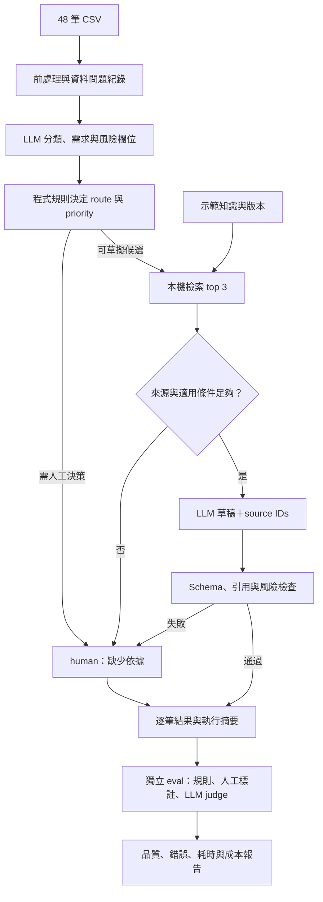

# PoC System Design：四種可選方案

文件狀態：設計比較，尚未呼叫模型 API 或實作。官方資訊查核日期：2026-10-29；免費額度、模型權限與區域可用性仍以帳號實際狀態為準。

## 1. 先選方向

**優先選 B：Groq 生成＋OpenAI 評估。**先用一個模型完成分類和有限草稿，再用另一提供者抽查品質；適合展示成本控制、RAG 與 eval 的分工。這是實作取捨，尚未以本資料比較模型品質。

| 方案 | 分類／草稿 | RAG | Eval | 費用與適合情境 |
| --- | --- | --- | --- | --- |
| A. OpenAI 主導 | OpenAI `gpt-4.1-mini` | 本機檢索 | 人工標註＋規則；Groq `openai/gpt-oss-120b` 輔助 judge | OpenAI 按量付費；適合想以官方 API 為主要展示的人 |
| B. Groq 主導＋OpenAI 評估 | Groq `openai/gpt-oss-120b` | 本機檢索 | 人工標註＋規則；OpenAI `gpt-4.1-mini` 抽查 judge | Groq 可使用可用的免費額度，OpenAI 少量付費；優先選項 |
| C. 免費雲端組合 | Gemini `gemini-3.6-flash` | 本機檢索 | 人工標註＋規則；Groq `openai/gpt-oss-120b` 輔助 judge | 兩者都需有可用免費額度；適合虛構資料、零 API 預算 |
| D. 本機模型 | Ollama `qwen3:8b` | 本機檢索 | 人工標註＋規則；本機 judge 僅作輔助 | 無雲端 token 費，需自備硬體；適合展示不外送資料的路徑 |

A、B 實際呼叫 OpenAI 官方服務；C、D 可以使用 OpenAI SDK，但不會因此呼叫 OpenAI 官方模型。Groq 的 `openai/gpt-oss-120b` 是由 Groq 提供推論，也不等於呼叫 OpenAI API。[OpenAI 模型](https://developers.openai.com/api/docs/models/gpt-4.1-mini)、[Groq 相容介面](https://console.groq.com/docs/openai)、[Groq 模型](https://console.groq.com/docs/models)。

## 2. 共同範圍：先完成題目，再展示 RAG

### 必做與不做

- **必做：**讀取原始 48 筆工單、前處理、category／priority／route／reason、輸出 CSV、分布摘要與 README。
- **展示加值：**本機 RAG、少量可引用來源的草稿、離線 eval 報告。
- **不做：**訂單實際查詢／修改、寄信、LoRA／finetune、多 agent、自動上網查法規、正式 MCP server 與監控平台。
- 訂單與寄送只保留介面說明或固定 mock；不得用假訂單狀態生成看似真實的客戶回覆。

分類、priority 與 route 沿用 answer-v1.md：主類別為訂單、產品、退改、投訴、帳號、其他、unknown；route=auto 只代表可自動草擬。human 仍可提供摘要或補問，所有 PoC 輸出都不寄送。

### 已確認的樣本特性

| 現象 | 預定處理 |
| --- | --- |
| 48 筆，ticket_id 無重複；多一個全空白欄位 | 去除空欄，不刪工單；保留原始檔與逐列對應 |
| channel 有 email 與表單 | 正規化為固定列舉 |
| TK-1007／1035 有全形字，TK-1020 有 HTML 與簽名 | 正規化空白、全形與 HTML，保留語意及原文 |
| TK-1012 是英文 | 分類支援英文；檢索無法找到對應知識時轉人工，不默認中文來源一定適用 |
| TK-1013／1031 是相似的扣款問題與追問 | 標記可能關聯，不刪除追問或宣稱已確認為同一人 |
| TK-1033 只有「可以退嗎」，TK-1041 只有「測試」 | 前者標退改且缺資訊，後者 unknown；不能只因文字短一律同類 |
| 招募、媒體、供應商、廣告與合作信 | 其他＋用途標籤；垃圾信不生成實質回覆 |
| 工單提到附件、個資、退款金額、出發日期 | 不假裝讀到附件；遮罩不必要識別資訊；金額與日期保留供風險判斷 |

相對日期以 created_at 為基準。退款簽核依「退款申請金額」判斷，不能把行程總價或兩次扣款直接當成退款額；金額不明即交人工確認。

### 知識來源是目前最大的限制

目前只有工單，沒有公司的 FAQ、產品規格或退改文件。不能從客戶提問反推正確答案。

- 準備 6–10 份短的示範知識／處理 SOP，逐份標記 `synthetic=true`、doc_id、版本、適用條件與是否允許草擬。
- 題目已提供的規則可直接引用，例如退款超過 30,000 元需主管簽核；其他內容明確標為示範假設。
- 不編造退費級距、簽證規定或實際產品價格。找不到有效依據就 human；即使因此 auto 比例低，也如實呈現。
- 另建少量與示範知識匹配的測試問句展示 RAG；與原 48 筆結果分開報告。

## 3. 共用系統設計



### 元件與資料邊界

| 元件 | 最小做法 |
| --- | --- |
| 執行器 | Python CLI，一次處理一筆，最多 2 次生成呼叫：分類一次、符合條件時草擬一次 |
| LLM client | OpenAI Python SDK；以 provider、base_url、model 設定切換，provider 差異放在一個小型 adapter |
| 結構化輸出 | Pydantic／JSON Schema；限制 category、priority、風險標籤與來源 ID。解析成功仍不代表內容正確 |
| RAG | 本機字元 2–3 gram TF-IDF＋cosine similarity，取 top 3；先不建向量資料庫 |
| 分流規則 | 退改、投訴、帳號風險、查訂單需求、缺資料及無來源轉 human；分類可由模型提出，最終權限與 route 由程式決定 |
| 儲存 | CSV／JSONL 檔案；保存處理結果、來源與版本、API usage、錯誤及時間，不另建 DB |
| Eval | 獨立命令讀取既有結果；judge 不在處理主路徑，也不能授權寄信或覆寫硬性規則 |

字元 n-gram 檢索省去中文斷詞與 embedding API，適合小型示範知識，但同義詞、跨語言與長距離語意能力有限。它仍是「檢索來源後生成」的 RAG；不能因用了 RAG 就宣稱理解正確。[scikit-learn 文字特徵文件](https://scikit-learn.org/stable/modules/feature_extraction.html)。

若 dev set 顯示主要失敗來自同義詞檢索，可加一個可選版本：OpenAI `text-embedding-3-small`＋本機向量 cosine search，不必新增向量 DB；embedding 也會把文件與查詢送到外部並計費。先比較 Recall@3，再決定是否值得換，避免同時更換檢索器與生成模型而無法解釋差異。[OpenAI embedding 模型](https://developers.openai.com/api/docs/models/text-embedding-3-small)。

**判斷來源足夠：**檢索分數只用來篩候選，門檻由開發案例調整；還需檢查文件有效性、適用條件與缺漏資訊。模型回傳的 source ID 必須存在於檢索結果，但「ID 存在」只證明引用對象存在，不能證明每句話都受到支持，後者由 eval 與人工覆核。

### 失敗處理

- 429 依 Retry-After 等待；網路／5xx 最多重試一次。額度用完就保存進度並以 human＋明確原因保留該筆，允許稍後重跑。
- JSON／schema 錯誤最多修正一次；仍失敗不丟工單，改 human。拒答、空內容與輸出截斷也算失敗。
- 不自動換到付費模型、不跨提供者默默傳資料。切換必須是明確設定，並在報告標記實際 provider／model。
- 每筆輸出有狀態：success、fallback 或 skipped；fallback 不算模型答對。整批仍需有 48 筆結果。
- API key 由環境變數提供，不寫入 repo；本機留下的 API 結果也不得包含 key。

## 4. 四種方案的 Pros／Cons

### A. OpenAI 生成＋Groq judge

**資料流：**本機分類／RAG → OpenAI 產生 JSON 與草稿 → 本機規則檢查 → Groq 抽查來源支持與完整性 → 人工裁決。

- **Pros：**主要功能直接使用 OpenAI 官方 API；同一模型處理分類與草擬，容易定位問題；Groq 提供跨模型的評估角度。
- **Cons：**生成呼叫均計費；資料可能送到兩家提供者；Groq judge 並非標準答案，雙模型也不保證正確。
- **工作量：**一個 pipeline、兩個 client 設定；judge 可以後補，不阻擋 CSV 產出。
- **選它的情況：**重視官方 API 展示，願意用少量費用降低對免費生成額度的依賴。

候選 `gpt-4.1-mini` 官方列有 Structured Outputs；Groq 的 `openai/gpt-oss-120b` 列有 strict JSON Schema 支援。使用的欄位與參數仍按提供者分別驗證，不能假定相容介面等於所有功能一致。[OpenAI 模型能力](https://developers.openai.com/api/docs/models/gpt-4.1-mini)、[Groq 結構化輸出](https://console.groq.com/docs/structured-outputs)。

### B. Groq 生成＋OpenAI judge（優先）

**資料流：**本機分類／RAG → Groq 產生結果 → 本機規則檢查 → OpenAI 抽查草稿 → 人工裁決。

- **Pros：**主要生成可用 Groq 免費額度；OpenAI 費用集中在少量評估；容易展示同一 pipeline 更換 provider 的取捨。
- **Cons：**免費 RPM／TPM／每日額度可能限制重跑；繁體中文、指令遵循與分類品質要實測；OpenAI judge 仍可能錯判。
- **工作量：**與 A 相近；需額外注意 Groq 限流與 usage，不能只按請求數估容量。
- **選它的情況：**希望結合 OpenAI API、免費生成模型與可解釋的 eval，但不想把兩家 API 都放進每筆工單的同步流程。

Groq 支援以 OpenAI SDK 指向 `https://api.groq.com/openai/v1`；模型與免費配額依帳號核對。以支援 schema 的 `openai/gpt-oss-120b` 為第一候選，若要改 20B，先用同一 dev set 比較，不以參數量推定結果。[相容介面](https://console.groq.com/docs/openai)、[限流文件](https://console.groq.com/docs/rate-limits)。

### C. Gemini 免費生成＋Groq 免費 judge

**資料流：**本機分類／RAG → Gemini 生成 → 本機規則檢查 → Groq 抽查 → 人工裁決。

- **Pros：**在兩家帳號皆有可用免費額度時，可不花 API token 費；跨模型評估；不需本機跑大模型。
- **Cons：**免費額度不是保證，可能因區域／帳號／模型而受限；需處理兩家的相容差異；免費服務的資料使用條件不適合作為正式個資部署的預設。
- **工作量：**與 B 接近，但需先確認 Gemini 相容介面的 schema 與所選模型行為。
- **選它的情況：**預算必須為零，資料僅限題目虛構工單與示範知識，且可接受限流時分批完成。

官方價格頁目前列 `gemini-3.6-flash` 免費輸入／輸出，並標記免費層資料可用於產品改善。Gemini 可透過 OpenAI SDK 的相容介面呼叫；這不是 OpenAI 官方服務，也不能把「免費」解讀為不限量。[Gemini 價格與資料使用](https://ai.google.dev/gemini-api/docs/pricing)、[相容介面](https://ai.google.dev/gemini-api/docs/openai)、[額度說明](https://ai.google.dev/gemini-api/docs/rate-limits)。

### D. Ollama 本機模型＋本機 RAG

**資料流：**本機 CSV → 本機 `qwen3:8b` → 本機檢索與規則 → 人工標註／本機 eval；關閉雲端模型及外送追蹤。

- **Pros：**推論與知識可留在本機；沒有雲端 token 費，也不依賴免費 API 配額；較容易展示資料邊界。
- **Cons：**需要下載模型及可用記憶體；速度、中文能力與 JSON 穩定性依硬體／量化而異；面試官重跑成本較高。
- **工作量：**程式可沿用 adapter，但環境準備與模型下載可能吃掉作業時間；沒有量測前不承諾能承受 700 件／日。
- **選它的情況：**已備妥本機模型環境，或最重視不外送資料。若再用 OpenAI judge，應另稱混合模式，不能宣稱全流程離線。

Ollama 提供 OpenAI API 的部分相容介面，官方模型庫有 Qwen3 8B。使用本機端點及本機模型，確認關閉 cloud 功能；不需要另一個本機大模型才能完成 eval，人工標註與規則是必要基準。[Ollama 相容文件](https://docs.ollama.com/api/openai-compatibility)、[Qwen3 模型](https://ollama.com/library/qwen3)、[Ollama FAQ](https://docs.ollama.com/faq)。

## 5. Eval 設計：模型評模型只是其中一層

### 資料安排

1. 先人工定義標註準則，再將 48 筆分成約 16 筆 dev、32 筆保留測試；按主題分層，相似／追問案件放同一側，避免洩漏。
2. 全部 48 筆仍須產出結果；保留測試指標與 dev 結果分開，不把調過 prompt 的案例當獨立測試。
3. 額外補至少 12 筆邊界案例：30,000／30,001 元退款、總價與退款額不同、無來源、版本衝突、prompt injection、缺附件、資料不足、API 429 等。風險規則以程式斷言檢查。
4. RAG 問答標註 `expected_source_ids`、`answerable`、必須涵蓋事項與禁止承諾；合成案例標明用途，不混進原始 48 筆營運比例。

### 三層驗證

| 層 | 檢查 | 如何判定 |
| --- | --- | --- |
| 程式檢查 | 48 筆對應、schema、列舉、風險規則、引用 ID、失敗回退 | 確定性檢查；引用 ID 存在不等於內容正確 |
| 人工標註 eval | 主分類／風險、route、priority、來源與是否可回答 | 與人工確認的標註比較；每類列分子、分母與失敗 ticket_id |
| LLM-as-judge＋覆核 | 草稿有無事實錯誤、漏答、引用不符、語氣問題、越權承諾 | judge 回傳逐項 pass／fail、證據與原因；不接受只有總分 |

Judge 看「問題＋來源＋草稿＋rubric」，不看生成模型的自評信心或隱藏推理。judge 不應憑模型自身知識補足來源。先挑 8–10 筆由人工與 judge 各自評分，比對分歧；校準後才擴大抽查，重大錯誤與分歧全部人工覆核。這遵循以人工校準自動評估的方向。[OpenAI Eval 指引](https://developers.openai.com/api/docs/guides/evaluation-best-practices)。

### 報告至少列出

- 分類正確率：主分類與風險標籤符合標註的筆數／受評筆數，另附各類混淆情況。
- 危險誤放率：預期 human 卻輸出 auto 的筆數／預期 human 的筆數；目標 0，不能靠全部轉人工就宣稱有效。
- 有效 auto 覆蓋：正確輸出 auto 的筆數／人工標為可 auto 的筆數；用來揭露過度保守。
- Retrieval Recall@3：可回答案例檢索到的必要來源數／必要來源總數，逐題計算後平均；另列無答案誤作答件數。
- 草稿品質：按事實、完整性、引用與語氣列錯誤；拒答或未生成不能算正確草稿，另報生成覆蓋率。
- API 成功率、fallback 數、每筆耗時與 token 費用；報告中不把 48 筆結果推論成正式營運成功率。

PoC 初始目標對齊 answer-v1.md：分類 ≥90%、危險誤放 0、有依據草稿正確率 ≥95%。小樣本須同時列件數；指標不達標就揭露限制，不反覆調整保留測試集直到過關。

**最小比較實驗：**同一份 dev set 跑規則 baseline 與選定 LLM；另在同一批問答上比較有／無 RAG 的來源支持率。先選一種方案做完，不同時實作四種架構。若比較提供者，固定資料、檢索器、rubric 與輸出格式。

## 6. 免費、成本與資料使用

- **OpenAI API 不當成免費額度。**目前 `gpt-4.1-mini` 標準文字價格為輸入 $0.40／百萬 tokens、輸出 $1.60／百萬 tokens。假設 48 筆各有兩次呼叫、每次 2,000 input＋500 output tokens，生成費約 $0.154；不是報價，未含重試、其他模型及 embedding。[官方模型價格](https://developers.openai.com/api/docs/models/gpt-4.1-mini)。
- **B 的 judge 範例：**20 筆各 3,000 input＋300 output，按同價約 $0.034；judge 的成本由抽查量控制，仍需使用量核對。
- **Groq 免費不等於一次能跑完。**要同時看 RPM、TPM、RPD、TPD；96 次生成若每次約 2,500 tokens，已約 240,000 tokens，可能超出帳號每日額度。先查限制、限制輸出及分批執行，不承諾免費層可承接旺季流量。[Groq limits](https://console.groq.com/docs/rate-limits)。
- **本機不等於零成本。**模型下載、記憶體、電力與環境維護也有成本。
- **PoC 的資料界線：**題目聲明工單為虛構資料，可以用於此設計的外部 API 展示；真實部署仍須逐一核准生成、embedding 與 judge 的供應商。OpenAI 的資料保存控制、Groq 的例外保存與 ZDR 設定，都不能取代公司的評估與簽約。[OpenAI data controls](https://developers.openai.com/api/docs/guides/your-data)、[Groq data controls](https://console.groq.com/docs/your-data)。

付費方案可先設定本機試跑預算上限，例如 US$1，依 usage 累計與下一次最大預估費用停止新請求；這是應用端控制，不宣稱供應商帳單一定有即時硬上限。雲端免費方案不自動升級付費。

## 7. 預定產出與實作順序

選定方案後，維持小型目錄：

```text
poc/
  README.md                執行、取捨、資料問題、限制、正式環境前三件事
  requirements.txt         固定實際驗證的套件版本
  config.example.json      模型、provider、預算、timeout；不含 key
  pipeline.py              前處理、模型呼叫、規則與 CSV 輸出
  retrieval.py             本機檢索與來源檢查
  evaluate.py              規則、標註與可選 judge
  knowledge/               明確標示 synthetic 的示範文件
  eval/                    標註、split、rubric、邊界案例
  outputs/
    triage_result.csv      原始 48 筆；必填欄位＋priority
    drafts.jsonl           選配草稿、引用、狀態
    summary.md             類別分布、人工比例與資料問題
    eval_report.md         指標、失敗案例、耗時與成本
```

先完成 CSV 分流與摘要，再加最小 RAG，最後執行 eval／抽查 judge。超過合理時間時，保留題目必交產出，減少示範知識與 judge 規模；不把 mock 結果包裝成真實 API 實測。

**選擇方式：**想用 OpenAI 為主選 A；想兼顧免費生成與 OpenAI eval 選 B；API 預算必須為零選 C；已備妥本機環境且不外送資料選 D。
