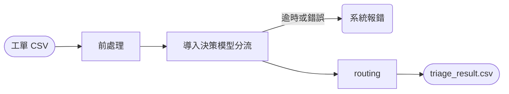

# 工單分流 PoC（Ticket Triage Pipeline）

讀取 `data/sample_tickets.csv`（48 筆），對每張工單輸出 `category`、`sub_category`、`route`（auto／human）、`priority` 與判斷依據。類別、route、priority 的定義以 [category-priority-spec.md](../category-priority-spec.md) 為準。

- 只使用 Python 標準庫，沒有第三方套件。
- 只驗證「分流」這一段，不生成回覆草稿。

---

## 1. Prerequisites

| 工具 | 版本 | 用途 | 安裝 |
| --- | --- | --- | --- |
| Python | ≥ 3.13（使用標準庫 `tomllib`） | 執行 pipeline | `uv python install 3.13` |
| uv | ≥ 0.5 | 建立環境與執行 | macOS：`brew install uv`；其他：`curl -LsSf https://astral.sh/uv/install.sh \| sh` |
| llama.cpp | ≥ v0.6.0（內含 Clef 支援與 `/v1/systemone` API） | 地端執行決策模型（模式 B） | macOS：`brew install llama.cpp`；或從 [releases](https://github.com/ggml-org/llama.cpp/releases) 下載 |
| Clef-flash GGUF | 9B，本 PoC 使用 `Q8_0` 量化 | 決策模型權重 | 從 Hugging Face 下載 Clef-flash 的 GGUF 檔 |

只想在乾淨環境確認流程可以跑，裝 Python 與 uv 即可（模式 A）。

---

## 2. 執行方式

```bash
cd poc

# A. 離線 mock 基準（不需模型服務）
uv run python triage.py --model mock

# B. 地端決策模型：llama.cpp + Clef-flash
#    單次請求約 800–950 tokens，需加 -ub 2048（physical batch 預設 512 會回傳 HTTP 500）
llama-server -m /path/to/Clef-Flash-Q8_0.gguf -c 4096 -b 2048 -ub 2048 --port 8090
uv run python triage.py --model llamacpp --endpoint http://localhost:8090/v1/systemone

# C. 遠端 Jev API（僅限虛構資料；真實工單須經法務核准供應商）
JEV_API_KEY=... uv run python triage.py --model jev

# 加上 --serve，執行後會在瀏覽器開啟 review.html
```

每次執行輸出到 `output/result-<YYYYMMDD_HHMMSS>/`：

| 檔案 | 內容 |
| --- | --- |
| `triage_result.csv` | 48 筆：`ticket_id, category, sub_category, route, priority, confidence, urgency, impact, reason, model` |
| `review.html` | 執行摘要（類別分佈、需人工比例、優先級分佈）、資料發現、評估結果、可篩選的逐筆檢視 |
| `run.log` | 每筆的模型輸入、3 題的機率輸出與 `reason` |

---

## 3. 為什麼用決策模型（Jev／Kev／Clef）

決策模型是「做選擇題」的模型：給定工單內容與一組選項，一次計算就輸出每個選項的機率與信心度，**不生成文字**（`output_tokens = 0`）。

| | 決策模型 | 讓生成式 LLM 直接分類 |
| --- | --- | --- |
| 速度與成本 | 不生成 token，較快、較省 | 需要生成 JSON |
| 輸出格式 | 必定是給定選項之一 | 可能格式錯誤或自創類別 |
| 信心度 | 每個選項都有機率，可直接設門檻 | 需要額外設計 |
| 部署 | Clef 可用 llama.cpp 在內網執行，工單不出內網 | 多半依賴外部 API |

代價是信心度是否可靠需要驗證：`review.html` 的「分類信心分箱」比較信心 ≥ 0.70 與 < 0.70 兩組的準確率，作為門檻的依據。

---

## 4. 分流機制



所有判斷都在兩個設定檔：

- **`config/labels.toml`**：模型的 3 題選擇題。選項描述只寫通用定義與邊界（「不含」），不含任何樣本內容。
- **`config/routing.toml`**：對應表。
  - `[route]`：18 個細項各自的 route。
  - `[priority_matrix]`：急迫度 × 影響程度對應的優先級。
  - `[priority_floor]`：細項的優先級下限，例如旅途異常至少 P4、求償至少 P3。
  - `[priority_fixed]`：非客服固定為 P1。
  - `confidence_threshold`：分類信心門檻，預設 0.70。

| 急迫度 \ 影響程度 | high | medium | low |
| --- | :---: | :---: | :---: |
| high | P4 | P4 | P4 |
| medium | P3 | P2 | P2 |
| low | P3 | P2 | P2 |

**route 原則**：只需知識庫或唯讀訂單資料就能回答的，走 `auto`（產出草稿，客服確認後送出）；需要在既有系統寫入，或需要調查、判斷責任的，走 `human`。18 個細項中有 10 個預設為 `human`。

**`reason` 格式**：`分類信心 0.88`；信心不足時為 `分類信心 0.55；信心不足轉人工`。

**為什麼沒有關鍵字規則**：對信件文字做關鍵字比對（金額、日期、升級字眼）很容易誤判，也容易寫成針對樣本的規則。正式環境的確定性規則應作用在結構化資料上：用訂單 API 的金額判斷 > 30,000 元、用訂單出發日判斷 72 小時內、用工單系統判斷是否為未結案件的重複來信（見 spec 第 4 節）。PoC 沒有串接這些系統，因此由模型的急迫度與影響程度判斷代替。

---

## 5. 資料發現與處置

| 發現 | 範例 | 處置 |
| --- | --- | --- |
| 原始試算表匯出後，每列多出 20 個空白欄位 | 全部 48 筆 | 只讀前 6 欄 |
| 全形英數字 | TK-1007、TK-1035 | NFKC 轉半形 |
| HTML 標籤與手機簽名檔 | TK-1020（`<br>`、「從我的 iPhone 傳送」） | 清除標籤與簽名後再送模型 |
| 廣告與測試單 | TK-1008、TK-1041 | 交給模型判斷為 `other/irrelevant` |
| 同一寄件人再次來信催單 | TK-1013 → TK-1031 | 只記錄；正式環境由工單系統以客戶 ID 判斷 |
| 內文夾帶身分證、手機、銀行帳號 | TK-1023 | 地端模型不出內網，本階段不遮罩；log 不存全文 |
| 寄件人是公司、記者等非旅客 | TK-1017、TK-1047 | 模型判斷為 `other/business` 轉交 |
| 日期沒有年份 | TK-1007（6 月來信提到 3 月出發） | 模型輸入含進件時間，由模型推論 |
| 英文信件 | TK-1012 | 直接交給模型 |
| 極短內文 | TK-1024、TK-1033 | 交給模型；看不出訴求時歸 `unclear/insufficient_info` |

`review.html` 第 2 節會在每次執行時自動統計上述項目。

---

## 6. 評估

`data/expected_labels.csv` 是依 spec 人工標註的 48 筆標準答案，執行時自動比對：主類別、細項、route、priority 準確率，以及 **False Auto**（應 human 卻判 auto，上線前必須為 0）。

**限制**：這 48 筆同時是設計類別時參考的資料，準確率只代表開發集。為了避免「看答案」，`labels.toml` 只寫通用定義，不含任何樣本內容；正式驗收仍需 50–100 筆未參與設計的歷史工單（answer Q2 §4）。

`mock` 是用通用詞庫打分數的離線基準，只用來確認流程在乾淨環境可以執行，準確率明顯低於決策模型，也會出現 False Auto。

---

## 7. 設計取捨（刻意不做）

- **不生成草稿**：分流與生成職責分離，PoC 只驗證分流與 False Auto。
- **不做個資遮罩**：本階段假設模型都在內網地端部署；若改用外部服務，再加入獨立遮罩系統。
- **不做文字關鍵字規則**：理由見第 4 節。
- **不做簽核與退款**：由真人在既有系統處理。
- **不做合成測試資料**：保持 PoC 規模。

---

## 8. 已知限制

- 急迫度依賴信件裡寫的日期；沒寫日期的即將出發工單，要等串接訂單 API 才能精準判斷。
- 一封信有多個訴求時只取一個細項（風險最高者），其他訴求留給草擬階段的摘要。
- 樣本只有 48 筆，部分細項只有 1–2 筆，準確率的統計意義有限。
- 每筆呼叫模型 3 次，平均約 7–8 秒；以每日 350–700 件計，循序處理仍在可接受範圍，量大時可平行處理。

---

## 9. 如果要進正式環境，接下來最重要的三件事

1. **串接工單系統與訂單唯讀 API，補上結構化規則**：用訂單金額、出發日、未結案件狀態加上確定性的轉人工與優先級規則，並加入 API 限流排隊。
2. **用真實歷史工單建立評估集並校準**：標註 50–100 筆未參與設計的歷史工單，驗證 False Auto = 0 與信心門檻；上線後把客服對草稿的評分回饋到評估集。
3. **確認合規邊界**：與法務確認地端部署的核准範圍、log 保存規則；若需要外部模型服務，先完成供應商評估並加入個資遮罩。

---

## 10. 目錄結構

```text
poc/
├── README.md
├── pyproject.toml / uv.lock
├── triage.py              # CLI：讀取 → 前處理 → 決策模型 → 對應表 → 輸出
├── evaluate.py            # 比對標準答案、產生 review.html
├── review_template.html   # review.html 的版面
├── pipeline/
│   ├── preprocess.py      # 欄位裁剪、NFKC、HTML、縮排、簽名檔；組成模型輸入
│   ├── models.py          # 決策模型 client（llama.cpp／Jev）與 mock
│   └── router.py          # 依 routing.toml 決定 route 與 priority
├── config/
│   ├── labels.toml        # 3 題選擇題的選項定義
│   └── routing.toml       # route 對應、優先級對應表、信心門檻
├── data/
│   ├── sample_tickets.csv
│   └── expected_labels.csv
└── output/
    └── result-<時間>/     # triage_result.csv、review.html、run.log
```
