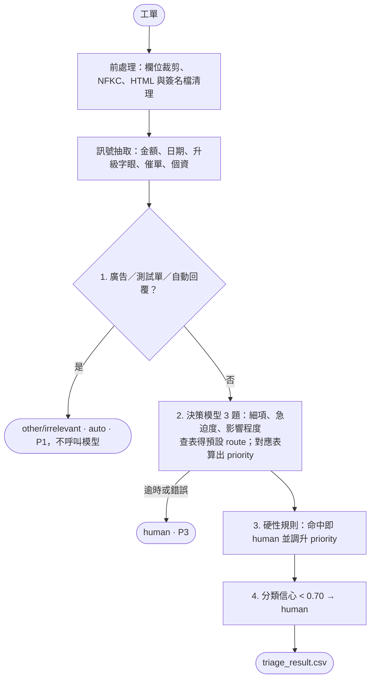

# 工單分流 PoC（Ticket Triage Pipeline）

讀取 `data/sample_tickets.csv`（48 筆），對每張工單輸出 `category`、`sub_category`、`route`（auto／human）、`priority` 與判斷依據。類別、route、priority 的定義以 [taxonomy-and-priority-spec.md](../taxonomy-and-priority-spec.md) 為準。

- 只使用 Python 標準庫，沒有第三方套件。
- 不生成回覆草稿：本 PoC 只驗證「分流」這一段。

---

## 1. 執行方式

需求：Python ≥ 3.13、[uv](https://docs.astral.sh/uv/)。

```bash
cd poc

# A. 乾淨環境：離線 mock 基準（不需模型服務）
uv run python triage.py --model mock

# B. 地端決策模型：llama.cpp + Clef GGUF
#    單次請求約 800–950 tokens，需加 -ub 2048（physical batch 預設 512 會回傳 HTTP 500）
llama-server -m /path/to/Clef-Flash-Q8_0.gguf -c 4096 -b 2048 -ub 2048 --port 8090
uv run python triage.py --model llamacpp --endpoint http://localhost:8090/v1/systemone

# C. 遠端 Jev API（僅限虛構資料；真實工單須經法務核准供應商）
JEV_API_KEY=... uv run python triage.py --model jev

# 加上 --serve 可在瀏覽器開啟 review.html
```

**輸出**（`output/`；每次執行另存一份於 `output/run/<時間>/`）

| 檔案 | 內容 |
| --- | --- |
| `triage_result.csv` | 48 筆：`ticket_id, category, sub_category, route, priority, confidence, urgency_level, impact_level, reason, model` |
| `review.html` | 執行摘要（類別分佈、需人工比例、優先級分佈）、資料發現、評估結果、可篩選的逐筆檢視 |
| `run.log` | 每筆的模型輸入、3 題的機率輸出與 `reason` |

---

## 2. 為什麼用決策模型（Jev／Kev／Clef）

決策模型是「做選擇題」的模型：給定工單內容與一組選項，一次計算就輸出每個選項的機率與信心度，**不生成文字**（`output_tokens = 0`）。

| | 決策模型 | 讓生成式 LLM 直接分類 |
| --- | --- | --- |
| 速度與成本 | 不生成 token，較快、較省 | 需要生成 JSON |
| 輸出格式 | 必定是給定選項之一 | 可能格式錯誤或自創類別 |
| 信心度 | 每個選項都有機率，可直接設門檻 | 需要額外設計 |
| 部署 | Clef 以 GGUF 搭配 llama.cpp 在內網執行，工單不出內網 | 多半依賴外部 API |

代價是信心度是否可靠要驗證：`review.html` 的「分類信心分箱」比較信心 ≥ 0.70 與 < 0.70 兩組的準確率，作為門檻設定的依據。

每張工單問 3 題：

1. **細項分類**：18 選 1，選項定義見 `config/labels.toml`
2. **急迫度**：high／medium／low
3. **影響程度**：high／medium／low

---

## 3. 分流機制

### 3.1 route 原則：由「完成工單需要的動作」決定

| 需要的動作 | route |
| --- | --- |
| 查知識庫，或唯讀查詢訂單資料即可回答 | `auto`（產出草稿，客服確認後送出） |
| 需要在既有系統寫入（改單、退款、發票更正） | `human` |
| 需要調查或判斷責任（系統異常、旅途異常、客訴） | `human` |
| 非客服：需轉交其他部門 | `human` |
| 非客服：廣告、測試單、自動回覆 | `auto`（歸檔，不生成） |
| 看不出訴求或缺資料 | `auto`（固定補件模板） |

### 3.2 處理流程（`pipeline/router.py`）



**優先級**（P4 最高）：

1. 急迫度 × 影響程度對應表（程度信心 < 0.70 視為 low）。
2. 與細項預設 priority 取較高者。
3. 硬性規則調升。
4. `other` 固定為 P1。

| 急迫度 \ 影響程度 | high | medium | low |
| --- | :---: | :---: | :---: |
| high | P4 | P4 | P4 |
| medium | P3 | P2 | P2 |
| low | P3 | P2 | P2 |

**硬性規則**（`config/route_rules.toml`、`config/regex_rules.toml`）：

| 規則 | 判斷 | 至少調升到 |
| --- | --- | :---: |
| 72 小時內出發或使用 | 內文日期或「今天、明天、後天」與進件時間相差 72 小時內，且附近有出發、使用、入住等字眼 | P4 |
| 金額超過 30,000 元 | 支援 `120,000 元`、`4.5 萬`、`三萬二`；需同時有退款、扣款、賠償等語境 | P3 |
| 客訴升級字眼 | 消保官、律師、提告、媒體、爆料、公開、爭議款、止付；排除採訪邀約 | P3 |
| 重複催單 | 催促字眼，或同一寄件人再次來信 | P3 |

退改與求償本來就是 `human`，由真人在既有系統處理（含主管簽核），所以金額規則的作用是**調升優先級**，以及在誤分類時作為**安全網**。

**`reason` 格式**：`分類信心 0.88；規則：72 小時內出發或使用`。信心不足時附上「信心不足轉人工」。

---

## 4. 資料發現與處置

| 發現 | 範例 | 處置 |
| --- | --- | --- |
| 每列 26 欄，後 20 欄空白 | 全部 48 筆 | 只讀前 6 欄 |
| 全形英數字 | TK-1007、TK-1035 | NFKC 轉半形，避免日期與單號解析漏抓 |
| HTML 標籤與手機簽名檔 | TK-1020（`<br>`、「從我的 iPhone 傳送」） | 清除標籤與簽名後再送模型 |
| 廣告、測試單 | TK-1008、TK-1041 | 規則歸檔，不呼叫模型 |
| 同一寄件人再次來信催單 | TK-1031 | 標記重複催單，轉人工並調升為 P3 |
| 內文夾帶身分證、手機、銀行帳號 | TK-1023 | 只標記 `has_inline_pii`，交給外部個資遮罩系統 |
| 寄件人是公司、記者等非客戶 | TK-1017、TK-1047 | 由分類判斷為 `other/business` 轉交 |
| 日期沒有年份 | TK-1007（6 月來信提到 3 月出發） | 已過的日期推論為隔年 |
| 「萬」不一定是金額 | TK-1034（「萬粉」） | 金額解析排除萬粉、萬人等用法 |
| 英文信件 | TK-1012 | 直接送模型，不另做翻譯 |
| 極短內文 | TK-1024、TK-1033 | 由模型判斷；看不出訴求時歸 `unclear/insufficient_info` 套補件模板 |

---

## 5. 評估

`data/expected_labels.csv` 是依 spec 人工標註的 48 筆標準答案。執行時自動比對，結果在 `review.html` 第 3 節：主類別、細項、route、priority 準確率，以及 **False Auto**（應 human 卻判 auto，上線前必須為 0）。

**限制**：這 48 筆同時是設計類別時參考的資料，準確率只代表開發集。為了避免「看答案」，`labels.toml` 描述、mock 詞庫與規則都只寫通用定義，不含任何樣本內容；但正式驗收仍需使用未參與設計的 50–100 筆歷史工單（answer Q2 §4）。

`mock` 是用通用詞庫打分數的離線基準，只用來確認流程在乾淨環境可以執行，準確率明顯低於決策模型，也會出現 False Auto。

---

## 6. 設計取捨（刻意不做）

- **不生成草稿**：分流與生成職責分離，PoC 只驗證分流與 False Auto。
- **不做個資遮罩**：由外部遮罩系統在送生成模型前遮罩、草稿進審核前還原（answer Q3 §6）；本 PoC 只標記。決策模型地端部署時，分流階段不需遮罩。
- **不做簽核與退款**：由真人在既有系統處理。
- **不合併工單**：只把同一寄件人再次來信當作催單訊號。
- **不判斷外部法規是否變動**：屬於草擬階段的知識庫檢索（查無有效依據即轉人工）。
- **不另做合成測試資料**：保持 PoC 規模。

---

## 7. 已知限制

- 同一客戶只能用 `customer_name` 比對，可能同名誤判或改名漏判。
- 72 小時判斷依賴內文日期；沒寫日期但其實即將出發的工單，要靠模型的急迫度判斷。
- 一封信有多個訴求時只取一個細項（風險最高者），其他訴求留給草擬階段的摘要處理。
- 樣本只有 48 筆，部分細項只有 1–2 筆，準確率的統計意義有限。

---

## 8. 如果要進正式環境，接下來最重要的三件事

1. **合規與個資邊界**：與法務確認地端模型或零留存合約的核准範圍，並串接外部個資遮罩系統（生成前遮罩、審核前還原）。
2. **串接工單系統與訂單唯讀 API**：改用客戶 ID 與未結案件狀態判斷催單；用訂單的實際出發日計算 72 小時；加入 API 限流排隊。
3. **用真實歷史工單建立評估集並持續校準**：標註 50–100 筆未參與設計的歷史工單，驗證 False Auto = 0 與信心門檻；上線後把客服的採用、修改、棄用紀錄回饋到評估集。

---

## 9. 目錄結構

```text
poc/
├── README.md
├── pyproject.toml / uv.lock
├── triage.py              # CLI：讀取 → 前處理 → 訊號 → 分流 → 輸出
├── evaluate.py            # 比對標準答案、產生 review.html
├── pipeline/
│   ├── preprocess.py      # 欄位裁剪、NFKC、HTML 與簽名檔清理、同寄件人標記
│   ├── signals.py         # 金額、日期（72 小時）、升級字眼、催單、個資
│   ├── models.py          # 決策模型 client（llama.cpp／Jev）與 mock
│   └── router.py          # 4 步驟分流與優先級
├── config/
│   ├── labels.toml        # 3 題選擇題的選項定義、細項預設 route 與 priority
│   ├── route_rules.toml   # 門檻、優先級對應表、硬性規則
│   └── regex_rules.toml   # 通用字詞規則
├── data/
│   ├── sample_tickets.csv
│   └── expected_labels.csv
└── output/                # triage_result.csv、review.html、run.log
```
