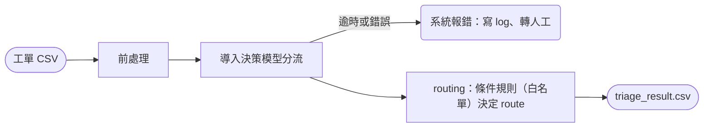

# 工單分流 PoC（Ticket Triage Pipeline）

讀取 `data/sample_tickets.csv`（48 筆），對每張工單輸出 `category`、`sub_category`、`route`（auto／human）、佇列排序與判斷依據。類別與 route 的定義以 [category-spec.md](../category-spec.md) 為準。

- 只使用 Python 標準庫，沒有第三方套件。
- 只驗證「分流」這一段，不生成回覆草稿。
- **False Auto（應由人處理卻判為 auto）必須為 0**；在此前提下，其他指標越高越好。

---

## 1. Prerequisites

| 工具 | 版本 | 用途 | 安裝 |
| --- | --- | --- | --- |
| Python | ≥ 3.13（開發與測試環境；程式只用標準庫） | 執行 pipeline | `uv python install 3.13` |
| uv | ≥ 0.5 | 建立環境與執行 | macOS：`brew install uv`；其他：`curl -LsSf https://astral.sh/uv/install.sh \| sh` |
| llama.cpp | ≥ v0.6.0（內含 Clef 支援與 `/v1/systemone` API） | 地端執行決策模型（模式 B） | macOS：`brew install llama.cpp`；或從 [releases](https://github.com/ggml-org/llama.cpp/releases) 下載 |
| Clef-flash GGUF | 9B，本 PoC 使用 `Q8_0` 量化 | 決策模型權重 | 從 Hugging Face 下載 Clef-flash 的 GGUF 檔 |

只想在乾淨環境確認流程可以跑，裝 Python 與 uv 即可（模式 A）。

---

## 2. 執行方式

```bash
cd poc

# A. 離線 mock 基準（不需模型服務）
uv run python triage.py --model mock

# B. 地端決策模型：llama.cpp + Clef-flash
#    單次請求約 800–950 tokens，需加 -ub 2048（physical batch 預設 512 會回傳 HTTP 500）
llama-server -m /path/to/Clef-Flash-Q8_0.gguf -c 4096 -b 2048 -ub 2048 --port 8090
uv run python triage.py --model llamacpp --endpoint http://localhost:8090/v1/systemone

# C. 遠端 Jev API（僅限虛構資料；真實工單須經法務核准供應商）
JEV_API_KEY=... uv run python triage.py --model jev

# 加上 --serve，執行後會在瀏覽器開啟 review.html
```

每次執行輸出到 `output/result-<YYYYMMDD_HHMMSS>/`：

| 檔案 | 內容 |
| --- | --- |
| `triage_result.csv` | 48 筆，依佇列排序：`queue_rank, ticket_id, category, sub_category, route, confidence, urgency, impact, reason, model` |
| `review.html` | 執行摘要（類別分佈、需人工比例、急迫度與影響程度分佈）、資料發現、評估結果、依佇列排序的逐筆檢視 |
| `run.log` | 每筆的模型輸入、3 題的機率輸出、`reason`；模型錯誤以 `[ERROR]` 記錄題目、重試次數與錯誤類型 |

auto 白名單與門檻都在 `config/routing.toml`，不需要改程式。

> PoC 使用虛構資料，為了方便除錯，`run.log` 與 `review.html` 含信件全文。正式環境的應用 log 只記 ID 與結構化欄位，信件原文留在有權限控管的工單系統（answers.md Q3-6）。

---

## 3. 流程



---

## 4. Pipeline 各模組

| 模組 | 職責 | 輸入 → 輸出 |
| --- | --- | --- |
| `triage.py` | CLI 入口：載入設定與工單，逐筆呼叫 router，排序佇列，寫出結果、log 與報表 | CSV、設定檔 → `output/result-<時間>/` |
| `pipeline/preprocess.py` | 讀取 CSV 前 6 欄並驗證表頭、略過 ticket_id 空白的列、去除前後空白、移除 HTML 標籤；組成模型輸入（主旨＋內文，內文超過 300 字時保留開頭 65% 與結尾 35%） | CSV → `Ticket` 清單 |
| `pipeline/models.py` | 呼叫決策模型 `/v1/systemone`，每筆問 3 題；失敗重試 1 次，仍失敗就回報錯誤。另有離線 `mock` | 模型輸入 → 3 題的選項、機率、信心 |
| `pipeline/router.py` | 依 `routing.toml` 的條件規則決定 route（第 5 節），並依急迫度、影響程度排序佇列 | 模型結果 → `TriageDecision` |
| `evaluate.py` | 比對 `expected_labels.csv`，計算準確率、False Auto、信心分箱，統計資料發現，產生 `review.html` | 結果、標準答案 → 評估數字與報表 |
| `review_template.html` | `review.html` 的版面（HTML／CSS／JS），`evaluate.py` 把資料填入 | — |
| `config/labels.toml` | 3 題選擇題的題目與選項定義。描述統一寫成「客戶狀態／想要／主題」，不寫「不含：某某」這類排除句，也不含任何樣本內容 | — |
| `config/routing.toml` | 條件規則的 auto 白名單、分類信心門檻、排序用的程度信心門檻、內文長度上限 | — |

---

## 5. 分類邏輯

### 5.1 決策模型回答 3 題

| 題目 | 選項 | 用途 |
| --- | --- | --- |
| 細項分類 | 18 個細項，例如 `product/travel_rule`、`order_change/booking_change` | 決定預設 route |
| 急迫度 | high／medium／low，只看時間點（high：事情在 3 天內發生，或客戶已在旅途中） | 條件規則、佇列排序 |
| 影響程度 | high／medium／low，只看後果（high：金錢損失或爭議、揚言對外申訴、人身安全） | 條件規則、佇列排序 |

### 5.2 route 怎麼決定

**原則：auto = AI 能決定回覆的絕大部分內容，而且不急迫；其餘都是 human。**

auto 有兩種：草擬（客服確認後送出），以及非客服信件的自動轉交或歸檔。

1. **分類信心 < 0.50** → 細項設為 `other/unclear`（待人工判斷），route = human。模型也可以直接選 `other/unclear`，代表信件看不出要處理什麼。
2. **條件規則**：同時符合以下三項才是 auto，其餘一律 human。

   | 條件 | auto 的允許值 |
   | --- | --- |
   | 細項 | `[auto]` 白名單內的 10 個細項 |
   | 急迫度 | low、medium |
   | 影響程度 | low、medium |

   例外：`other/irrelevant`（廣告、測試單、自動回覆）不論程度一律 auto 歸檔，因為客服本來就不處理。

   白名單外的 8 個細項是需寫入既有系統、需調查、需人判斷、需個案確認，或看不出要處理什麼（`other/unclear`）的類別。每個細項可以各自設定允許的急迫度與影響程度；目前除 `other/irrelevant` 外，9 個細項的設定相同。

### 5.3 佇列排序

不設優先等級。依 **模型異常置頂 → `human` 在 `auto` 之前 → 急迫度 → 影響程度 → 進件時間** 排序，`queue_rank` 就是處理順序。

程度的信心 < 0.70 時，**排序**視為 low，避免模型沒把握的 high 被排到最前面；**分流**則一律採用模型選的等級，只要選了 high 就轉人工（偏保守）。

### 5.4 例子（條件規則）

| 工單內容 | 模型輸出 | 判斷 |
| --- | --- | --- |
| 詢問團費是否含機場稅與小費 | `product/product_info`，信心 0.94；急迫度 low、影響程度 low | 白名單內，程度都不是 high → **auto** |
| 明天出發遇颱風警報，問會不會延期、怎麼退費 | `product/travel_rule`，信心 0.76；急迫度 high | 白名單內，但急迫度 high → **human** |
| 申請改期 | `order_change/booking_change`，信心 0.93 | 不在白名單 → **human** |
| 詢問郵輪艙房能否指定樓層 | `product/product_info`，信心 0.41 | 信心 < 0.50 → **`other/unclear`、human** |

`reason` 會寫出判斷依據，例如 `分類信心 0.76；急迫度 high 不在 auto 條件`。

---

## 6. 實跑結果與改進方案

### 6.1 最新 Clef 實跑結果（條件規則）

| 指標 | 結果 |
| --- | --- |
| 主類別準確率 | 93.8% |
| 細項準確率 | 93.8% |
| route 準確率 | 93.8%（45/48） |
| **False Auto** | **0** |
| False Human | 3 |

3 筆 False Human 都是「多轉人工」，不會造成錯誤回覆：

| 工單 | 標註 | 模型輸出 | 原因 |
| --- | --- | --- | --- |
| TK-1009 郵輪艙房 | `product/product_info`（auto） | `product_info` 排第一，但信心 0.41 < 0.50 | 機率被 `custom_request` 分散，歸 `other/unclear` |
| TK-1036 JR PASS 兌換 | `product/product_info`（auto） | `product_info` 排第一，但信心 0.37 < 0.50 | 機率被 `document` 分散，歸 `other/unclear` |
| TK-1017 巴士公司報價 | `other/business`（auto） | `product/custom_request`，信心 0.63 | 供應商的包車報價被讀成客製團體需求；歷次實跑都分錯 |

### 6.2 過程中確認過、沒有採用的做法

| 做法 | 結果 | 不採用的理由 |
| --- | --- | --- |
| 調低分類信心門檻 | 前兩筆會變成 auto | 信心本身可靠（≥ 0.70 的全部分對），調門檻是用這 48 筆換分數，提高 False Auto 風險 |
| 先分大類再分細項 | 細項多對 1 筆 | 細項層的「看不懂」被大類加總後藏起來；「可以退嗎」這筆會變成 False Auto |
| 在選項描述寫「不含：某某」 | 平均信心從 0.84 降到 0.79 | 模型會把否定句裡的詞當成該選項的特徵；已改為只寫正面定義 |

### 6.3 可能的改進方案

目前的錯誤都在「信心偏低」與「相近類別難分」，而且都錯在安全方向。以下方案需要真實歷史工單驗證後才開啟：

1. **用標註的歷史工單微調決策模型**：收集 50–100 筆以上、經資深客服標註的歷史工單，對 Clef 做微調或校準，提高相近類別的信心與區分度。這是根本解法。
2. **低信心時用前幾名重新分類**：信心不足時，只保留前 3 名選項重問一次，讓機率集中。風險是會把「真的看不懂」的工單逼出確定答案，所以需要防線，例如 `other/unclear` 已在前 2 名時不重問，並用真實資料確認不產生 False Auto。
3. **用結構化資料補強難分的類別**：例如供應商報價可以用寄件網域或供應商名單判斷，不必靠信件文字；訂單金額、出發日、未結案件也改用訂單與工單系統的資料（spec 第 5 節）。
4. **持續修訂類別描述**：依客服對草稿與分類的回饋，修正描述的用詞；每次修改都要用同一份評估集重跑，確認 False Auto 仍為 0。

### 6.4 防止 overfitting

- 條件規則沒有權重。白名單由「AI 能否決定回覆內容」這個原則決定，不是用樣本調出來的。
- 類別描述只寫通用定義，不放樣本內容；修改一律套用到全部選項，不針對個別工單。
- 48 筆同時是設計時參考的資料，以上數字只代表開發集。

---

## 7. 為什麼用決策模型（Jev／Kev／Clef）

決策模型是「做選擇題」的模型：給定工單內容與一組選項，一次計算就輸出每個選項的機率與信心，**不生成文字**（`output_tokens = 0`）。

| | 決策模型 | 讓生成式 LLM 直接分類 |
| --- | --- | --- |
| 速度與成本 | 不生成 token，較快、較省 | 需要生成 JSON |
| 輸出格式 | 必定是給定選項之一 | 可能格式錯誤或自創類別 |
| 信心 | 每個選項都有機率，可直接設門檻 | 需要額外設計 |
| 部署 | Clef 可用 llama.cpp 在內網執行，工單不出內網 | 多半依賴外部 API |

代價是信心是否可靠需要驗證：`review.html` 的「分類信心分箱」比較各信心區間的準確率。

**選項描述的寫法**：實測發現，在描述裡寫「不含：某某」反而會讓模型把「某某」當成這個選項的特徵，信心因此下降。所以 `labels.toml` 的描述不寫「不含：某某」這類排除句，並統一用「客戶狀態／想要／主題」三段，讓相鄰類別的差異落在這三個維度上（例如「已有訂單＋查詢」和「已有訂單＋要求修改」）。類別之間的邊界寫在 spec，作為人工標註的依據。

---

## 8. 刻意不做的判斷

- **不放進件時間**：急迫度只依信件中寫的日期與「今天、明天、後天」判斷。精確的 72 小時應由正式環境的訂單出發日計算。先前把進件時間放進模型輸入後，分類信心整體下降，原因未確認前先不使用。
- **不做文字關鍵字規則**：對信件文字比對金額、日期、升級字眼很容易誤判，也容易寫成只適用樣本的規則。正式環境的確定性規則應作用在結構化資料上：訂單金額 > 30,000 元、訂單出發日在 72 小時內、工單系統顯示有未結案件（spec 第 5 節）。

---

## 9. 資料發現與處置

| 發現 | 範例 | 處置 |
| --- | --- | --- |
| 原始試算表匯出後，每列多出 20 個空白欄位 | 全部 48 筆 | **處理**：只讀前 6 欄 |
| HTML 標籤 | TK-1020（`<br>`） | **處理**：移除標籤，`<br>` 轉換行 |
| 廣告與測試單 | TK-1008、TK-1041 | 由模型判斷為 `other/irrelevant`，自動歸檔 |
| 寄件人是公司、記者等非旅客 | TK-1017、TK-1047 | 由模型判斷為 `other/business`，自動轉交 |
| 同一寄件人再次來信催單 | TK-1013 → TK-1031 | PoC 不合併；正式環境由工單系統以客戶 ID 判斷未結案件 |
| 內文夾帶身分證、手機、銀行帳號 | TK-1023 | 模型地端部署、不出內網，本階段不遮罩；log 不存信件全文 |

`review.html` 的資料發現區塊列出程式自動偵測的項目（空白欄位、HTML 標籤、證號或帳號、同一寄件人重複來信）與處置；廣告與非旅客信件由模型分類處理，見類別分佈。

---

## 10. 評估

`data/expected_labels.csv` 是依 spec 人工標註的 48 筆標準答案（`category`、`sub_category`、`route`），執行時自動比對：

- 主類別、細項、route 準確率
- **False Auto**：不為 0 時，報表最上方會顯示紅色警示並列出工單
- `other/unclear`：分開計算「判斷不了的件數」與「有判斷時的準確率」，不直接算成分類錯誤
- 分類信心分箱

佇列排序沒有標準答案，不評估準確率。

**限制**：這 48 筆同時是設計類別時參考的資料，準確率只代表開發集。為了避免「看答案」，`labels.toml` 只寫通用定義，不含任何樣本內容；正式驗收仍需 50–100 筆未參與設計的歷史工單（answers.md Q2-4）。

`mock` 是用通用詞庫打分數的離線基準，只用來確認流程在乾淨環境可以執行，準確率明顯低於決策模型，也會出現 False Auto。

---

## 11. 設計取捨（刻意不做）

- **不生成草稿**：分流與生成職責分離，PoC 只驗證分流與 False Auto。
- **不設優先等級**：等級的判斷很主觀，難以寫成一致的規則；改用急迫度、影響程度直接排序。
- **不做個資遮罩**：本階段假設模型都在內網地端部署；若改用外部服務，再加入獨立遮罩系統。
- **不做文字關鍵字規則**、**不放進件時間**：理由見第 8 節。
- **不用樣本調參數**、**不做合成測試資料**：避免 overfitting、保持 PoC 規模（見第 6.4 節）。
- **不做簽核與退款**：由真人在既有系統處理。

---

## 12. 已知限制

- 急迫度依賴信件裡寫的日期；沒寫日期但即將出發的工單，要等串接訂單 API 才能精準判斷。
- 一封信有多個訴求時只取一個細項（風險最高者），其他訴求留給草擬階段的摘要。
- 樣本只有 48 筆，部分細項只有 1–2 筆，準確率與門檻的統計意義有限。
- 每筆呼叫模型 3 次，平均約 7–8 秒；以每日 350–700 件計，循序處理仍在可接受範圍，量大時可平行處理。

---

## 13. 如果要進正式環境，接下來最重要的三件事

1. **串接工單系統與訂單唯讀 API，補上結構化規則**：用訂單金額、出發日、未結案件狀態加上確定性的轉人工與排序規則，並加入 API 限流排隊。
2. **用真實歷史工單建立評估集並校準**：標註 50–100 筆未參與設計的歷史工單，驗證 False Auto = 0，並重新檢視 auto 白名單；上線後把客服對草稿的評分回饋到評估集。
3. **確認合規邊界**：與法務確認地端部署的核准範圍與 log 保存規則；若需要外部模型服務，先完成供應商評估並加入個資遮罩。

---

## 14. 目錄結構

```text
poc/
├── README.md
├── pyproject.toml / uv.lock
├── triage.py              # CLI：讀取 → 前處理 → 決策模型 → route → 排序 → 輸出
├── evaluate.py            # 比對標準答案、產生 review.html
├── review_template.html   # review.html 的版面
├── pipeline/
│   ├── preprocess.py      # 讀前 6 欄、去空白、移除 HTML 標籤；組成模型輸入
│   ├── models.py          # 決策模型 client（llama.cpp／Jev）與 mock
│   └── router.py          # 依條件規則決定 route、排序佇列
├── config/
│   ├── labels.toml        # 3 題選擇題的選項定義
│   └── routing.toml       # auto 白名單、分類門檻、排序門檻
├── data/
│   ├── sample_tickets.csv
│   └── expected_labels.csv
└── output/
    └── result-<時間>/     # triage_result.csv、review.html、run.log
```
