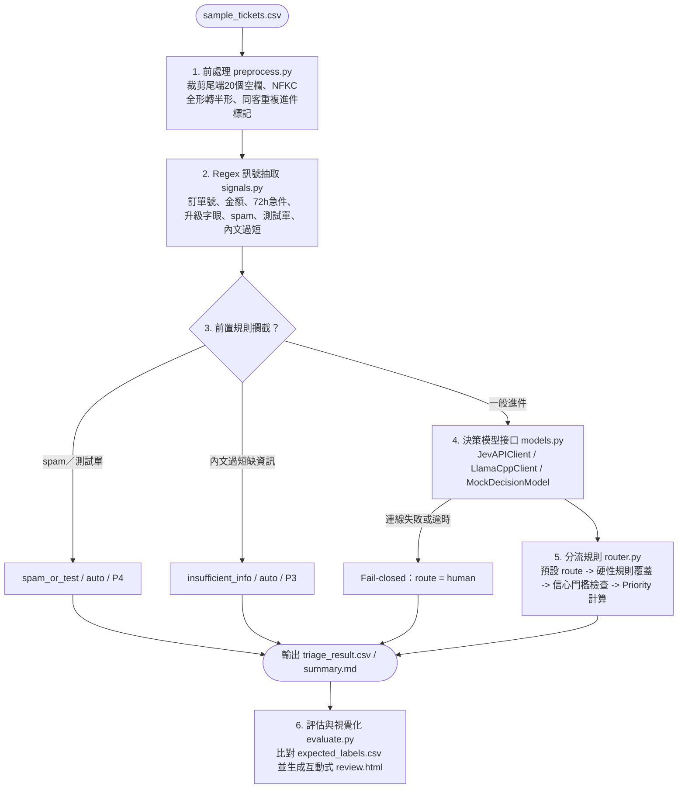

# 工單分流 PoC（Ticket Triage Pipeline）

以 `sample_tickets.csv`（48 筆）實作可執行的工單分流 pipeline，驗證 [answer-v0-gemini.md](../answer-v0-gemini.md) Q2／Q3 的分類與分流設計。類別與優先級定義見 [taxonomy-and-priority-spec.md](../taxonomy-and-priority-spec.md)，48 筆標準標註存放於 [data/expected_labels.csv](data/expected_labels.csv)。

---

## 1. 技術規格與版本（Tech Stack）

| 元件 | 技術／工具 | 版本／規格 | 用途 |
| --- | --- | --- | --- |
| 執行環境 | Python | `3.13` | 僅使用標準庫（`csv`, `re`, `unicodedata`, `tomllib`, `urllib.request`, `http.server`, `unittest`），零第三方套件依賴 |
| 決策模型接口 1（本地地端） | `llama.cpp` + Clef GGUF | `llama.cpp b4500+`<br>`ggml-org/Clef-Flash-GGUF`（9B）<br>`ggml-org/Clef-GGUF`（27B） | 本機／內網啟動 `llama-server`，透過 `/v1/systemone` 輸出 14 個 `sub_category` 的正規化機率分佈 |
| 決策模型接口 2（遠端 API） | Jev API | Jev `/v1/systemone` HTTP API | 透過 Bearer Token 呼叫 Jev 決策模型服務，與 `llama.cpp` 共用相同問題結構 |
| 離線備援／基準模型 | `MockDecisionModel` | 內建於 Python 標準庫 | 免啟動模型服務即可在乾淨環境執行完整 pipeline，作為比較基準（Baseline） |
| 規則與設定檔 | TOML | 標準庫 `tomllib` | 管理可熱抽換的 Regex 訊號規則、類別描述與分流規則 |
| Review & Eval 檢視介面 | Standalone HTML UI | 原生 HTML5 / CSS / JS（由 CLI 產出與啟動） | 單檔互動式檢視器（`output/review.html`），於瀏覽器檢視分類結果、Eval 指標與錯題比對 |

---

## 2. 目錄結構（Folder Structure）

```text
poc/
├── README.md                  # 設計說明、部署與執行方式、取捨與正式環境規劃
├── triage.py                  # 主程式 CLI：讀取工單 -> 前處理 -> 分類 -> 分流 -> 輸出 CSV / 摘要 / HTML
├── evaluate.py                # 評估與 HTML 報表產生器：比對 expected_labels.csv 並產出 output/review.html
├── pipeline/
│   ├── __init__.py
│   ├── preprocess.py          # 資料前處理：裁剪 CSV 尾端空欄、NFKC 全形轉半形、同客重複進件標記
│   ├── signals.py             # Regex 訊號抽取（依 config/regex_rules.toml）
│   ├── models.py              # 決策模型介面與實作（JevAPIClient / LlamaCppClient / MockDecisionModel）
│   └── router.py              # 分流與優先級判定（依 config/route_rules.toml）
├── config/
│   ├── labels.toml            # 14 個 sub_category 定義、對應主類別與送給決策模型的選項說明
│   ├── regex_rules.toml       # 硬性訊號正則規則（單號、金額、急件、升級字眼、spam、測試單）
│   └── route_rules.toml       # 預設 route、硬性轉人工條件、信心門檻（0.70）、priority 規則
├── data/
│   └── expected_labels.csv    # 48 筆工單人工標準標註（Golden Set）
├── output/
│   ├── triage_result.csv      # 分流結果輸出（48 筆）
│   ├── summary.md             # 執行摘要（類別分佈、需人工比例、資料問題統計）
│   ├── eval_report.md         # 模型與規則評估報告（Accuracy、False Auto 等）
│   └── review.html            # 互動式 Review & Eval 網頁介面（支援篩選錯題與檢視各類機率）
└── tests/
    └── test_pipeline.py       # 單元測試（前處理、Regex 抽取、模型介面、規則覆蓋、降級行為）
```

---

## 3. 部署與執行方式（Deployment & Execution）

### 3.1 模式 A：乾淨環境直接執行（Mock Baseline）

使用 `uv` 管理環境（Python 3.13+，純標準庫零外部依賴）：

```bash
cd poc

# 1. 執行分流 pipeline 並產出 CSV、摘要、Eval 報告與互動式 HTML
uv run python triage.py --model mock

# 2. 開啟互動式 HTML 介面檢視分類結果與 Eval 報告（或直接於瀏覽器開啟 output/review.html）
uv run python triage.py --model mock --serve --port 8000

# 3. 執行單元測試
uv run python -m unittest discover -s tests -v
```

### 3.2 模式 B：本機部署 `llama.cpp` + `Clef GGUF` 接口

```bash
# Step 1：啟動本地 llama.cpp 伺服器（載入 Clef-Flash GGUF，預設 port 8090）
llama-server -m /Users/james/llm_models/clef/Clef-Flash-Q8_0.gguf --port 8090

# Step 2：以 llamacpp 接口執行分層分流與產出 HTML Review 介面
cd poc
uv run python triage.py \
  --model llamacpp \
  --endpoint http://localhost:8090/v1/systemone \
  --threshold 0.70
```

### 3.3 模式 C：呼叫遠端 Jev API 接口

```bash
export JEV_API_KEY="your_jev_api_key"

cd poc
uv run python triage.py \
  --model jev \
  --endpoint https://api.jev.ai/v1/systemone \
  --threshold 0.70
```

---

## 4. 架構設計：前處理、模型接口、分流規則與 HTML 檢視器

### 4.1 端到端處理流程



### 4.2 前處理設計（基於 `sample_tickets.csv` 實測評估）

檢視 48 筆樣本後，僅 `TK-1020` 出現 `<br>` 與手機簽名檔，對決策模型語意理解與 Regex 擷取均無影響，因此**不額外撰寫 HTML 清洗邏輯**（遵循 KISS 原則，避免無效複雜度）。前處理聚焦於真正影響後續判斷的三件事：

1. **CSV 尾端空白欄位裁剪**：原始 CSV 每列含 26 個欄位（後 20 欄為多餘空逗號），讀取時只取前 6 個有效欄位（`ticket_id, created_at, channel, customer_name, subject, body`）並去除首尾空白。
2. **Unicode NFKC 全形轉半形正規化**：將 `TK-1007`（「３月２８日」「４月」）、`TK-1035`（「７/１５」）等全形數字、英文字母與標點正規化為標準半形，確保後續 Regex 能準確擷取金額、日期與單號。
3. **同客重複進件關聯**：依 `created_at` 時間排序，比對同一 `customer_name`（排除「佚名」「test」等通用名）是否已有前期未結工單（如 `楊承翰` 於 `TK-1013` 與 `TK-1031`），標記 `is_repeat_customer` 訊號供路由規則使用。

### 4.3 決策模型雙接口設計（`pipeline/models.py`）

定義統一的 `DecisionModel` 協定，實作 **Jev API 接口** 與 **`llama.cpp` 本地接口**（外加離線 `MockDecisionModel`）：

```python
class DecisionModel(Protocol):
    name: str
    def classify(self, text: str, labels: dict[str, str]) -> dict[str, float]:
        """
        輸入工單文字與 {sub_category: 判斷條件說明}，
        回傳各 sub_category 的正規化機率分佈（總和為 1.0）。
        """
```

| 接口類別 | CLI 參數 | 連接目標與認證 | 設計目的與適用場景 |
| --- | --- | --- | --- |
| `JevAPIClient` | `--model jev` | `POST https://api.jev.ai/v1/systemone`<br>Header: `Authorization: Bearer $JEV_API_KEY` | 對接 Jev 官方雲端決策 API；適合離線以虛構資料快速測試，或法務完成供應商簽約後使用 |
| `LlamaCppClient` | `--model llamacpp` | `POST http://127.0.0.1:8080/v1/systemone`<br>連接本地 `llama-server`（載入 `Clef-GGUF`） | 對接內網自架之 `llama.cpp` 伺服器；工單資料不離開公司內網，直接滿足法務個資限制 |
| `MockDecisionModel` | `--model mock` | 本地記憶體內執行（無網路呼叫） | 依關鍵字權重計算模擬機率；供乾淨環境直接執行與單元測試，並作為模型評估 Baseline |

兩者皆使用 System One 結構化 `choice` 題型請求格式：

```json
{
  "state": "主旨：東京五日遊費用內含項目\n內文：請問官網上的東京經典五日遊，售價是否已含機場稅、燃油附加費與導遊小費？",
  "questions": {
    "sub_category": {
      "type": "choice",
      "instructions": "判斷此旅遊電商客服工單最核心的細項類別",
      "criteria": {
        "product_spec_and_price": "詢問行程內容、費用包含項目、兒童收費、集合資訊、票券兌換",
        "order_cancellation_refund": "實際申請取消訂單與退費（含傷病、天災、提供帳戶要求匯款）"
      }
    }
  }
}
```

### 4.4 分流判斷順序（`pipeline/router.py`）

每筆工單依序套用 `config/route_rules.toml`（`human` 一旦觸發即不可被覆蓋為 `auto`）：

1. **前置規則攔截**：命中 `spam_or_test`（博弈廣告、測試單）或 `insufficient_info`（內文過短且無具體訴求）直接設為 `route = auto`。
2. **模型分類與預設路由**：取決策模型最高機率之 `sub_category`，查表取得對應 `category` 與預設 `route`。
3. **硬性規則覆蓋為 `human`**（對應 answer Q3 §4）：
   - `amount > 30000` 且涉及退改、扣款或求償。
   - 命中升級字眼（消保官、媒體、記者、律師、爆料、爭議款、止付、社團公開；排除正常媒體採訪邀約）。
   - 命中 72 小時內出發／使用急件或旅途中食宿安全異常。
   - 命中重複催單（同客重複進件＋催問字眼）。
   - 命中外部最新簽證／法規變動字眼（知識庫無唯一有效依據）。
4. **信心門檻檢查**：若 `confidence < 0.70`，強制覆蓋為 `route = human`。

### 4.5 HTML Review & Eval 檢視器（`output/review.html`）

執行 `triage.py --html`（或 `evaluate.py`）會生成單一檔案、零外部依賴的 `output/review.html`，提供給工程師與資深客服快速 Review：

- **頂部 Eval 指標卡片**：顯示目前模型（`mock` / `llamacpp` / `jev`）的 Category Accuracy、Sub-category Accuracy、Route 分流錯誤率、**高風險誤放行數（False Auto，紅線指標）** 與需人工比例。
- **多維度篩選列**：可依「僅顯示與標準答案不符（Mismatch）」、「僅顯示 False Auto」、「主類別」、「`route`（`auto` / `human`）」、「`priority`（`P1–P4`）」或關鍵字即時過濾。
- **逐筆對照檢視表**：並列顯示工單原件、Regex 抽出的訊號標籤、模型預測 vs `expected_labels.csv` 標準答案、信心分數與 `reason` 判斷依據，方便調校規則後立即刷新比對。

---

## 5. 資料前處理：發現與處置

<!-- 實作執行後填入各類雜訊影響筆數與具體處置結果 -->

| 問題類型 | 發現內容與範例 | 處置方式 |
| --- | --- | --- |
|  |  |  |

---

## 6. 執行摘要與評估結果

<!-- 執行 triage.py 與 evaluate.py 後填入或連結至 output/summary.md -->

---

## 7. 設計取捨（刻意不做的事與理由）

<!-- 填寫 PoC 階段刻意簡化或不做的功能與理由 -->

---

## 8. 已知限制

<!-- 填寫目前實作的限制 -->

---

## 9. 如果要進正式環境，接下來最重要的三件事

1. 
2. 
3. 
