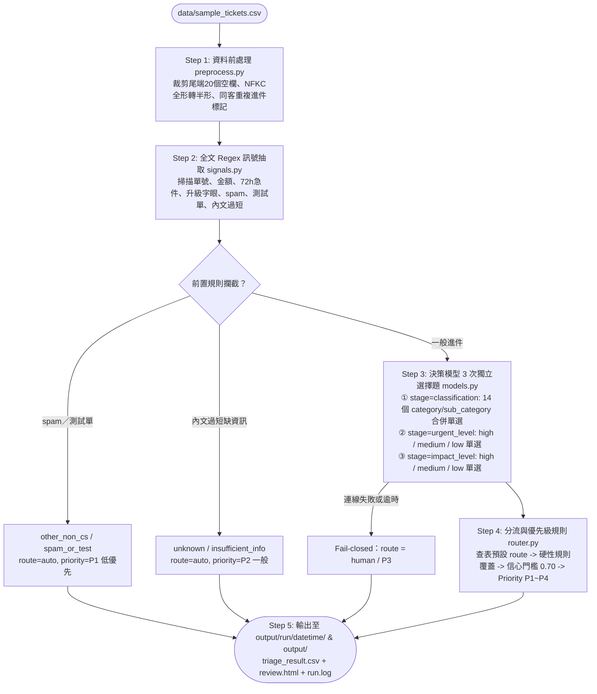

# 工單分流 PoC（Ticket Triage Pipeline）

以 `data/sample_tickets.csv`（48 筆）實作可執行的工單分流 pipeline，驗證 [answer-v0-gemini.md](../answer-v0-gemini.md) Q2／Q3 的分類與分流設計。類別與優先級定義見 [taxonomy-and-priority-spec.md](../taxonomy-and-priority-spec.md)，48 筆標準標註存放於 [data/expected_labels.csv](data/expected_labels.csv)。

---

## 1. 技術規格與版本（Tech Stack）

| 元件 | 技術／工具 | 版本／規格 | 用途 |
| --- | --- | --- | --- |
| 執行環境與管理 | Python + `uv` | `Python >= 3.13` | 僅使用標準庫（`csv`, `re`, `unicodedata`, `tomllib`, `urllib.request`, `http.server`），零第三方套件依賴 |
| 決策模型接口 1（本地地端） | `llama.cpp` + Clef GGUF | `llama.cpp b4500+`<br>`Clef-Flash-Q8_0.gguf`（9B） | 本機／內網啟動 `llama-server`，透過 `/v1/systemone` 分 3 次獨立選擇題輸出 `classification`（合併 `category/sub_category` 共 14 項）、`urgent_level`（3 項）與 `impact_level`（3 項）機率分佈 |
| 決策模型接口 2（遠端 API） | Jev API | Jev `/v1/systemone` HTTP API | 透過 Bearer Token 呼叫 Jev 決策模型服務，與 `llama.cpp` 共用相同問題結構 |
| 離線備援／基準模型 | `MockDecisionModel` | 內建於 Python 標準庫 | 免啟動模型服務即可在乾淨環境執行完整 pipeline，作為比較基準（Baseline） |
| 規則與設定檔 | TOML | 標準庫 `tomllib` | 管理可熱抽換的 Regex 訊號規則、合併類別與程度描述、以及分流規則 |
| Review & Eval 檢視介面 | Standalone HTML UI | 原生 HTML5 / CSS / JS | 單檔互動式檢視器（`review.html`），整合統計摘要、各階段耗時、Eval 指標與逐筆篩選檢視 |

---

## 2. 目錄結構（Folder Structure）

```text
poc/
├── README.md                  # 設計說明、完整 Pipeline 運作機制、部署與執行方式、取捨與正式環境規劃
├── pyproject.toml             # uv 專案設定檔
├── triage.py                  # 主程式 CLI：讀取工單 -> 前處理 -> 3 階段選擇題 -> 分流 -> 輸出至 output/run/<datetime>/
├── evaluate.py                # 評估與報表產生器：比對 expected_labels.csv 並將統計摘要與 Eval 報告整合輸出至 review.html
├── pipeline/
│   ├── __init__.py
│   ├── preprocess.py          # Step 1 資料前處理：裁剪 CSV 尾端空欄、NFKC 全形轉半形、同客重複進件標記
│   ├── signals.py             # Step 2 Regex 訊號抽取（依 config/regex_rules.toml）與模型輸入長度控制（max_body_chars）
│   ├── models.py              # Step 3 決策模型 3 階段選擇題雙接口（LlamaCppClient / JevAPIClient / MockDecisionModel）
│   └── router.py              # Step 4 分流與優先級判定（依 config/route_rules.toml，Priority: P1=低 -> P4=超重要）
├── config/
│   ├── labels.toml            # 3 階段選擇題定義：classification（14 個合併 category/sub_category 選項）、urgent_level、impact_level
│   ├── regex_rules.toml       # 硬性訊號正則規則（單號、金額、72h 急件、升級字眼、spam、測試單）
│   └── route_rules.toml       # 預設 route、硬性轉人工條件、信心門檻（0.70）、priority 規則、max_body_chars
├── data/
│   ├── sample_tickets.csv     # 48 筆原始輸入客服工單
│   └── expected_labels.csv    # 48 筆工單人工標準標註（Golden Set，P1=低優先 ~ P4=超重要急件）
└── output/
    ├── run/<YYYYMMDD_HHMMSS>/ # 每次執行的獨立紀錄目錄（含 triage_result.csv, review.html, run.log）
    ├── triage_result.csv      # 最新一次分流結果輸出（48 筆）
    ├── review.html            # 最新一次互動式檢視器（整合執行摘要、類別與優先級分佈、各環節耗時統計、Eval 指標與逐筆檢視表）
    └── run.log                # 最新一次逐筆執行耗時與完整 Model Input/Output 追蹤 Log
```

---

## 3. 目前 Pipeline 完整運作機制（Step-by-Step）



### Step 1：資料前處理（`pipeline/preprocess.py`）
1. **欄位裁剪與清理**：`sample_tickets.csv` 每列包含 26 個欄位（後 20 欄為空白），讀取時僅取前 6 個有效欄位（`ticket_id`, `created_at`, `channel`, `customer_name`, `subject`, `body`）並去除首尾空白。
2. **Unicode NFKC 正規化**：將主旨與內文中的全形英數字（如 `ＬＴ２０２６`、全形日期與金額）統一轉為半形，避免後續 Regex 漏抓。
3. **跨單同客重複進件偵測**：依時間順序比對非匿名之 `customer_name`，若同一客戶重複來信（如 `TK-1013` -> `TK-1031` 楊承翰），自動標記 `is_repeat_customer = True`。

### Step 2：Regex 訊號抽取與前置規則攔截（`pipeline/signals.py` & `config/regex_rules.toml`）
1. **全文 Regex 掃描**：對**未截斷的完整主旨與內文**抽取確定性訊號：
   - `order_ids`（如 `LT2026...`）、`max_amount`（解析 `186,000 元`、`4.5 萬` 等金額）與 `is_financial_context`。
   - `is_urgent_72h`（明日／今日出發或使用、旅途中飯店蟑螂、帳號被鎖待付款）。
   - `has_escalation`（消保官、媒體爆料、律師、銀行止付／爭議款，並排除單純記者採訪邀約）。
   - `has_external_policy_change`（近期最新簽證／新規定）與 `has_inline_pii`（身分證、手機、銀行帳號）。
2. **前置規則直接攔截（不呼叫模型）**：
   - **廣告與測試單（`is_spam` / `is_test`）**：直接判定為 `other_non_cs / spam_or_test`（`route = auto`, `priority = P1` 低優先）。
   - **極短缺資訊工單（`is_short_insufficient`，內文 ≤ 6 字且無明確訴求，如 `TK-1033`「可以退嗎」）**：直接判定為 `unknown / insufficient_info`（`route = auto`, `priority = P2` 一般），套用固定補件模板。
3. **模型輸入結構化與長度上限控制（`build_structured_state`）**：
   - 為避免超長信件超出模型 Token 預算，`route_rules.toml` 設定 `max_body_chars = 300`。當內文超過 `300` 字元時，保留前 65%（開頭背景）+ 後 35%（結尾訴求），組合成結構化 `主旨：...\n內文：...` 傳給模型。

### Step 3：決策模型 3 次獨立選擇題呼叫（`pipeline/models.py` & `config/labels.toml`）
對每筆一般工單，透過 `/v1/systemone` 依序發送 **3 次獨立的 `type = "choice"` 選擇題**（確保每次選項數皆 `< 20` 個）：

1. **第 1 次呼叫：`stage=classification`（大類與細項合併單選，共 14 個選項）**
   - 直接將 `category` 與 `sub_category` 合併為 `"<category>/<sub_category>"` 鍵值，選項描述同時包含**「【主類別定位—細項名稱】＋具體業務定義」**（定義於 `config/labels.toml` 的 `[classification.options]`）：
     - `product_inquiry/product_spec_and_price`（預設 `auto`）
     - `product_inquiry/policy_and_regulation`（預設 `auto`）
     - `product_inquiry/customization_request`（預設 `human`）
     - `order_info/order_status_and_points`（預設 `auto`）
     - `order_info/order_policy_and_refund_status`（預設 `auto`）
     - `order_info/document_and_invoice`（預設 `auto`）
     - `order_info/account_and_pricing_issue`（預設 `human`）
     - `order_change/schedule_or_group_change`（預設 `human`）
     - `order_change/passenger_or_addon_change`（預設 `human`）
     - `order_refund/cancellation_refund_request`（預設 `human`）
     - `order_refund/refund_payout_request`（預設 `human`）
     - `complaint/pure_complaint`（預設 `auto`）
     - `complaint/service_or_billing_dispute`（預設 `human`）
     - `other_non_cs/b2b_media_hr_referral`（預設 `human`）
   - 模型回傳最高分選項後，直接以 `split("/", 1)` 拆出 `category` 與 `sub_category`，並取得該選項之 `confidence`。

2. **第 2 次呼叫：`stage=urgent_level`（時間緊迫程度單選，共 3 個選項）**
   - `high`：極度緊急（對應 `P4` 超重要：72 小時內出發或使用票券、旅途中突發危機、帳號被鎖待付款）。
   - `medium`：近期需處理（出發日在 3 天至 14 天內的退改、加購或單據補正）。
   - `low`：一般非急件（出發日在 2 週以上、售前詢問、一般訂單與退款進度查詢、發票重開、事後客訴或外部信件）。

3. **第 3 次呼叫：`stage=impact_level`（業務與財務影響程度單選，共 3 個選項）**
   - `high`：高影響（對應 `P3` 高優先：退改或求償金額 > 30,000 元、重複扣款、嚴重服務瑕疵求償、揚言找消保官或媒體、同客重複催單）。
   - `medium`：中度影響（一般訂單改期、換接送飯店、更正護照拼音、加購嬰兒票或行李、一般退費申請、帳號或結帳價差）。
   - `low`：低影響（單純詢問產品規格、簽證、查進度、補寄確認信與改發票統編、純抱怨無求償、非客服信件）。

### Step 4：分流與優先級判定規則（`pipeline/router.py` & `config/route_rules.toml`）
1. **預設路由查表**：依模型選出的 `category/sub_category` 查表取得預設 `route`（`auto` 或 `human`）。
2. **硬性規則覆蓋（`route = human` 具黏著性，不可被 AI 覆寫回 `auto`）**：
   - 退改／爭議金額 `> 30,000` 元
   - 含客訴升級字眼（`has_escalation`）
   - 72 小時內急件／旅途中危機／帳號鎖定（`is_urgent_72h`）
   - 同一客戶重複進件催單（`is_repeat_followup`）
   - 涉及外部最新簽證／法規變動無明確依據（`has_external_policy_change`）
3. **信心度門檻攔截**：若 `classification` 的 `confidence < 0.70`，強制覆蓋為 `route = human`。
4. **優先級判定（`P1` 低優先 -> `P4` 超重要急件）**：
   - **`P1`（低優先）**：`category == "other_non_cs"`（非客服信件、廣告、測試單）。
   - **`P4`（超重要急件）**：命中 `is_urgent_72h`，或（`urgent_level == "high"` 且 `urgent_conf >= 0.70` 且 `route == "human"`）。
   - **`P3`（高影響爭議）**：金額 `> 30,000` 元、命中升級字眼、重複催單、細項為 `service_or_billing_dispute`，或（`impact_level == "high"` 且 `impact_conf >= 0.70` 且 `route == "human"`）。
   - **`P2`（一般標準件）**：其餘所有常規詢問、訂單查詢、一般退改與待補件工單。

### Step 5：產出檔案與追蹤紀錄（`triage.py` & `evaluate.py`）
每次執行自動建立 `output/run/<YYYYMMDD_HHMMSS>/` 並同步複製最新結果至 `output/`，共產出 3 個檔案：
- `triage_result.csv`：48 筆分流結果（含 `category`, `sub_category`, `priority`, `route`, `confidence`, `urgent_level`, `impact_level`, `total_ms`, `reason`, `model`）。
- `review.html`：單檔互動式檢視器（內嵌執行統計摘要、主類別分佈表、`P1~P4` 優先級分佈表、各階段耗時統計表、Eval 指標卡片與可篩選搜尋的逐筆檢視表）。
- `run.log`：逐筆記錄 `stage=regex`、`stage=classification`、`stage=urgent_level`、`stage=impact_level`、`stage=router` 耗時，以及完整的 `[INPUT_STATE]` 與 `[MODEL_IO]`（含 `input_tokens`、問題清單與模型回傳機率）。

---

## 4. 部署與執行方式（Deployment & Execution）

### 4.1 模式 A：本機部署 `llama.cpp` + `Clef GGUF` 接口

> **重要參數說明（`-ub 2048` 實體 Batch 上限）**：
> 在 `llama.cpp` 中，`-c 4096` 為 Context Size，`-b 2048` 為 Logical Batch Size（預設即為 2048），而控制單次請求 Token 上限的 **Physical Batch Size 参数名稱為 `-ub` (`--ubatch-size`，預設為 `512`)**。
> 由於 `stage=classification` 將 14 個合併選項（含完整描述）與工單內文一次送出，單次請求約為 **`800 ~ 950 tokens`**，因此啟動 `llama-server` 時**必須加上 `-ub 2048`**，否則 `llama-server` 會因預設 `512` 限制而回傳 HTTP 500。

```bash
# Step 1：啟動本地 llama.cpp 伺服器（務必包含 -ub 2048 提升 physical batch size）
llama-server -m /Users/james/llm_models/clef/Clef-Flash-Q8_0.gguf -c 4096 -b 2048 -ub 2048 --port 8090

# Step 2：執行分流 pipeline
cd poc
uv run python triage.py \
  --model llamacpp \
  --endpoint http://localhost:8090/v1/systemone \
  --threshold 0.70
```

### 4.2 模式 B：乾淨環境直接執行（Mock Baseline）

```bash
cd poc
uv run python triage.py --model mock
uv run python triage.py --model mock --serve --port 8000
```

### 4.3 模式 C：呼叫遠端 Jev API 接口

```bash
export JEV_API_KEY="your_jev_api_key"
cd poc
uv run python triage.py --model jev --endpoint https://api.jev.ai/v1/systemone --threshold 0.70
```

---

## 5. 資料前處理：發現與處置

| 問題類型 | 發現內容與範例 | 處置方式 |
| --- | --- | --- |
| CSV 尾端多出 20 個空白欄位 | 全部 48 筆工單（`TK-1001`–`TK-1048`）每列皆有 26 欄，後 20 欄為空字串 | `preprocess.py` 讀取時僅截取前 6 個有效欄位並執行 `.strip()` |
| 全形數字／英文字母混用 | 2 筆（`TK-1007` 含 `ＬＴ２０２６`、`TK-1035` 含全形數字日期） | `unicodedata.normalize("NFKC", text)` 統一轉為標準半形字元，確保單號與金額 Regex 100% 命中 |
| 外部博弈廣告與系統測試單 | 2 筆（`TK-1008` 博弈體驗金廣告、`TK-1041` 系統測試單） | 前置規則直接標記 `other_non_cs / spam_or_test`（`route = auto`, `priority = P1` 低優先），不消耗模型算力 |
| 內文過短缺乏訂單與訴求上下文 | 1 筆（`TK-1033` 內文僅「可以退嗎」4 字） | 前置規則標記 `unknown / insufficient_info`（`route = auto`, `priority = P2`），套用固定補件模板 |
| 同一客戶重複進件催單 | 1 筆（`TK-1031` 楊承翰針對 `TK-1013` 重複扣款二次來信催單） | 跨單比對 `customer_name` 標記 `is_repeat_customer = True`，強制覆蓋 `route = human` 並調升為 `P3` |
| 信件內文直接夾帶高敏個資 | 1 筆（`TK-1023` 內文含身分證字號、手機、銀行帳號） | Regex 偵測並標記 `inline_pii`，呼應 Q1/Q3 最小化傳輸與獨立個資遮罩系統之邊界設計 |

---

## 6. 設計取捨（刻意不做的事與理由）

- **不在 PoC 階段串接生成式 LLM 撰寫回覆草稿**：依 Q3 架構設計，分流（Triage）與草稿生成（Drafting）職責分離；PoC 聚焦驗證分流準確率、零誤放行（False Auto = 0）與優先級排序。
- **不讓模型直接輸出自由文字 JSON，改用 `/v1/systemone` 結構化選擇題機率**：避免生成式模型出現格式損毀（JSON parse error）或幻覺類別，並直接取得經過校準的選項信心度（`confidence`）。
- **不以模型單獨決定高風險邊界**：金額 `> 30,000` 元、72 小時內急件、消保官／媒體升級字眼與重複催單皆由確定性 Regex 與規則強制覆蓋為 `route = human` 與 `P3/P4`，模型分數不可覆寫硬性規則。

---

## 7. 已知限制

- **本地 `llama-server` 實體 Batch 參數要求**：合併 14 個 `category/sub_category` 選項的單次請求約需 `800 ~ 950 tokens`，啟動 `llama-server` 時必須指定 `-ub 2048`（`--ubatch-size 2048`），僅指定 `-b 2048`（Logical batch size）仍會受限於預設的 `ubatch = 512`。
- **同客重複進件目前僅以 `customer_name` 比對**：樣本 CSV 無 `customer_id` 或 `email` 欄位，實務上同名同姓可能誤判，或同一客戶改填不同稱呼可能漏判。

---

## 8. 如果要進正式環境，接下來最重要的三件事

1. **完成合規審查與個資邊界確認**：與法務確認自架地端模型（Clef／Kev）或零留存企業合約之核准範圍，並針對內文夾帶身分證／銀行帳號（如 `TK-1023`）確認是否需前置串接獨立的個資遮罩服務。
2. **串接工單系統與訂單唯讀 API**：將同客去重與催單判定改為比對工單系統之 `customer_id / email` 與訂單系統之真實出發日（計算精確的 `< 72 小時` 急件），並加入 API 限流排隊機制。
3. **建立 50–100 筆黃金評估集與審核介面回饋迴路**：將資深客服裁決後的高頻問題版本與線上客服「採用／修改／棄用」紀錄納入追蹤，持續校準各細項的信心度門檻（`confidence_threshold`）與審核 Config。
